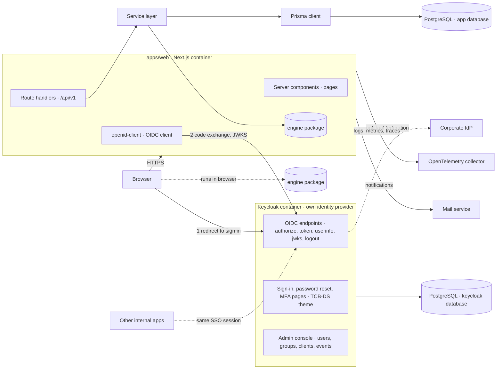
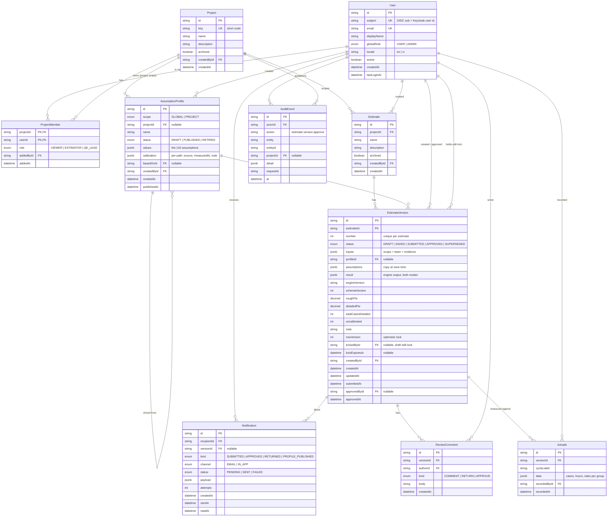
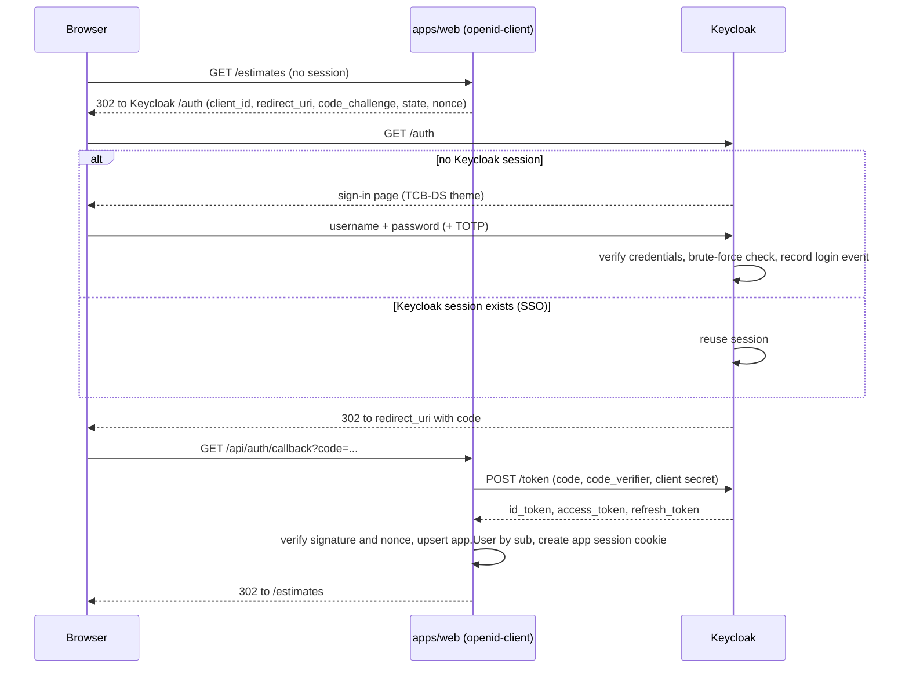

# SIT Sizing Model — Solution Design and Delivery Plan

| | |
|---|---|
| **Status** | Draft for review, revision 4. No development has started. |
| **Changes in revision 3** | Identity provider is self-hosted Keycloak, not a custom build. Plan restructured into three releases. Added non-functional targets, pipeline, observability, backup, engine change policy, notifications, Excel export, portfolio view, governance. |
| **Changes in revision 4** | API contract follows OpenAPI 3.2 (3.1 fallback, decided by a spike) and is documented with a self-hosted Scalar API Reference (section 9.4, ADR-0003). |
| **Audience** | Engineering, QE leads, and the AI coding agents that will build it |
| **Prototype** | `SIT_Sizing_Model.html` (single-file tool, EN/VI, 34 driver groups, 142 assumptions) |
| **Reference files** | `sit-sizing-reference/` (prototype logic, translations, golden example) |

---

## 1. Summary

**Decision needed:** approve this design, and answer the open questions in section 16, before any build starts.

The prototype is a single HTML file. It estimates QE test cases, hours and FTE for SIT, data platform, AI product and performance testing. It stores everything in one browser, so estimates cannot be shared, versioned, reviewed or calibrated across teams.

The full version turns it into a multi-user web application:

- **Shared estimates** per project, with versions, comparison and an approval step.
- **Calibration profiles** managed centrally, so teams start from measured values rather than uncalibrated defaults.
- **Actuals capture** after each SIT cycle, feeding calibration.
- **Its own identity provider**: a self-hosted Keycloak instance with username and password sign-in, giving single sign-on to this app and to other internal tools.
- **Role-based access** by project.
- **One calculation engine**, a pure TypeScript package, with the prototype's results locked in as regression tests.

The largest risk is silently changing the numbers during the rewrite. The plan therefore ports the engine first and proves parity against a golden example before any UI work.

---

## 2. Goals and non-goals

### Goals

1. Reproduce every calculation in the prototype exactly (parity, section 6.4).
2. Persist estimates, versions, profiles and actuals in PostgreSQL.
3. Run a self-hosted identity provider (Keycloak) with username and password sign-in and SSO; authorise by role and project membership.
4. Keep EN/VI support, with Vietnamese as a first-class language.
5. Apply the TCB-DS design system through a layered component base.
6. Run locally in containers on Docker Desktop or Rancher Desktop with one command.
7. Be maintainable: strict typing, schema validation at every boundary, high test coverage on the engine.

### Non-functional targets (to confirm, Q10)

These are planning assumptions for sizing the hosting and the tests. They are not commitments; confirm them with the product owner and the platform team.

| Area | Working assumption |
|---|---|
| Users | Up to 300 named users, up to 50 at the same time |
| Availability | Business hours, internal tool; planned maintenance windows allowed |
| Response time | Pages under 2 s at the 95th percentile; a recalculation in the browser under 50 ms |
| Data volume | Up to 5,000 estimates and 50,000 versions over three years |
| Browsers | Current Chrome and Edge on desktop; tablet width supported; phone is read-only |
| Recovery | Restore from the previous night's backup; targets agreed with the platform team (Q4) |
| Languages | English and Vietnamese |

### Non-goals (this release)

- Integration with Jira, Confluence, test management or Jenkins. Evidence values are entered by hand. Planned as a later phase.
- Automatic calibration from actuals. Actuals are captured and shown beside estimates; a person updates the profile.
- Scheduling or resource booking. The tool outputs FTE and calendar checks, not a staffing plan.
- Storing any personal or customer data beyond the signed-in user's name, email and role.

---

## 3. Technology stack

Pin exact versions at kickoff (latest stable, at least two weeks old) and record them in `docs/adr/0001-stack.md`.

| Concern | Choice | Notes |
|---|---|---|
| Framework | **Next.js** (App Router, React Server Components) | `output: "standalone"` for the container image |
| Language | **TypeScript**, `strict: true`, `noUncheckedIndexedAccess: true` | No `any` in `packages/engine` |
| UI primitives | **shadcn/ui** on Radix, Tailwind CSS | Components are copied into the repo and themed with TCB-DS tokens |
| Design system | **TCB-DS** | See section 8 and open question Q1 |
| Animation | **anime.js** (v4 modular API) | Optional polish only, wrapped in three hooks; most transitions are plain CSS. Honours `prefers-reduced-motion` |
| Validation | **Zod** | Single source for types, API contracts and form validation |
| ORM / DB | **Prisma** + **PostgreSQL** | JSONB for scope and assumption payloads, relational for everything queried |
| HTTP client | **Axios** | For browser calls that change data. Read data in server components where possible. One configured instance with interceptors (section 9.3) |
| Server state (recommended addition) | TanStack Query | Caching, optimistic updates and retries around the Axios client. Not in the requested list; drop it if the team prefers plain Axios |
| Identity provider | **Keycloak**, self-hosted in its own container with its own database | Username and password sign-in, SSO, MFA, admin console, corporate federation by configuration; see section 10 |
| App sign-in | **openid-client** (OpenID Certified) with an encrypted session cookie (jose); ADR-0004 replaced Auth.js v5, which is still a beta | The web app never sees passwords |
| i18n (recommended addition) | next-intl | EN/VI messages, locale routing, number formatting |
| Forms (recommended addition) | React Hook Form + Zod resolver | The editor is form-heavy |
| Charts | Hand-built SVG components | Bars, tornado and range charts only; no charting library |
| Component catalogue (recommended addition) | Storybook | Review surface for the component base and TCB-DS theming |
| API contract | **OpenAPI 3.2** document generated from the Zod schemas; 3.1 fallback until the generator and renderer support 3.2 (section 9.4) | Published contract; drift and unapproved breaking changes fail CI |
| API documentation | **Scalar API Reference** (`@scalar/nextjs-api-reference`, open source, MIT), self-hosted in the web app | Interactive reference behind sign-in; no hosted Scalar service or public CDN. Swagger UI is the fallback (section 9.4) |
| Spreadsheet export (recommended addition) | ExcelJS | Biz Case and QBR work happens in spreadsheets |
| Logging and tracing (recommended addition) | pino (structured JSON) + OpenTelemetry | Same tracing approach as the team's services |
| Tests | **Vitest**, Testing Library, Testcontainers (PostgreSQL, Keycloak), Playwright for E2E | Playwright is a recommended addition |
| Containers | Docker (multi-stage), Docker Compose; Helm chart if the target is Kubernetes (Q4) | Docker Desktop or Rancher Desktop locally (section 12) |
| Pipeline | Jenkins, images and packages through Nexus | Section 12.5 |
| Package manager | pnpm workspaces | Monorepo with shared packages |

---

## 4. Architecture

### 4.1 Overview



Key decisions:

- **Two deployables, one of them off the shelf.** `apps/web` serves pages and the REST API. Keycloak is the identity provider, configured as code and not modified. They share nothing at runtime except the OIDC protocol, so the IdP can serve other internal apps.
- **Two databases.** Keycloak owns its own database. The app owns `app`. The web app has no access to the Keycloak database and never handles a password.
- **The engine is isomorphic.** `packages/engine` is pure TypeScript with no I/O. The browser runs it on every keystroke for instant results. The server runs the same code when it saves a version, and stores the result. The server never trusts a client-computed total.
- **Layers are one-directional:** route handler → service → repository (Prisma). Route handlers do validation and authorisation only. Business rules live in services. Components never call Prisma.
- **Stateless web tier.** Sessions are in an encrypted cookie and all state is in PostgreSQL, so the web container can be scaled out or restarted freely.

### 4.2 Repository layout

```
sit-sizing/
├─ apps/
│  └─ web/                         Next.js application
│     ├─ app/
│     │  ├─ [locale]/(app)/…       authenticated pages
│     │  ├─ [locale]/(auth)/…      sign-in, access denied
│     │  └─ api/v1/…               REST route handlers
│     ├─ components/
│     │  ├─ ui/                    shadcn primitives, themed (layer 2)
│     │  ├─ patterns/              composed, domain-free (layer 3)
│     │  └─ features/              domain components (layer 4)
│     ├─ lib/                      axios client, auth, rbac, i18n, query keys
│     ├─ server/                   services, repositories, audit
│     ├─ messages/                 en.json, vi.json
│     └─ tests/                    component, API integration, e2e
├─ packages/
│  ├─ engine/                      calculation engine (pure TS, zero deps except zod)
│  ├─ schemas/                     zod schemas shared by web and engine
│  ├─ tokens/                      TCB-DS design tokens → CSS variables + Tailwind preset
│  └─ config/                      shared tsconfig, eslint, vitest presets
├─ packages/db/                    Prisma schema, migrations, seed, client (moved from prisma/ in step 1.2)
├─ docker/                         Dockerfile, compose files
│  └─ keycloak/                    realm export (config as code), TCB-DS login theme
├─ deploy/                         Jenkinsfile, Helm chart or compose for server environments
├─ docs/                           adr/, runbook, this design
└─ AGENTS.md                       rules for AI agents (section 15)
```

---

## 5. Domain model

### 5.1 Concepts

| Concept | Meaning |
|---|---|
| **Project** | A product or programme that owns estimates. Has members with roles. |
| **Estimate** | One sizing exercise for a release or change, such as "Mobile onboarding R3". |
| **Estimate version** | An immutable snapshot of inputs and results. Editing creates a new draft version. |
| **Inputs** | `scope` (rough features, detailed drivers, channels, test types), `team`, `evidence`. Same shape as the prototype's `S` object. |
| **Assumption profile** | A named set of the 142 assumption values (the prototype's `A` object), with calibration status per value. |
| **Result** | The engine output for rough and detailed mode: per-group cases and hours, totals, FTE, range, calendar checks. |
| **Actuals** | Measured cases, hours and rates after a SIT cycle, recorded against an approved version. |
| **Audit event** | Who did what, when, to which record. |

### 5.2 Database design

Two PostgreSQL databases on one server in development, and separately securable in production:

| Database | Owner | Contents |
|---|---|---|
| `app` | `apps/web` | Projects, estimates, versions, profiles, actuals, audit |
| `keycloak` | Keycloak | Accounts, credentials, groups, clients, sessions, keys, login events. Keycloak's own schema; never read or written by the app |

The only link between them is the user's OIDC subject: `app.User.subject` = the Keycloak user ID. There is no cross-database access.

#### 5.2.1 ERD — application database (`app`)



Constraints and indexes:

- `EstimateVersion`: unique `(estimateId, number)`; partial unique index allowing one `DRAFT` per estimate; index `(estimateId, status)`.
- `EstimateVersion` edit lock: only drafts can be locked; a lock expires after 15 minutes without a heartbeat and can be taken over by a QE Lead.
- Version lifecycle (clarified in step 1.2): `DRAFT` is the one editable working copy; **save version** freezes it as `SAVED` (immutable); a new draft is started from a saved version (`POST /estimates/:id/draft`). Submit and approve (release 2) move `SAVED` → `SUBMITTED` → `APPROVED`, and the previous approved version becomes `SUPERSEDED`.
- `Notification` is an outbox: rows are written in the same transaction as the business change and sent by a background worker with retries.
- `ProjectMember`: composite primary key `(projectId, userId)`.
- `AssumptionProfile`: check that `projectId` is set when `scope = PROJECT` and null when `GLOBAL`; unique `(scope, projectId, name)`.
- `AuditEvent`: append-only (no update or delete grants for the app role); indexes `(entity, entityId)` and `(projectId, at)`.
- JSONB columns are validated by Zod before every write; a GIN index is added only if a query needs it.

#### 5.2.2 Identity data (Keycloak)

Keycloak ships and migrates its own database schema, so there is no ERD to design or maintain for identity. The project owns configuration, kept as code in `docker/keycloak/`:

| Configured item | Content |
|---|---|
| Realm | One realm for QE tools, with password policy, brute-force detection, session and token lifetimes, required actions, email settings, event logging |
| Client | `sit-sizing-web`: confidential, authorization code flow with PKCE, exact redirect URIs, back-channel logout URL |
| Groups | `sit-sizing-admins` (maps to the app's global Admin role); project roles stay in the app database |
| Protocol mappers | `groups`, `locale`, `preferred_username` claims |
| Login theme | TCB-DS look for sign-in, reset and MFA pages, in EN and VI |
| Identity brokering | Disabled; ready for a corporate IdP later (section 10.6) |

#### 5.2.3 Prisma implementation

Agents: implement the application ERD as `prisma/schema.prisma`. The outline below shows the main models; the ERD is the full field list.

```prisma
model User {
  id          String   @id @default(cuid())
  subject     String   @unique          // OIDC "sub" = Keycloak user id
  email       String   @unique
  displayName String
  globalRole  GlobalRole @default(USER)
  locale      String   @default("en")
  active      Boolean  @default(true)
  createdAt   DateTime @default(now())
  lastLoginAt DateTime?
  memberships ProjectMember[]
}

enum GlobalRole { USER  ADMIN }
enum ProjectRole { VIEWER  ESTIMATOR  QE_LEAD }
enum VersionStatus { DRAFT  SAVED  SUBMITTED  APPROVED  SUPERSEDED }
enum ProfileScope { GLOBAL  PROJECT }
enum ProfileStatus { DRAFT  PUBLISHED  RETIRED }

model EstimateVersion {
  id             String   @id @default(cuid())
  estimateId     String
  number         Int
  status         VersionStatus @default(DRAFT)
  inputs         Json                         // zod: EstimateInputs
  profileId      String?
  assumptions    Json                         // full copy at save time
  result         Json                         // zod: EstimateResult
  engineVersion  String
  schemaVersion  Int
  roughFte       Decimal  @db.Decimal(8,2)
  detailedFte    Decimal  @db.Decimal(8,2)
  totalCasesDetailed Int
  uncalibrated   Int
  note           String?
  rowVersion     Int      @default(1)
  createdById    String
  createdAt      DateTime @default(now())
  submittedAt    DateTime?
  approvedById   String?
  approvedAt     DateTime?
  estimate       Estimate @relation(fields: [estimateId], references: [id])
  actuals        Actuals[]
  comments       ReviewComment[]
  @@unique([estimateId, number])
  @@index([estimateId, status])
}
// Project, ProjectMember, Estimate, AssumptionProfile, Actuals, ReviewComment, Notification, AuditEvent: as in the ERD.
```

Design notes:

- **Why JSONB for inputs, assumptions and result.** They are deep, versioned documents that the engine reads whole. Columns that lists and reports filter or sort on are denormalised (`roughFte`, `detailedFte`, `status`).
- **Assumptions are copied into each version.** An approved estimate must not change when a profile is edited later.
- **`engineVersion` and `schemaVersion`** let old versions be re-read, and re-computed deliberately, after the engine changes.

---

## 6. Calculation engine (`packages/engine`)

### 6.1 Rules

- Pure functions. No I/O, no dates, no randomness, no globals.
- Inputs and outputs are validated Zod types.
- No UI text. The engine returns keys and numbers; the UI formats and translates.
- Semantic versioning. Any change to a formula or default is at least a minor version, with an ADR.

### 6.2 Public API

As built in step 1.1 (engine 1.0.0):

```ts
// packages/engine/src/index.ts
export function compute(mode: "rough" | "detailed", inputs: EstimateInputs,
                        assumptions: Assumptions, evidenceOverride?: Partial<Evidence>): ModeResult;
export function computeBoth(inputs: EstimateInputs, assumptions: Assumptions): BothResults;   // + engineVersion
export function toStoredResult(both: BothResults): EstimateResult;        // what a saved version stores
export function sensitivity(mode: Mode, inputs: EstimateInputs, assumptions: Assumptions,
                            swing: number): { base: number; rows: SensitivityRow[] };
export function shiftLeftScenarios(inputs: EstimateInputs, assumptions: Assumptions): Scenario[];
export function derivedRows(result: ModeResult, assumptions: Assumptions): DerivedRow[];
export function calendarChecks(both: BothResults, inputs: EstimateInputs,
                               assumptions: Assumptions): CalendarCheck[];
export function gapRows(both: BothResults): GapRow[];
export function topGap(both: BothResults): { group: GroupKey; deltaHours: number; share: number } | null;
export function itemHours(driver: Driver, band: 0 | 1 | 2, result: ModeResult, assumptions: Assumptions): number;
export function uncalibratedCount(assumptions: Assumptions, defaults: Assumptions): number;
export function fromPrototypeProfile(json: unknown): { assumptions; inputs; profile };  // HTML tool import
export const DEFAULT_ASSUMPTIONS: Assumptions;
export const EXAMPLE_INPUTS: EstimateInputs;
export const SENSITIVITY_ITEMS: { key: string; roughOnly?: true }[];      // 42 items, labels live in the UI
export const ENGINE_VERSION: string;                                       // "1.0.0" = faithful port
```

### 6.3 Module map

Port from `sit-sizing-reference/prototype-engine-and-ui.js`. The prototype's `compute()` is one long function; split it by driver family, keeping the arithmetic identical.

| Module | Prototype source | Covers |
|---|---|---|
| `counts.ts` | `counts()` | Rough feature expansion by type (application, data, AI) and detailed counts |
| `application.ts` | `compute()` first half | APIs, screens, integrations, batch, events, journeys |
| `rules.ts` | business-rule block | Critical vs standard rules, rule-test credit, mutation uplift, variants |
| `workflow-roles.ts` | workflow/role block | Transitions, invalid share, role-gated actions, segregation of duties |
| `validation.ts` | `fieldProfile()`, field blocks | Field-type matrix, frontend and backend validation, API-only cases |
| `mapping.ts` | mapping block | Response and payload fields, format checks |
| `channels.ts` | channel/mobile/a11y block | Second web stack, languages, iOS/Android, device matrix, accessibility |
| `data-platform.ts` | data block | Feeds, pipelines, tables, columns, DQ rules, reports, access, data prep |
| `ai-product.ts` | AI block | Intents, RAG, OCR, guardrails, tools, HITL, labelling, review, evaluation runs |
| `performance.ts` | PT block | Scenarios, scripting, workload model, data, environment, runs, cycles |
| `effort.ts` | `GROUPS.forEach` effort loop | Minutes per group, special effort rates, overhead |
| `capacity.ts` | capacity block | Hours per FTE, blended capacity, FTE, range, level split |
| `credit.ts` | `credit()` | Coverage → sample / partial / full |
| `sensitivity.ts` | `SENS`, `renderTornado()` | Swing analysis |
| `catalogue.ts` | `GROUPS`, `DRV`, `META`, `FTYPES`… | Driver groups, assumption metadata, field types |

### 6.4 Parity: the first deliverable

`sit-sizing-reference/golden-example.json` holds the prototype's default assumptions, its example scope, and the exact results. The ported engine must reproduce them.

| Golden value (example scope, default assumptions) | Rough | Detailed |
|---|---|---|
| Cases and samples | 3,511 | 4,047 |
| Hours | 3,499 | 3,681 |
| FTE | 20.46 | 21.53 |

Requirements:

1. A Vitest test loads the golden file and asserts every group's cases (exact) and hours (to 0.01), plus totals, FTE and range, for both modes.
2. Add at least 25 further golden cases before the UI phase. Generate them by running the prototype logic on varied inputs: each evidence gate on and off, each channel combination, data-only, AI-only, performance-only, typed field counts, zero scope, extreme values.
3. Property tests: results are never negative; raising any count never lowers total cases; with all gates met, FTE is no higher than with no gates.
4. No formula change is allowed in the porting phase. Suspected prototype bugs go to `docs/engine-findings.md` and are fixed later through an ADR with a new golden file.

### 6.5 Known prototype behaviours to preserve, then review

Record these in `docs/engine-findings.md` as review items. Do not "fix" them during the port.

- Rounding happens per group and band, after uplifts.
- In rough mode, guardrail categories take the maximum across AI features rather than the sum.
- `overhead` is applied to every group, including data preparation and performance hours.
- Validation, mapping and data tests use their own effort rates and ignore the design-time setting for functional cases, except for the AI-assist cut.

### 6.6 Engine change policy

What happens to saved estimates when a formula or default changes:

1. **Stored results never change silently.** Every version keeps the result computed at save time, with its `engineVersion`.
2. **Flag, don't recompute.** When a version was computed by an older engine, the UI shows "computed with engine x.y" and offers "recompute as a new draft".
3. **Recompute is a user action** that creates a new draft version; the comparison view then shows what the engine change did to the numbers.
4. **Approved versions are immutable**, whatever the engine version.
5. **Schema changes** to inputs or assumptions ship with a tested upgrade function (`upgradeInputs(vN → vN+1)`); old payloads are upgraded on read, never rewritten in place.
6. **Default changes** go into a new published global profile, not into existing profiles.

---

## 7. Feature scope

| Area | Capabilities |
|---|---|
| **Projects** | List, create, archive. Manage members and roles. |
| **Estimates** | Create from blank, from the example, or by importing a prototype JSON profile. List with status, FTE, last editor. |
| **Estimate editor** | The prototype's tabs: Rough scope, Detailed scope (nine collapsible sections with live summaries), Window/team/environment, Shift-left evidence, Assumptions. Live results. Autosave of the draft. |
| **Results** | Summary cards, rough vs detailed gap table, sensitivity chart, shift-left scenarios, derived-driver formulas, calendar check, worked-example trace. |
| **Versions** | Save version (release 1). Submit, approve or return, compare any two versions side by side, restore as new draft (release 2). |
| **Assumption profiles** | Global and project profiles. Per-value calibration status with source and date. Publish, retire, clone. Apply a profile to an estimate. |
| **Actuals** | Record measured cases, hours, minutes per case, retest rate and productive hours per cycle. Show variance against the approved version (release 3). |
| **Export** | QBR summary (text) and JSON (release 1). Excel workbook with inputs, drivers, gap table and assumptions; CSV; print-friendly view (release 2). |
| **Notifications** | Email and in-app notice on submit, approve, return and profile publish (release 2). |
| **Portfolio view** | Totals and ranges across projects and releases for QBR, with calibration status (release 3). |
| **Guide and reference** | "How to use this tool", method, standards and rationale, as content pages in EN/VI. |
| **Admin** | Users and global roles, global profiles, audit log viewer. |

---

## 8. UI architecture and design system

> **Step 1.4 note (ADR-0005):** `packages/tokens` now carries TCB-DS (`tcb-ds/`, captured from the public techcombank.com site; Q1 answered for release 1), with WCAG AA adjustments marked in `tokens.ts`. Rough and detailed keep the prototype's gold and navy series colours. The app uses the system font stack, not the SF Pro web fonts (licence).


### 8.1 Component layers

A component may only import from layers below it. Enforce with an ESLint import-boundary rule.

| Layer | Location | Contents | Rule |
|---|---|---|---|
| 1 · Tokens | `packages/tokens` | TCB-DS colour, type, spacing, radius, shadow, motion tokens as CSS variables and a Tailwind preset, light and dark | No component code |
| 2 · Primitives | `components/ui` | shadcn components (Button, Input, Select, Tabs, Table, Dialog, Tooltip, Accordion, Badge, Card, Checkbox…) themed only through tokens | No domain words, no data fetching |
| 3 · Patterns | `components/patterns` | `NumberField`, `ComplexityCountTable`, `CollapsibleSection`, `StatCard`, `RangeBar`, `TornadoChart`, `EvidenceRow`, `FormulaTrace`, `LangSwitch`, `HelpTip` | Domain-free, props only, fully tested |
| 4 · Features | `components/features/*` | `estimate-editor/`, `results/`, `profiles/`, `actuals/`, `versions/`, `admin/` | Compose patterns; talk to hooks, never to Axios directly |
| 5 · Pages | `app/[locale]/…` | Routing, data loading, layout | Thin |

Each layer 2 and 3 component ships with a Vitest + Testing Library test and a usage example (Storybook, or an internal `/dev/components` page if Storybook is not wanted).

### 8.2 TCB-DS

- The prototype uses Techcombank web tokens taken from the public stylesheet: red `#ED1B24`, navy `#1B1564`, gold `#D6B973`, page grey `#F5F6F8`, SF Pro type with light headings, 8px radius, soft shadows.
- The official TCB-DS source (the `tcb-ds` skill or package) was not readable when the prototype was built. **Before UI work starts, obtain the official tokens and component guidance** (Q1). Until then, `packages/tokens` starts from the prototype values, isolated so they can be replaced without touching components.
- Semantic colours (good, warning, bad) stay separate from brand colours. Rough = gold, detailed = navy, as in the prototype.

### 8.3 Editor state

> **Step 1.5 note (ADR-0006):** the editor uses a context + reducer store with the prototype's own input normalisers instead of React Hook Form; locale routing uses next-intl with the locale prefix added by `proxy.ts`; a parity test runs the HTML prototype in jsdom against the app.


- The open draft lives in one client store (React context + reducer, or Zustand). Shape: `{ inputs, assumptions, dirty, rowVersion }`.
- Every change runs `computeBoth()` in the browser, memoised. If profiling shows more than 16 ms per run on a large scope, move it to a Web Worker.
- **One editor at a time per draft.** Opening a draft for editing takes a lock (`lockedById`, 15-minute expiry, renewed by a heartbeat). Others see "being edited by …" and a read-only view. A QE Lead can take the lock over. This is simpler and safer than merging two people's changes.
- Autosave: debounce 1.5 s, `PATCH` the draft with `rowVersion` as a second line of defence. A 409 means the lock was lost; the editor reloads and keeps the user's unsaved values in a side panel.
- Forms use React Hook Form with the Zod resolver; the same schemas validate on the server.

### 8.4 Animation (anime.js)

Wrap anime.js in three hooks. Components never import it directly.

| Hook | Use |
|---|---|
| `useCountUp(value)` | Summary card numbers ease to the new value |
| `useBarTransition(ref, width)` | Gap bars, tornado bars, scenario bars |
| `useReveal(ref, open)` | Collapsible sections and panels |

Rules: durations of 150–350 ms, no animation on first paint of data tables, and every hook is a no-op when `prefers-reduced-motion` is set.

### 8.5 Internationalisation

> **Step 1.6 note:** EN and VI messages are generated from the prototype (its EN text and VI dictionary); the guide, method and standards pages are ported from its panels. `PATCH /api/v1/me` saves the language. CI checks keys, placeholders, tags, compilation and untranslated copies; the Vietnamese review uses `pnpm i18n:review` / `pnpm i18n:apply` (`docs/i18n/README.md`).


- next-intl with `en` and `vi`; locale in the URL (`/vi/estimates/...`) and saved to the user profile.
- Migrate `sit-sizing-reference/vi-translations.json`. Its keys are English sentences; convert them to stable message IDs (`editor.detailed.sections.fields.title`) with a one-off script, and keep EN and VI files in sync with a CI check that fails on missing keys.
- Numbers: keep `1,255` and `11.8` formatting in both languages for now, as in the prototype (Q6).
- The Vietnamese text was machine-translated. Schedule a review by a Vietnamese-speaking QE lead before release 1.

### 8.6 Accessibility and responsiveness

- WCAG 2.1 AA: keyboard reachable, visible focus, labelled inputs, contrast checked in both themes.
- Tables wrap headers and avoid horizontal page scroll; at narrow widths a table scrolls inside its own container.

---

## 9. API design

### 9.1 Conventions

- REST under `/api/v1`. JSON only. Route handlers in `app/api/v1/**/route.ts`.
- Every handler: authenticate → authorise → parse with Zod → call a service → return a typed response.
- Errors use one envelope: `{ "error": { "code": "VALIDATION_FAILED", "message": "...", "details": [...] } }` with standard HTTP status codes.
- Optimistic locking on mutable drafts through `rowVersion`.
- List endpoints page with `?cursor=&limit=`.
- **Contract through Zod.** Every endpoint is registered in the OpenAPI document with its request schema, every response schema (including the error envelope), synthetic examples, required role and tag. An endpoint without an OpenAPI entry fails CI.
- The document is generated at build time and published at `/api/v1/openapi.json`; the interactive reference is at `/api/v1/docs` (section 9.4). CI fails if the generated document differs from the committed one.

### 9.2 Endpoints

| Method and path | Purpose | Minimum role |
|---|---|---|
| `GET /projects` · `POST /projects` | List my projects · create | USER · ADMIN |
| `GET/PATCH /projects/:id` · `PUT /projects/:id/members` | Read, update, manage members | VIEWER · QE_LEAD |
| `GET /projects/:id/estimates` · `POST …` | List · create estimate | VIEWER · ESTIMATOR |
| `GET /estimates/:id` | Estimate with version list | VIEWER |
| `GET /estimates/:id/versions/:n` | One version with inputs, assumptions, result | VIEWER |
| `POST /estimates/:id/draft` | Start a new draft from a saved version (default: latest) | ESTIMATOR |
| `POST /estimates/:id/draft/lock` · `DELETE …/lock` | Take, renew or release the edit lock | ESTIMATOR |
| `PATCH /estimates/:id/draft` | Autosave draft inputs and assumptions; server recomputes | ESTIMATOR (lock holder) |
| `POST /estimates/:id/versions` | Freeze the draft as a new version | ESTIMATOR |
| `POST /estimates/:id/versions/:n/submit` | Submit for approval | ESTIMATOR |
| `POST /estimates/:id/versions/:n/approve` · `/return` | Approve or return with a note | QE_LEAD |
| `GET /estimates/:id/compare?a=1&b=3` | Field-level and result diff | VIEWER |
| `POST /estimates/import` | Import a prototype JSON profile | ESTIMATOR |
| `GET /estimates/:id/versions/:n/export?format=json\|csv\|xlsx\|summary` | Exports | VIEWER |
| `GET/POST /profiles` · `GET/PATCH /profiles/:id` · `POST /profiles/:id/publish` | Assumption profiles | VIEWER · QE_LEAD (project) · ADMIN (global) |
| `GET/POST /versions/:id/actuals` | Read and record actuals | VIEWER · ESTIMATOR |
| `GET /audit?projectId=&entity=` | Audit events | QE_LEAD · ADMIN |
| `GET /notifications` · `POST /notifications/:id/read` | My in-app notifications | USER |
| `GET /portfolio?projectIds=&status=` | Roll-up of latest approved versions | QE_LEAD · ADMIN |
| `GET /me` | Current user, roles, locale | USER |
| `GET /openapi.json` | OpenAPI document (3.2, or 3.1 fallback) | USER |
| `GET /docs` | Scalar API Reference | USER |
| `GET /health` · `GET /ready` | Liveness and readiness (DB check) | none |

### 9.3 Axios client

- One instance in `lib/http.ts`: base URL `/api/v1`, `withCredentials`, 15 s timeout.
- Request interceptor adds `X-Request-Id` and the current locale.
- Response interceptor parses the body with the endpoint's Zod schema, maps the error envelope to a typed `ApiError`, and redirects to sign-in on 401.
- Typed endpoint functions live in `lib/api/*.ts` (`estimatesApi.getVersion(id, n)`). Components use hooks that wrap these; nothing else calls Axios.

### 9.4 OpenAPI contract and API documentation

**Decision (ADR-0003):** publish an OpenAPI document generated from the Zod schemas, and document it with **Scalar API Reference**, self-hosted inside `apps/web`.

| Item | Decision |
|---|---|
| Specification version | **OpenAPI 3.2.0** (latest, published September 2025). Fall back to **3.1** if spike A-07 shows the generator or Scalar cannot handle 3.2; move to 3.2 once both do. The API does not depend on 3.2-only features, so the switch is a version bump. |
| Source of truth | Zod schemas in `packages/schemas`, registered per route in `apps/web/lib/openapi/registry.ts`. No hand-edited YAML. |
| Generator | A Zod-to-OpenAPI library chosen in the spike (for example `@asteasolutions/zod-to-openapi` or `zod-openapi`), pinned in ADR-0003. |
| Output | `GET /api/v1/openapi.json`, plus a committed copy at `docs/api/openapi.json` for review and diff. |
| Reference UI | `@scalar/nextjs-api-reference`, mounted as a route handler at `GET /api/v1/docs`. Assets bundled with the app; no script, font or document loaded from Scalar's servers or a public CDN. Telemetry and external integrations off. |
| Access | Same sign-in as the app (`middleware.ts`). The "try it" client calls the API with the user's own session, so it can do only what the user's role allows. |
| Theme | TCB-DS colours through Scalar's CSS variables; light and dark. Descriptions in English (developer audience). |
| Why not Swagger UI | Scalar has a Next.js integration, a better built-in request client, search and code samples. Swagger UI announced OpenAPI 3.2 support earlier, so it is the fallback if 3.2 on day one becomes a hard requirement. The generated document stays the same either way. |
| Why not Scalar's hosted Docs product | It would publish the internal API description outside the bank's network. |

Rules for the document:

- `info.version` follows the API version; `servers` lists only the relative `/api/v1`.
- Security scheme `cookieAuth` (the app session cookie) on every operation except health. Each operation states its minimum role in its description and in an `x-required-role` extension.
- Every operation has an `operationId`, a summary, a tag matching section 9.2, request and response examples using **synthetic data only**, and every error status it can return with the shared error envelope.
- Breaking changes (removed fields, changed types, new required inputs) need a new API version path or an ADR. CI runs an OpenAPI diff against the main branch and fails on unapproved breaking changes.
- The document is linted in CI (Spectral or Redocly CLI, chosen in the spike) against a small ruleset: operation IDs, examples, error responses, security on every operation, no unused schemas.
- Content Security Policy for `/api/v1/docs` allows only the app's own origin.

---

## 10. Identity provider, authentication and authorisation

### 10.1 Approach

The solution runs its own identity provider: a self-hosted **Keycloak** instance, in its own container with its own database. "Basic authentication" is read here as sign-in with a username and password held by this IdP, not HTTP Basic auth on every request.

- **Why Keycloak and not a custom build.** An identity provider is security-critical and is not the product. Keycloak gives username and password sign-in, SSO, MFA, password policy, lockout, an admin console, login events and corporate federation out of the box. A custom authorization server, even on a certified library, would add eight backlog tasks, a penetration test and a permanent patching duty for code only this team maintains.
- **What the team owns:** the realm configuration as code, a TCB-DS login theme, the upgrade and backup routine. No Keycloak source changes and no custom extensions in the first release.
- **Fallback.** If information security rules out Keycloak, the alternative is a small service built on `node-oidc-provider`; the app does not change, because it only speaks OpenID Connect. ADR-0002 records the decision (Q2).

### 10.2 What the IdP provides

| Capability | Detail |
|---|---|
| Sign-in | Username or email and password. TOTP second factor with recovery codes. |
| SSO | One Keycloak session. Any registered app that redirects to it gets signed in without a second prompt. |
| Protocol | OpenID Connect: authorization code flow with PKCE. Discovery, JWKS, userinfo, RP-initiated logout, back-channel logout, refresh token rotation. |
| Disabled on purpose | Implicit flow, direct access grants (password grant), wildcard redirect URIs, self-registration. |
| Claims | `sub`, `name`, `email`, `email_verified`, `preferred_username`, `locale`, `groups`. |
| Clients | `sit-sizing-web` as a confidential client; further internal apps are added as clients by an IdP admin. |
| Account lifecycle | Admin creates accounts or sends invitations; forced password change on first sign-in; self-service password reset by email; lock, disable, unlock. |
| Admin | Keycloak admin console for accounts, groups, clients, sessions and login events, restricted to IdP admins and reachable only from the internal network. |
| Federation (optional, later) | Sign in through a corporate IdP by identity brokering (section 10.6). |

### 10.3 Sign-in flow



Sign-out: the web app clears its session and redirects to the Keycloak end-session endpoint. Keycloak ends the SSO session and notifies other apps by back-channel logout.

### 10.4 Realm configuration baseline

Set in the realm export and verified by an automated test against a Keycloak test container.

- **Password policy:** minimum 12 characters, not the username or email, not one of the last 5, checked against a common-password blacklist. No composition rules beyond length. Hashing uses Keycloak's current default algorithm; do not lower it.
- **Brute-force detection:** on, with progressive wait and temporary lockout after 10 failures.
- **MFA:** TOTP required for IdP admins and app Admins, optional for others (Q3).
- **Sessions:** SSO session 8-hour idle and 12-hour maximum. App session is its own encrypted cookie with the same idle limit.
- **Tokens:** access token 10 minutes; refresh tokens rotated, reuse revokes the session.
- **Client:** confidential, PKCE required, exact redirect URIs, secret from the secret store.
- **Events:** login and admin events stored and exported to the central log platform.
- **Exposure:** only the realm's public endpoints are routed externally; the admin console and master realm are internal only. TLS everywhere outside local development.
- **Review:** a configuration review against the vendor's hardening guide and a penetration test are release gates.

### 10.5 Authorisation in the app

| Role | Scope | Can |
|---|---|---|
| **Viewer** | Project | Read estimates, versions, profiles, exports |
| **Estimator** | Project | Viewer + create and edit estimates, save and submit versions, record actuals |
| **QE Lead** | Project | Estimator + approve or return versions, manage project profiles and members, read project audit log, take over an edit lock |
| **Admin** | Global | Everything, plus projects, global profiles, users, portfolio |

- **Who you are** comes from Keycloak. **What you can do in a project** is stored in the app (`ProjectMember`). The `groups` claim maps only to the global Admin role (group `sit-sizing-admins`).
- A user cannot approve a version they submitted (segregation of duties), unless they are the only QE Lead and an Admin has allowed it for the project.
- One `authorize(user, action, resource)` function in `lib/rbac.ts`, driven by a permission matrix. Used by every route handler and by server components.
- `proxy.ts` (Next.js 16's middleware) sends pages without a session to sign-in and keeps the session fresh; API routes return 401; `/api/v1/health`, `/api/v1/ready`, the auth routes and `/signed-out` are public.
- The UI hides actions the user cannot perform, but the server check is the control.
- Authorisation tests cover every endpoint × role, including cross-project access (must return 404, not 403, to avoid leaking existence).
- Disabling an account in Keycloak takes effect in the app within one access-token lifetime, and immediately through back-channel logout.

### 10.6 Federation with a corporate IdP (optional)

If the bank later requires corporate credentials, Keycloak can delegate sign-in to the corporate IdP by identity brokering (OIDC or SAML), configured in the realm. Apps keep trusting only Keycloak, so nothing changes for them. Local passwords can then be disabled. Not configured in the first release (Q2).

### 10.7 Operating Keycloak

- **Version:** pin a supported release; apply security patches within the bank's patching window; upgrade at least once per supported release line. Test each upgrade in `sit` with the realm export and the E2E sign-in suite.
- **Database:** its own PostgreSQL database and role; included in the same backup and restore tests as the app database.
- **Configuration as code:** the realm export is the source of truth; manual console changes are exported back into the repository through a pull request.
- **Availability:** one instance is enough for release 1; two instances behind the load balancer if other apps start to depend on it.
- **Ownership:** a named owner for the IdP (Q11), with a second person trained.

---

## 11. Security and data handling

- **No PII or customer data.** The system stores only what sign-in needs: username, name, work email and role. Credentials live only in Keycloak's database.
- **Synthetic data only** in seeds, fixtures, tests and examples. The AI-product guidance in the UI (golden sets must be synthetic or anonymised) is kept.
- **Validation at every boundary** with Zod; Prisma parameterises queries.
- **Headers:** CSP, HSTS, `X-Content-Type-Options`, `Referrer-Policy`, frame-ancestors none.
- **CSRF:** SameSite cookies plus an origin check on state-changing routes.
- **Secrets** from environment variables or the platform secret store; never in the repo or image. `.env.example` lists names only.
- **Audit** every create, update, submit, approve, publish, role change and export.
- **Rate limiting** on the API per user. Sign-in throttling is handled by Keycloak's brute-force detection.
- **IdP isolation:** separate container, database and database role; the web app has no credentials for the Keycloak database.
- **Threat model and data classification** before build starts: a short STRIDE review of sign-in, the API and exports, and a classification of estimate data (internal, no customer data).
- **Pipeline security:** static analysis, secret scanning, dependency and licence scanning, and container image scanning on every build; dynamic scan of the deployed `sit` environment before each release.
- **Secrets management:** client secret, database passwords and the session encryption key come from the bank's secret store (Q4), are rotated on a schedule, and have a named owner.
- **Dependencies:** lockfile committed, vulnerability scan and licence check in CI, images scanned.
- **Disclaimer kept:** results are a planning range; FTE and timelines are confirmed with the accountable delivery owner. The app must not present them as commitments.

---

## 12. Containers and local development

### 12.1 Images

- Multi-stage `docker/Dockerfile`: `deps` → `build` → `runner`. The runner uses a slim Node base image, a non-root user, a read-only root filesystem, and Next.js standalone output.
- Base images and npm packages are pulled through the internal Nexus registry. The registry prefix is a build argument (`REGISTRY_PREFIX`), with no hard-coded hosts.
- Prisma migrations run as a separate one-shot `migrate` service (`prisma migrate deploy`), not at app start.

### 12.2 Compose services (development)

| Service | Purpose |
|---|---|
| `db` | PostgreSQL with two databases (`app`, `keycloak`), separate roles, a named volume and a health check |
| `migrate` | Applies migrations, then exits |
| `seed` | Loads synthetic projects, users, the default profile and the example estimate |
| `keycloak` | Keycloak, started with the realm import from `docker/keycloak/`: synthetic test users, the `sit-sizing-web` client and the TCB-DS theme |
| `otel` | OpenTelemetry collector with a local viewer (profile `obs`) |
| `mail` | Local mail catcher for invitation, reset and notification emails (development only) |
| `worker` | Sends queued notifications (same image as `web`, different command) |
| `web` | The Next.js app; hot reload in dev through a bind mount |

Commands (to be provided as `pnpm` scripts): `pnpm dev:up`, `pnpm dev:down`, `pnpm db:migrate`, `pnpm db:seed`, `pnpm test`, `pnpm test:int`, `pnpm test:e2e`.

### 12.3 Docker Desktop and Rancher Desktop

The setup must work on both without changes:

- Use the Compose v2 specification and `docker compose` only. With Rancher Desktop, select the **dockerd (moby)** engine so `docker` and `docker compose` are available; containerd with `nerdctl compose` is supported on a best-effort basis.
- Avoid host-specific features: no `host.docker.internal` assumptions without an `extra_hosts` entry, no privileged containers, no bind mounts outside the repo.
- Testcontainers needs the Docker socket. Document the socket path for Rancher Desktop on macOS, Windows and Linux in `docs/runbook.md`, as in the Component Isolation Testing guide.
- Bind-mount performance differs between the two; keep `node_modules` and `.next` in named volumes.

### 12.4 Environments

`local` → `dev` → `sit` → `prod`. Configuration only through environment variables, validated at start-up with a Zod schema (`env.ts`). The app fails fast on missing or invalid configuration.

### 12.5 Pipeline and promotion

- **Jenkins multibranch pipeline**, with every dependency and image pulled through Nexus.
- **Stages:** install → type check and lint → unit and component tests → engine parity and mutation gate → API integration tests (Testcontainers) → build image → security scans → E2E smoke against the compose stack → publish image to Nexus.
- **One image, promoted unchanged** through `dev` → `sit` → `prod`. Configuration differs only by environment variables and secrets.
- **Database migrations** run as a separate pipeline step before the new image starts. Migrations must be backward compatible with the previous app version (expand, then contract in a later release), so a rollback is "redeploy the previous image".
- **Release gate:** a human approves promotion to `prod`; the checklist includes the security scan results and the restore test date.

### 12.6 Observability

| Signal | Content |
|---|---|
| Logs | Structured JSON (pino) with `requestId`, user ID, route, status, duration. No inputs, tokens or personal data in logs. |
| Traces | OpenTelemetry for route handlers, Prisma queries and outbound calls to Keycloak and mail. |
| Metrics | Request rate, error rate, latency percentiles, database pool, notification queue depth, sign-in failures, engine compute time. |
| Dashboards and alerts | One service dashboard; alerts on error rate, latency, failed migrations, queue backlog, certificate expiry. |
| Health | `/api/v1/health` (liveness) and `/api/v1/ready` (database and Keycloak discovery reachable). |

### 12.7 Backup and recovery

- Nightly backups of the `app` and `keycloak` databases, plus point-in-time recovery if the platform offers it.
- A restore test into a scratch environment before each release, recorded in the runbook.
- Recovery targets are agreed with the platform team (Q4); the design assumes losing at most one day of edits is acceptable for an internal planning tool.
- The realm export and all configuration are in the repository, so Keycloak can be rebuilt from code plus the database backup.

---

## 13. Testing strategy

This follows the team's own Component Isolation Testing levels.

| Level | Tooling | Scope | Gate |
|---|---|---|---|
| L1 unit | Vitest | `packages/engine`, `packages/schemas`, `lib/rbac`, pure helpers | Engine: 95% line and branch; golden parity; mutation score (Stryker) ≥ 70% on engine |
| L1/L2 component | Vitest + Testing Library | Layers 2–4 components, forms, hooks, i18n key completeness | 80% on patterns and features |
| L2/L3 API integration | Vitest + Testcontainers (PostgreSQL) | Route handlers with real Prisma and DB: validation, RBAC matrix, optimistic locking, versions workflow, audit | Every endpoint × role |
| L4 contract | Zod schemas shared by client and server; OpenAPI document | Response parsing in the Axios layer fails the build on drift; OpenAPI lint, drift check and breaking-change diff in CI | Type-checked; every endpoint in the document |
| Identity | Keycloak test container with the realm export | Realm baseline (section 10.4): password policy, lockout, MFA requirement, token lifetimes, redirect URI checks, disabled flows, logout | Baseline test passes on every change to the realm export |
| L5 E2E | Playwright against the compose stack with Keycloak | Sign-in, SSO, create estimate, edit, save version, approve, compare, export, language switch, sign-out | Smoke suite on every PR |

Additional checks: accessibility scan (axe) in component and E2E tests; visual regression on the summary cards and gap table; a performance budget for `computeBoth()`.

---

## 14. Delivery plan

The plan is three releases, each usable on its own. Durations are not given here; size them with the team once Q1, Q2, Q4 and Q10 are answered. Engine parity comes first in every scenario.

### Release 1 — replace the HTML file for a pilot team

| Step | Deliverables | Exit criteria |
|---|---|---|
| **1.0 · Foundations** | Monorepo, tooling, Jenkins pipeline, Docker Compose, env validation, logging and tracing, ADR-0001/0002, `AGENTS.md`, PR template (code owners optional), threat model | `pnpm dev:up` works on Docker Desktop and Rancher Desktop; pipeline green on an empty app |
| **1.1 · Engine** | `packages/schemas`, `packages/engine`, golden tests, property tests, findings log | Parity with the golden example and 25+ extra cases; coverage and mutation gates met |
| **1.2 · Data and API** | Prisma schema and migrations, seed, services, REST API, OpenAPI document and Scalar API reference, Axios client, audit, edit lock | API integration suite green; RBAC matrix tested |
| **1.3 · Identity** | Keycloak realm as code, TCB-DS login theme, openid-client sign-in, proxy, user provisioning | Sign-in, SSO and sign-out work; realm baseline test passes; every endpoint enforces roles |
| **1.4 · Design system and components** | `packages/tokens` (TCB-DS), themed shadcn primitives, patterns layer, Storybook | Component catalogue reviewed by design; accessibility checks pass |
| **1.5 · Editor and results** | All five tabs, nine detailed sections, live results, sensitivity, scenarios, calendar check, autosave, save version, JSON and summary export, import of prototype JSON | A user reproduces the prototype's example with identical numbers |
| **1.6 · Content and i18n** | Guide, method, standards pages; EN/VI complete; Vietnamese review | No missing message keys; reviewer sign-off |
| **1.7 · Hardening and pilot** | Security scans, IdP configuration review and penetration test, E2E suite, runbook, restore test | Release checklist complete; one QE team uses it for a real estimate |

### Release 2 — review and reuse

Approval workflow with segregation of duties, version comparison, assumption profiles with calibration status, Excel export, email and in-app notifications.

**Exit criteria:** a QE Lead approves an estimate end to end; a published profile is applied to a new estimate; the Excel export matches the on-screen numbers.

### Release 3 — calibrate and report

Actuals capture and variance, portfolio view for QBR, admin and audit screens, engine "recompute as new draft".

**Exit criteria:** actuals from one SIT cycle are recorded and used to publish a calibrated profile; the portfolio view totals match the underlying versions.

### Later candidates

Jira and test-management integration, pulling gate results from Jenkins, calibration suggestions from actuals, corporate IdP federation.

### Ownership and support (to confirm, Q11)

| Role | Responsibility |
|---|---|
| Product owner | Priorities, acceptance, the non-functional targets |
| Tech lead | Architecture, ADRs, reviews of engine, auth and migration changes |
| IdP owner | Keycloak configuration, upgrades, access to the admin console |
| QE practice lead | Global assumption profiles and calibration sign-off |
| Platform team | Hosting, databases, backups, secret store, monitoring platform |
| Support | First line and escalation path after go-live |

---

## 15. Instructions for AI agents

Copy this section into `AGENTS.md` at the repository root. It applies to every agent session.

### 15.1 Ground rules

1. **Read first.** Before any task, read this design, `AGENTS.md`, the relevant ADRs and the files you will change. If the repository has a `CLAUDE.md` with code-intelligence rules (impact analysis before editing a symbol, change detection before commit), follow them.
2. **One task, one branch, one pull request.** Keep PRs under about 400 changed lines where possible. Do not mix refactoring with behaviour changes.
3. **Never change the numbers by accident.** Any change under `packages/engine` must keep all golden tests green. If a formula or default must change, stop, write an ADR, get human approval, then update the golden files in the same PR.
4. **Tests come with the code.** Write or update tests in the same PR. For the engine, write the failing test first.
5. **Schema first.** Add or change the Zod schema, then types, then code. Do not hand-write a type that a schema can infer.
6. **Respect the layers.** Components do not call Axios or Prisma. Route handlers do not contain business rules. The engine has no I/O and no UI text.
7. **No real data.** Use synthetic names and values in seeds, fixtures, tests, examples and screenshots. Never add personal or customer data, real account numbers or real ID numbers.
8. **No secrets** in code, tests, logs or commit messages. Add new variables to `.env.example` and `env.ts`.
9. **i18n always.** Every user-facing string goes through next-intl with both `en` and `vi` entries. Do not hard-code text in components.
10. **Accessibility is part of done:** labels, keyboard access, focus state, reduced motion.
11. **Do not add dependencies** without stating why in the PR and checking the licence. Prefer what is already in the stack.
12. **Ask instead of guessing** when a requirement is ambiguous or an open question in section 16 blocks the task. Record the question in the PR.
13. **Identity is configuration, not code.** Change sign-in behaviour through the Keycloak realm export. Authentication code lives only in `apps/web/server/auth` and `app/api/auth` (ADR-0004); do not add token or password logic anywhere else. Never log passwords, tokens, secrets or reset links. Never weaken a rule in section 10.4 to make a test pass. Every change to the realm export, `lib/rbac.ts` or auth code needs human security review.
14. **Do not** push to the main branch, change CI gates, edit migrations that have been merged, or run destructive database commands outside your own dev containers.
15. **API changes include the contract.** A new or changed endpoint is not done until its Zod schemas are registered in the OpenAPI registry with synthetic examples and error responses, the committed `openapi.json` is updated, and it renders in `/api/v1/docs`. Do not hand-edit the generated document.

### 15.2 Definition of done (every PR)

- Type check, lint, unit and component tests pass; integration tests pass when API or schema code changed.
- New code meets the coverage gate for its layer.
- Golden parity tests pass.
- For API changes: OpenAPI document regenerated, linted, and free of unapproved breaking changes.
- EN and VI messages complete.
- Docs updated: ADR for decisions, runbook for operational changes, `docs/engine-findings.md` for engine observations.
- PR description states what changed, how it was verified, and what was not verified.

### 15.3 Task backlog

Work in this order. A task may start only when its dependencies are merged.

| ID | Task | Depends on | Acceptance |
|---|---|---|---|
| F-01 | Scaffold pnpm monorepo, TS configs, ESLint with import boundaries, Prettier, Vitest presets | — | `pnpm lint && pnpm test` pass |
| F-02 | Dockerfile, compose (db, migrate, seed, web), env validation, health routes | F-01 | Stack starts on both container runtimes |
| F-03 | Jenkins pipeline: install, type check, lint, test, build image, scans, publish to Nexus | F-01 | Pipeline green |
| F-04 | Structured logging, OpenTelemetry, request IDs, health and readiness | F-02 | Trace visible locally for one API call |
| F-05 | PR template with the definition of done, branch protection, ADR template; code owners optional (example file ready) | F-01 | PR template flags engine, auth and migration paths for a named human reviewer |
| E-01 | `packages/schemas`: Zod for `Assumptions`, `EstimateInputs`, `Evidence`, `Team`, `EstimateResult` from the prototype's `DEFAULTS` and `SAMPLE_SCOPE` | F-01 | Golden file parses without loss |
| E-02 | Port `catalogue`, `credit`, `counts` | E-01 | Unit tests against prototype values |
| E-03 | Port application, rules, workflow-roles, validation, mapping, channels modules | E-02 | Per-group golden assertions pass |
| E-04 | Port data-platform, ai-product, performance modules | E-02 | Per-group golden assertions pass |
| E-05 | Port effort, capacity; `compute`, `computeBoth` | E-03, E-04 | Full golden parity, both modes |
| E-06 | Port sensitivity, scenarios, derived rows, calendar checks | E-05 | Matches prototype output for the example |
| E-07 | Generate 25+ extra golden cases; property tests; Stryker config | E-05 | Gates met; findings log written |
| D-01 | Prisma schema, first migration, seed with synthetic data | F-02, E-01 | `pnpm db:migrate && pnpm db:seed` |
| D-02 | Repositories and services: projects, estimates, versions, profiles, actuals, audit | D-01, E-05 | Service tests with Testcontainers |
| A-01 | REST route handlers with Zod and the error envelope | D-02 | API integration suite |
| A-02 | `lib/rbac.ts` permission matrix and `authorize()` | D-02 | Matrix tests, including cross-project |
| K-01 | Keycloak in compose: realm export with client, groups, mappers, synthetic users; `keycloak` database | F-02 | Discovery document served; realm imports cleanly on a fresh start |
| K-02 | Realm baseline (section 10.4) and its automated test against a Keycloak test container | K-01 | Baseline test passes |
| K-03 | TCB-DS login theme (sign-in, reset, MFA) in EN and VI | K-01, U-01 | Theme review; E2E sign-in and reset |
| K-04 | Runbook: upgrade, backup and restore, admin access, adding a client | K-01 | Dry-run of an upgrade and a restore |
| A-03 | OIDC client of Keycloak (openid-client, ADR-0004), proxy session refresh, user provisioning by `sub`, groups → Admin mapping | A-02, K-01 | Sign-in, SSO and sign-out E2E locally |
| A-04 | Axios instance, typed API modules, query hooks | A-01 | Contract tests parse every response |
| A-07 | Spike: generate OpenAPI 3.2 from Zod and render it in self-hosted Scalar with no external network access. Record the generator, linter and the 3.2-or-3.1 decision in ADR-0003 | A-01 | ADR-0003 merged; sample endpoints render with examples and the try-it client |
| A-05 | OpenAPI document from Zod for every endpoint; `/api/v1/openapi.json` and committed copy; lint, drift check and breaking-change diff in CI | A-07 | CI fails on a missing endpoint, an uncommitted change or an unapproved breaking change |
| A-06 | Draft edit lock: take, heartbeat, release, takeover | A-01 | Integration tests for expiry and takeover |
| A-08 | Scalar API Reference at `/api/v1/docs` behind sign-in, TCB-DS theme, bundled assets, telemetry off, CSP | A-05, A-03 | Docs load with no external requests; try-it respects roles |
| U-01 | `packages/tokens` from TCB-DS; Tailwind preset; light and dark | F-01, Q1 | Token review |
| U-02 | Themed shadcn primitives (layer 2) | U-01 | Component tests, accessibility checks |
| U-03 | Patterns layer (layer 3) and anime.js hooks | U-02 | Component tests, reduced-motion test |
| U-04 | App shell: layout, navigation, language switch, session menu | U-02, A-03 | E2E smoke |
| U-05 | Estimate editor: Rough scope tab | U-03, A-04, E-05 | Matches prototype for the example |
| U-06 | Estimate editor: Detailed scope, nine sections with live summaries | U-05 | As above |
| U-07 | Window/team/environment, Shift-left evidence, Assumptions tabs | U-05 | As above |
| U-08 | Results: cards, gap table, sensitivity, scenarios, derived rows, calendar check, worked example | U-05, E-06 | Numbers equal the engine output |
| U-09 | Autosave, edit-lock UX ("being edited by"), lost-lock recovery | U-05, A-06 | Integration and E2E tests |
| V-01 | Versions: save, submit, approve, return, compare, restore | U-08, A-02 | Workflow E2E; segregation of duties test |
| P-01 | Assumption profiles with calibration status; apply to estimate | U-07, D-02 | Profile E2E |
| P-02 | Actuals capture and variance view | V-01 | Variance matches manual calculation |
| X-01 | JSON and summary export; import of prototype JSON | U-08 | Round-trip test with a prototype export |
| X-02 | Excel export (inputs, drivers, gap table, assumptions); CSV | V-01 | Workbook totals equal the engine output |
| N-01 | Notification outbox, worker, email templates (EN/VI), in-app list | V-01 | Delivery, retry and failure tests with the mail catcher |
| R-01 | Portfolio view and endpoint | V-01 | Totals equal the sum of the underlying versions |
| E-08 | Engine version flag and "recompute as new draft"; input upgrade functions | V-01 | Old payload fixtures upgrade and recompute |
| C-01 | Migrate translations to message IDs; key-completeness check | U-04 | CI check fails on a missing key |
| C-02 | Guide, method, standards content pages | C-01 | Content review |
| H-01 | Security headers, rate limiting, audit viewer, admin screens | A-03 | Security checklist |
| H-02 | E2E suite, visual regression, performance budget, runbook | all | Release checklist |

**Release mapping**

| Release | Tasks |
|---|---|
| 1 | F-01 to F-05, E-01 to E-07, D-01, D-02, A-01 to A-08, K-01 to K-04, U-01 to U-09, X-01, C-01, C-02, H-02 (release 1 scope) |
| 2 | V-01, P-01, X-02, N-01, H-02 (release 2 scope) |
| 3 | P-02, R-01, E-08, H-01, H-02 (release 3 scope) |

In release 1, "save version" is the simple freeze from U-08 and A-01; the approval workflow in V-01 comes in release 2.

### 15.4 How to brief an agent for one task

Give each session: the task ID and acceptance line from the table, links to this design and the relevant section, the files in `sit-sizing-reference/` it needs, and what is out of scope. Ask the agent to finish with a summary of what it changed, how it verified it, and anything it could not verify.

### 15.5 Human controls on agent work

- **Sensitive paths:** `packages/engine`, `prisma/migrations`, `lib/rbac.ts`, auth code, `docker/keycloak` and the pipeline need review by a named human. Code-owner enforcement is **optional for now**: until it is turned on, the PR author ticks the sensitive-path box in the PR template and asks a named reviewer. `docs/CODEOWNERS.example` is ready to copy to the repository root when owners are agreed. An agent's approval never counts as that review.
- **No self-merge.** Agents open pull requests; a person merges.
- **Small, traceable changes.** Each PR names its task ID and states what was verified and what was not.
- **Golden files are protected.** Changing a file under `packages/engine/golden/` requires an ADR link in the PR.
- **Stop conditions.** An agent stops and asks when a test can only pass by weakening a gate, when a requirement conflicts with this design, or when a task touches something outside its stated scope.

---

## 16. Open questions

| # | Question | Why it matters | Default if unanswered |
|---|---|---|---|
| Q1 | Where is the official TCB-DS source (tokens, components, usage rules), and can it be added to the repository? | Blocks U-01 | **Answered for release 1:** `tcb-ds/` (captured from the public site), adopted in `packages/tokens` (ADR-0005 amendment) |
| Q2 | Is self-hosted Keycloak with local accounts acceptable to information security? Will sign-in with corporate credentials be required later? | Go/no-go for the identity approach | Keycloak with local accounts; federation ready, not configured |
| Q3 | Session lifetimes and MFA policy: who must use a second factor? | Realm configuration | 8-hour idle, 12-hour maximum; TOTP required for admins, optional for others |
| Q9 | How are accounts created: admin-created, email invitation, or bulk import? Is an outbound mail service available? | Account lifecycle and reset flow | Admin-created with email invitation |
| Q4 | Target hosting: Kubernetes, VM with Compose, or a managed platform? Which secret store? Who owns PostgreSQL backups and the recovery targets? | Deployment, secrets, runbook | Container images plus Compose; platform team owns backups and the secret store |
| Q5 | Should approval be mandatory before a QBR summary can be exported? | Version workflow rules | Export allowed for any version, marked with its status |
| Q6 | Number formatting in Vietnamese: keep `1,255` and `11.8`, or switch to `1.255` and `11,8`? | i18n formatting | Keep the prototype's formatting |
| Q7 | Who owns global assumption profiles and signs off calibrated values? | Profile governance | Admin role held by the QE practice lead |
| Q8 | Data retention for estimates and audit events | Schema and housekeeping jobs | Keep indefinitely; archive, never delete |
| Q10 | Are the non-functional targets in section 2 right (users, availability, response time, browsers)? | Sizing of hosting and tests | Use the working assumptions in section 2 |
| Q11 | Who are the product owner, the IdP owner and the support contact after go-live? | Ownership table in section 14 | Tech lead covers until named |
| Q12 | Which mail service can the app and Keycloak use for invitations, resets and notifications? | Account lifecycle, release 2 notifications | Admin-created accounts with temporary passwords until mail is available |

---

## 17. Risks

| Risk | Impact | Mitigation |
|---|---|---|
| Numbers drift during the port | Loss of trust in the tool | Engine first, golden parity, no formula changes without an ADR |
| TCB-DS source unavailable or late | UI rework | Token package isolated; components themed only through tokens |
| Operating an identity provider | Patching and upgrade duty; outage blocks sign-in for every dependent app | Off-the-shelf Keycloak, configuration as code, named owner, upgrade and restore dry-runs, penetration test |
| Information security does not accept Keycloak or local passwords | Rework of sign-in | Confirm Q2 before step 1.3; the app only depends on OIDC, so the provider can be swapped |
| First release too large | Nothing in users' hands for a long time | Three releases; release 1 is the editor, save and sign-in only |
| OpenAPI 3.2 tooling not ready (generator or Scalar) | Contract published as 3.1 for a while | Spike A-07 first; 3.1 is a compatible fallback; Swagger UI as alternative renderer |
| AI-generated changes merged without real review | Defects in engine, auth or migrations | Named human reviewer for sensitive paths (code owners optional), protected golden files, no self-merge (section 15.5) |
| Uncalibrated defaults treated as facts | Wrong staffing decisions | Calibration status shown on every value and on exports; governance in Q7 |
| Scope growth (integrations, automation) | Delays | Non-goals stated; later phases listed separately |
| Machine-translated Vietnamese | Misreading by QE teams | Native review before release 1 (step 1.6) |

---

## 18. Reference files

| File | Use |
|---|---|
| `SIT_Sizing_Model.html` | The working prototype. Behavioural reference for every screen. |
| `sit-sizing-reference/prototype-engine-and-ui.js` | Prototype source: model (`counts`, `compute`, `SENS`, catalogues, defaults, example scope) and UI rendering logic. Port the model; use the UI code only to understand behaviour. |
| `sit-sizing-reference/golden-example.json` | Default assumptions, example scope and expected results per group for both modes. First parity test. |
| `sit-sizing-reference/vi-translations.json` | English-keyed Vietnamese translations to migrate to message IDs. |
