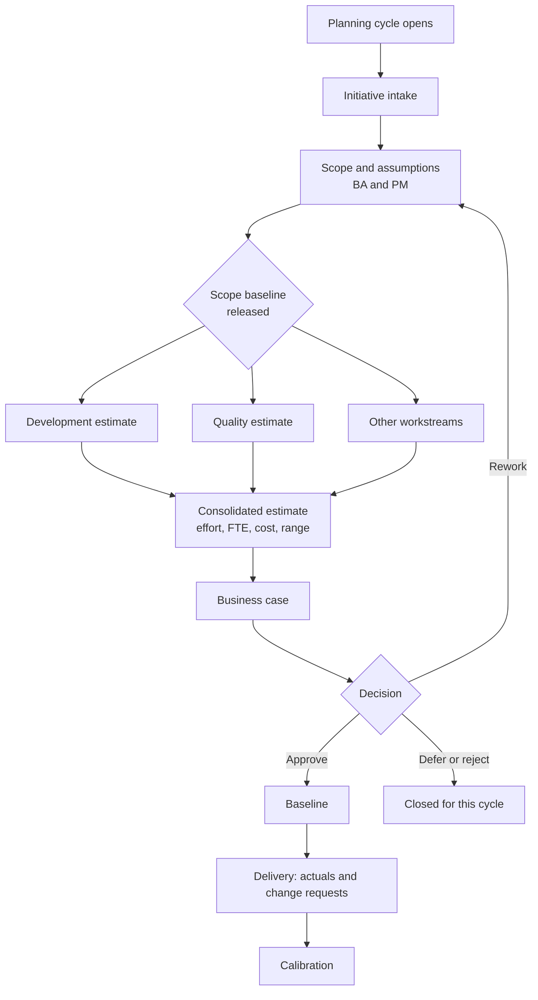
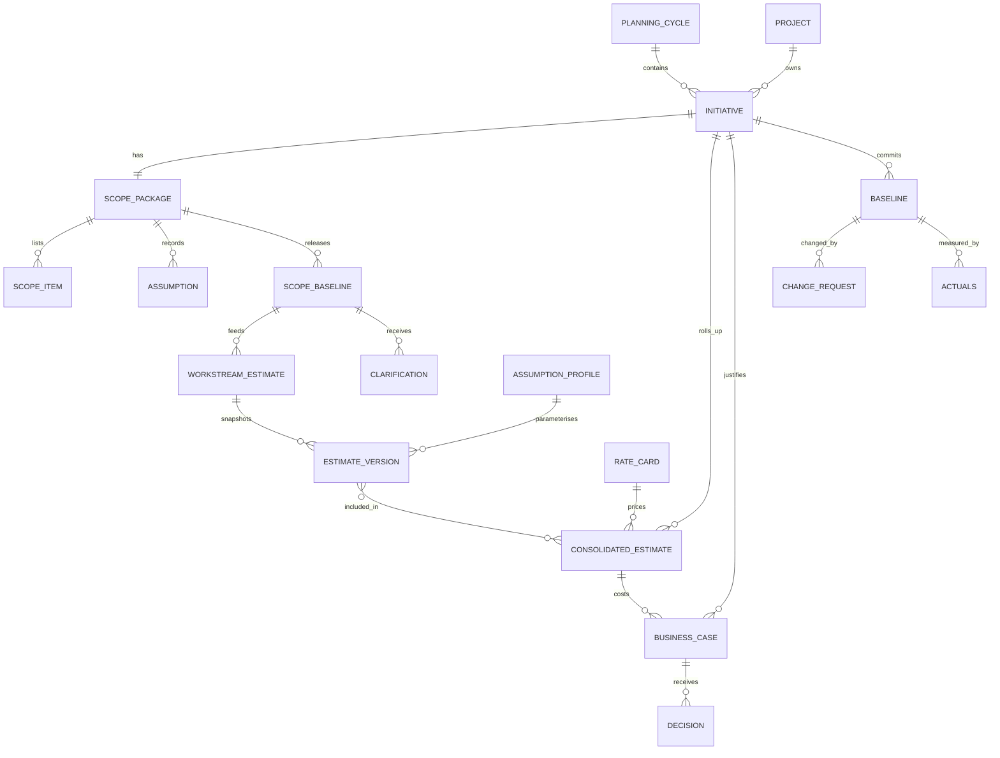
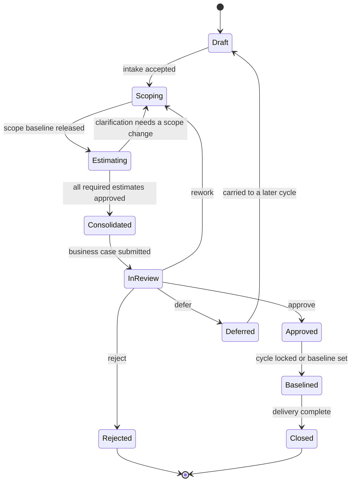

# Estimation Lifecycle Platform — Business and Product Requirements (BRD / PRD)

|                   |                                                                                                  |
| ----------------- | ------------------------------------------------------------------------------------------------ |
| **Status**        | Draft 0.1 for review. Nothing in this document is approved or committed.                         |
| **Date**          | 2026-11-19                                                                                       |
| **Builds on**     | SIT Sizing app as built (solution design revision 5, engine 1.3.0, ADR-0001 to ADR-0021)         |
| **Product owner** | To be named (open question OQ-01)                                                                |
| **Working name**  | "Estimation Lifecycle Platform". The name is a placeholder (OQ-02).                              |
| **HTML version**  | [brd-prd-estimation-lifecycle.html](brd-prd-estimation-lifecycle.html), generated from this file |

**How to read this document.** Part A (sections 1–10) is the business requirements: why, for whom, and what the business needs. Part B (sections 11–26) is the product requirements: what the product does, module by module. Requirement IDs are stable so that reviews, stories and tests can refer to them.

**Marked assumptions.** This first draft was written before the business problem, the development-estimation method and the cost model were confirmed. Every statement the author had to assume is marked **[A]**. Treat each **[A]** as a proposal to accept, change or reject. The ones that change what gets built are collected in section 25.

---

# Part A — Business requirements

## 1. Executive summary

Today the SIT Sizing app answers one question well: how much Quality Engineering effort does a release need? It does so with a calibrated model, immutable versions, an approval step and an audit trail. It does not answer the question that Annual Planning and Quarterly Business Reviews (QBR) actually ask: **what will this initiative cost in total, how sure are we, and should we fund it?**

That answer is assembled outside the tool. Business Analysts and Project Managers describe scope and assumptions in documents. Development Engineering and Quality Engineering each estimate from their own reading of those documents. The numbers meet in a spreadsheet, shortly before the planning deadline. **[A]**

This document proposes extending the app into one place where an initiative is estimated from first idea to delivered result:

1. **One chain of inputs.** BAs and PMs record scope and assumptions once. That released scope becomes the input for Development Engineering and Quality Engineering, so every discipline estimates the same thing.
2. **Estimates that match the planning phase.** A rough order of magnitude for Annual Planning, a budgetary estimate with a business case for QBR, a definitive estimate before delivery. Each carries a stated range, and each refines the one before.
3. **A business case built on live numbers.** Effort, FTE, cost and range flow into the business case. When scope changes, the case shows it is out of date.
4. **A portfolio view for the planning cycle.** Every initiative in a cycle, with its status, cost, range and demand on each team, set against capacity and budget.
5. **A learning loop.** Actuals are recorded against the approved baseline, for all disciplines, and feed calibration.

The existing QE model, its numbers and its controls stay as they are. The new work wraps a lifecycle around it and adds the upstream and sibling disciplines.

## 2. Background and current state

### 2.1 What exists

| Capability          | As built today                                                                                  |
| ------------------- | ----------------------------------------------------------------------------------------------- |
| Disciplines covered | Quality Engineering only: SIT, data platform, AI product and performance testing                |
| Structure           | Project → Estimate → numbered, immutable Versions; one editable draft per estimate              |
| Modes               | Rough (features with T-shirt sizes) and Detailed (driver counts), with a gap table between them |
| Governance          | Submit → approve or return, segregation of duties, full audit log                               |
| Calibration         | Assumption profiles (Draft → Published → Retired), actuals per SIT cycle, variance view         |
| Roll-up             | Portfolio view of QE estimates across projects; QBR summary text; Excel and CSV export          |
| Roles               | Viewer, Estimator, QE Lead (per project); Admin (global)                                        |
| Channels            | Web app (EN/VI) and an AI-assistant channel (MCP server, 17 tools)                              |

### 2.2 What is missing for planning

| Gap                                 | Effect                                                                                                           |
| ----------------------------------- | ---------------------------------------------------------------------------------------------------------------- |
| No planning cycle                   | An estimate is not tied to "Annual Plan 2027" or "QBR Q2". Nothing can be opened, locked or rolled up per cycle. |
| No initiative or business case      | There is no record of why the work is proposed, what it is worth, or what was decided.                           |
| No upstream scope owner             | QE types in features and counts. BA and PM assumptions live in separate documents and are re-keyed.              |
| No Development Engineering estimate | The largest share of delivery effort is estimated elsewhere, with no shared method, versioning or calibration.   |
| No cost                             | The app outputs hours and FTE. Planning decisions are made on money.                                             |
| No capacity context                 | Demand is not compared with what teams can deliver in a quarter.                                                 |
| No estimate maturity                | A first guess and a detailed estimate look alike. There is no stated confidence class.                           |

## 3. Problem statement and opportunity

**Problem [A].** Planning estimates are produced by several roles, in several tools, from inputs that are not shared. The consequences are:

- Disciplines estimate different scope without knowing it. Differences surface during delivery.
- Assumptions are not visible to the people who depend on them, and are not challenged before the number is used.
- Early estimates are treated as commitments because their uncertainty is not stated.
- When scope changes, nobody can tell which estimates and which business cases are now out of date.
- There is no organisation-wide record of estimate against actual, so the next plan starts from opinion again.

**Opportunity.** The app already has the hard parts of a trustworthy estimating tool: an auditable engine, immutable versions, approvals, profiles and calibration. Extending the same pattern upstream (scope and assumptions) and sideways (Development Engineering, cost) gives planning a single, traceable source for its numbers.

## 4. Vision, objectives and success measures

**Vision.** Every planning decision is backed by an estimate whose scope, assumptions, method, range and approver can be seen in one place.

| #   | Objective                            | Measure                                                                                   | Baseline         | Target                                        |
| --- | ------------------------------------ | ----------------------------------------------------------------------------------------- | ---------------- | --------------------------------------------- |
| O1  | One shared scope for all disciplines | Share of approved initiatives whose DE and QE estimates reference the same scope baseline | Not measured     | To agree (OQ-03)                              |
| O2  | Faster planning rounds               | Elapsed days from cycle opening to all estimates submitted                                | Not measured     | To agree                                      |
| O3  | Honest uncertainty                   | Share of estimates presented with an estimate class and range                             | 0%               | 100% of submitted estimates                   |
| O4  | Better accuracy over time            | Variance of actual vs baseline effort, by discipline and estimate class                   | QE only, partial | Trend improves cycle on cycle; value to agree |
| O5  | Traceable decisions                  | Share of funded initiatives with an approved business case linked to an approved estimate | Not measured     | 100%                                          |
| O6  | Adoption                             | Share of initiatives in a planning cycle estimated in the platform                        | 0%               | To agree, per release                         |

Baselines are "not measured" because they are not recorded anywhere today. The first cycle run in the platform sets them.

## 5. Scope

### 5.1 In scope

- Planning cycles: Annual Planning, QBR, and out-of-cycle change requests.
- Initiatives of two kinds: a **new project**, and **new features or enhancements on an existing project**.
- A business case per initiative, fed by the consolidated estimate.
- A scope and assumptions package owned by BA and PM, released as a baseline for downstream estimators.
- Development Engineering estimation, with profiles, versions, review and calibration.
- Quality Engineering estimation: the existing model, fed from the scope baseline.
- Other workstreams (for example BA, project management, UAT support, release and environments) as simple, configurable lines.
- Consolidation into effort, FTE, duration, cost and range.
- Review, approval, baselining and change control.
- Portfolio, capacity and prioritisation views per cycle.
- Actuals and calibration for all disciplines.
- Reporting and export for planning packs.
- The AI-assistant channel, extended to the new objects.

### 5.2 Out of scope

- Named-person resource booking, timesheets and leave. Capacity is planned per team and role, in FTE.
- Project scheduling (Gantt charts, sprint planning, dependencies between tasks).
- Financial accounting: purchase orders, invoices, actual spend ledgers. Cost here is an estimate derived from effort and rates.
- Benefits realisation tracking after go-live, beyond recording the expected benefits in the business case (later candidate).
- Replacing Jira, Confluence or the test-management tool.
- Any personal or customer data beyond a signed-in user's name, work email and role.

### 5.3 Anti-goals

The product has failed, even if it works, when any of these is true:

- It changes the existing QE numbers. Engine parity and the golden tests stay in force.
- A rough estimate can be shown without its class and range, and so read as a commitment.
- It becomes a form-filling exercise that people complete after deciding the number elsewhere.
- Rates or cost data are visible to people who should not see them.
- A decision can be recorded with no trace of the scope and assumptions it was based on.

## 6. Stakeholders and roles

| Stakeholder                                 | Interest                                               | Role in the product                                               |
| ------------------------------------------- | ------------------------------------------------------ | ----------------------------------------------------------------- |
| Business sponsor                            | Fund the right work; know the cost and the risk        | Owns the business case; receives the decision                     |
| Product owner                               | Shape scope to fit value and budget                    | Proposes initiatives; prioritises                                 |
| Business Analyst (BA)                       | Scope understood the same way by everyone              | Authors scope items and business assumptions                      |
| Project Manager (PM)                        | A plan that holds: timeline, team, dependencies, risks | Authors delivery assumptions; assembles the consolidated estimate |
| Development Engineering lead and estimators | Estimate from clear scope; be able to push back        | Produce and approve the DE estimate                               |
| Quality Engineering lead and estimators     | As today, with less re-keying                          | Produce and approve the QE estimate                               |
| PMO / portfolio office                      | Run the cycle; compare initiatives fairly              | Opens and locks cycles; owns the portfolio view                   |
| Finance                                     | Rates and budget envelopes are applied consistently    | Owns rate cards and budget figures                                |
| Architecture, security, platform            | Early sight of large or risky work                     | Reviewers and optional workstream owners                          |
| Engineering practice leads                  | Calibrated, consistent methods                         | Own the DE and QE assumption profiles                             |
| Internal audit                              | Evidence of who decided what, on what basis            | Reads the audit trail                                             |

## 7. Business process

### 7.1 The lifecycle



### 7.2 Estimate classes by planning phase

Each phase asks for a different depth. The estimate class states that depth and the range that goes with it. The ranges below are starting values **[A]**; they are configuration, and practice leads replace them with measured ranges once actuals exist.

| Phase                        | Typical question                                                | Estimate class                               | Inputs expected                                                                                       | Starting range [A] |
| ---------------------------- | --------------------------------------------------------------- | -------------------------------------------- | ----------------------------------------------------------------------------------------------------- | ------------------ |
| Annual Planning              | Roughly how big is next year's demand, and does it fit?         | **Class 1 — Rough order of magnitude (ROM)** | Initiative outline; scope items with T-shirt sizes; key assumptions                                   | −25% to +75%       |
| QBR                          | Should we fund this now, and what do we commit for the quarter? | **Class 2 — Budgetary**                      | Scope items with size and complexity; channels, integrations and data; team and window; business case | −15% to +30%       |
| Pre-delivery (after BRD/FSD) | What exactly do we commit to deliver?                           | **Class 3 — Definitive**                     | Detailed drivers and counts; confirmed assumptions; evidence                                          | −10% to +15%       |
| Change request               | What does this change add or remove?                            | Same class as the baseline it changes        | Delta scope against a baseline                                                                        | As class           |

This maps onto what the QE model already does: Class 1 and 2 use rough mode; Class 3 uses detailed mode; the existing rough-versus-detailed gap table becomes the comparison between classes.

### 7.3 Two kinds of initiative

|               | New project                                   | Features on an existing project                                                         |
| ------------- | --------------------------------------------- | --------------------------------------------------------------------------------------- |
| Starts from   | A blank scope, or a template                  | The existing project's last approved baseline, profiles and actuals                     |
| Profiles      | Global published profiles                     | The project's own calibrated profiles where they exist                                  |
| Business case | Full case: options, costs, benefits, run cost | Lighter case **[A]**: incremental cost and benefit; full case above a threshold (OQ-08) |
| History       | None                                          | Past estimate-versus-actual variance shown beside the new estimate                      |

## 8. Business requirements

Priority uses MoSCoW: **M** must, **S** should, **C** could.

| ID    | Requirement                                                                                                                    | Priority |
| ----- | ------------------------------------------------------------------------------------------------------------------------------ | -------- |
| BR-01 | The organisation can define planning cycles (Annual Planning, QBR, ad hoc) with opening, submission and lock dates.            | M        |
| BR-02 | Every initiative in a cycle is recorded once, as a new project or as features on an existing project.                          | M        |
| BR-03 | BAs and PMs record scope and assumptions once, and release them as a versioned baseline.                                       | M        |
| BR-04 | Development Engineering and Quality Engineering estimate from a released scope baseline, not from separate documents.          | M        |
| BR-05 | Every assumption has an owner, and a downstream role can question it before estimating on it.                                  | M        |
| BR-06 | Every estimate states its class, its range and the assumptions it depends on.                                                  | M        |
| BR-07 | Estimates from all disciplines are consolidated into effort, FTE, duration and cost per initiative.                            | M        |
| BR-08 | Each initiative has a business case that draws its cost figures from the consolidated estimate.                                | M        |
| BR-09 | Estimates and business cases pass through review and approval with segregation of duties, and approved versions are immutable. | M        |
| BR-10 | When upstream scope changes, every dependent estimate and business case is marked out of date.                                 | M        |
| BR-11 | The portfolio office can see all initiatives in a cycle with status, cost, range and decision.                                 | M        |
| BR-12 | Demand per team and quarter can be compared with capacity.                                                                     | S        |
| BR-13 | An approved estimate becomes a baseline; later changes are recorded as change requests against it.                             | M        |
| BR-14 | Actual effort is recorded against the baseline for each discipline, and variance is reported.                                  | S        |
| BR-15 | Estimating methods are calibrated from actuals, under the control of practice leads.                                           | S        |
| BR-16 | Planning packs (cycle summary, business case, estimate detail) can be exported.                                                | M        |
| BR-17 | Every create, change, submission and decision is audited: who, what, when, through which channel.                              | M        |
| BR-18 | Cost rates and budget figures are visible only to authorised roles.                                                            | M        |
| BR-19 | The product works in English and Vietnamese.                                                                                   | M        |
| BR-20 | Initiatives can be ranked and scenarios compared against a budget or capacity limit.                                           | C        |
| BR-21 | An AI assistant can help draft scope and estimates from requirement documents, with a person confirming every write.           | C        |
| BR-22 | Existing QE estimates, profiles, actuals and audit history are kept and remain usable.                                         | M        |

## 9. Business rules

| ID     | Rule                                                                                                                                                              |
| ------ | ----------------------------------------------------------------------------------------------------------------------------------------------------------------- |
| BRL-01 | A downstream estimate always references exactly one released scope baseline version.                                                                              |
| BRL-02 | A released scope baseline is immutable. A change creates a new version.                                                                                           |
| BRL-03 | The person who submits an estimate or a business case cannot approve it.                                                                                          |
| BRL-04 | A business case can be submitted only when every required workstream estimate is approved against the same scope baseline.                                        |
| BRL-05 | An estimate cannot be shown, exported or summed without its class and range.                                                                                      |
| BRL-06 | When a cycle is locked, the initiatives in it and their approved versions are frozen for that cycle. Later work is a change request or belongs to the next cycle. |
| BRL-07 | A consolidated range is derived from the workstream ranges by a documented rule (FR-CON-04), not typed in.                                                        |
| BRL-08 | Cost is always computed from effort and a published rate card; it is never typed in as a total. Fixed non-labour costs are separate, labelled lines.              |
| BRL-09 | A change to an estimating method (formula or default) follows the existing engine change policy: ADR, human approval, version stamp.                              |
| BRL-10 | An AI assistant never approves, returns, decides or releases. It drafts; a person confirms.                                                                       |

## 10. Benefits, assumptions, constraints and dependencies

**Expected benefits.** Less re-keying and reconciliation in each planning round; fewer delivery surprises from mismatched scope; decisions made with stated uncertainty; a growing record of accuracy that improves the next plan. These are not yet quantified (OQ-03).

**Assumptions [A].**

- Planning runs on an annual cycle with quarterly reviews, and both use the same initiative list.
- BA and PM are distinct roles; on small initiatives one person may hold both.
- Development Engineering is willing to adopt a shared, calibrated method. This is the largest adoption risk.
- Finance can provide blended rates by role family, grade and location. No individual salary is needed or wanted.
- The existing hosting, identity provider (Keycloak) and stack remain.

**Constraints.**

- The QE engine's numbers must not change (parity and golden tests).
- No personal or customer data; synthetic data in all examples, tests and seeds.
- Role and permission changes, identity configuration, migrations and engine changes need named human review.
- English and Vietnamese for every user-facing string.

**Dependencies.** A named product owner; a Development Engineering method owner; a Finance contact for rate cards; the planning calendar from the portfolio office; a decision on integrations (section 21).

---

# Part B — Product requirements

## 11. Product principles

1. **Enter once, reuse downstream.** Scope and assumptions are typed by the role that owns them, and flow to everyone else.
2. **Uncertainty is part of the number.** Class and range travel with every figure, on screen and in exports.
3. **Immutable history.** Baselines and approved versions never change; a change makes a new version.
4. **Stale is visible.** Anything computed from superseded inputs says so, and offers a one-step refresh into a new draft.
5. **Same controls everywhere.** Every discipline gets the pattern QE has today: draft, lock, version, submit, approve, audit, profile, actuals.
6. **Pure, versioned engines.** Each discipline's maths is a pure package with golden tests and a version stamp. The server's numbers are authoritative.
7. **Light by default.** A Class 1 estimate for Annual Planning should take minutes per initiative. Depth is added only when the phase asks for it.

## 12. Personas and their main jobs

| Persona                      | Main jobs in the product                                                                                                                            |
| ---------------------------- | --------------------------------------------------------------------------------------------------------------------------------------------------- |
| **Sponsor** (business owner) | Read the business case; see cost, range and risk; decide or endorse                                                                                 |
| **Product owner**            | Create initiatives; shape scope; compare options; prioritise                                                                                        |
| **Business Analyst**         | List scope items; size them; record business assumptions; answer clarifications; release the scope baseline with the PM                             |
| **Project Manager**          | Record delivery assumptions (window, team, dependencies, risks); request estimates; assemble and submit the consolidated estimate and business case |
| **DE estimator / DE lead**   | Estimate development effort from the scope baseline; raise clarifications; review and approve                                                       |
| **QE estimator / QE lead**   | As today, starting from the scope baseline; review and approve                                                                                      |
| **Portfolio manager (PMO)**  | Open, run and lock cycles; chase status; compare and rank initiatives; export the pack                                                              |
| **Finance partner**          | Maintain rate cards and budget envelopes; review cost                                                                                               |
| **Practice lead**            | Own profiles; review accuracy; calibrate                                                                                                            |
| **Viewer / auditor**         | Read initiatives, decisions and the audit trail they are allowed to see                                                                             |
| **Admin**                    | Users, reference data, configuration                                                                                                                |

## 13. Domain model

### 13.1 Concepts

| Concept                            | Meaning                                                                                   | Relation to today                                   |
| ---------------------------------- | ----------------------------------------------------------------------------------------- | --------------------------------------------------- |
| **Portfolio / business unit**      | Grouping of projects for roll-up and access                                               | New (light)                                         |
| **Planning cycle**                 | A dated planning round: Annual Planning 2027, QBR 2027-Q2, ad hoc                         | New                                                 |
| **Project**                        | A product or programme that owns work                                                     | Exists                                              |
| **Initiative**                     | A proposed piece of work in a cycle: a new project, or features on an existing project    | New                                                 |
| **Scope package**                  | The BA/PM working draft: scope items, assumptions, delivery parameters, risks             | New                                                 |
| **Scope item**                     | One feature or capability, with type, size, complexity and attributes                     | Generalises today's rough-scope feature row         |
| **Assumption (business/delivery)** | A stated condition the estimate depends on, with owner, confidence and status             | New. Distinct from _model assumptions_ in profiles  |
| **Scope baseline**                 | An immutable, numbered release of the scope package                                       | New                                                 |
| **Clarification**                  | A question or challenge raised against a scope item or assumption                         | New                                                 |
| **Workstream estimate**            | One discipline's estimate against one scope baseline: DE, QE, or another workstream       | Today's Estimate becomes the QE workstream estimate |
| **Estimate version**               | Immutable snapshot of a workstream estimate's inputs and results                          | Exists                                              |
| **Assumption profile**             | Published set of model parameters for a discipline                                        | Exists for QE; extended to DE and other workstreams |
| **Rate card**                      | Published cost rates by role family, grade, location and year                             | New                                                 |
| **Consolidated estimate**          | Roll-up of approved workstream estimates: effort, FTE, duration, cost, range              | New                                                 |
| **Business case**                  | Problem, options, benefits, costs (from the consolidated estimate), risks, recommendation | New                                                 |
| **Decision**                       | Approve, rework, defer or reject, with note and decider                                   | New                                                 |
| **Baseline**                       | The approved consolidated estimate and business case that delivery is measured against    | New                                                 |
| **Change request**                 | A proposed change to a baseline, with delta scope and delta estimate                      | New                                                 |
| **Capacity plan**                  | Available FTE per team, role family and quarter                                           | New                                                 |
| **Actuals**                        | Measured effort and outcomes against a baseline                                           | Exists for QE; extended                             |

### 13.2 Relationships



### 13.3 Two kinds of assumption

The word "assumption" already has a meaning in the app. This document keeps the two apart:

|                     | Business and delivery assumptions                                                         | Model assumptions                             |
| ------------------- | ----------------------------------------------------------------------------------------- | --------------------------------------------- |
| Example (synthetic) | "The core banking sandbox is available from week 3." "Two channels only: web and mobile." | "Minutes to design one medium API test case." |
| Owner               | BA or PM, per initiative                                                                  | Practice lead, per profile                    |
| Lives in            | Scope package and baseline                                                                | Assumption profile                            |
| Changes when        | The initiative's facts change                                                             | Calibration shows a better value              |
| Effect              | Shapes scope and inputs; flagged as a risk when unconfirmed                               | Changes the maths                             |

## 14. Lifecycle and states

### 14.1 Initiative



### 14.2 Other objects

| Object                      | States                                                       | Notes                                                                                           |
| --------------------------- | ------------------------------------------------------------ | ----------------------------------------------------------------------------------------------- |
| Planning cycle              | Draft → Open → Estimating → In review → Locked → Closed      | Dates drive reminders, not automatic transitions **[A]**; the portfolio manager moves the cycle |
| Scope package / baseline    | Draft → Released (v1, v2, …) → Superseded                    | Edit lock and autosave as in today's editor                                                     |
| Clarification               | Open → Answered → Accepted, or → Scope change raised         | An open _blocking_ clarification stops submission of the dependent estimate                     |
| Workstream estimate version | Draft → Saved → Submitted → Approved / Returned → Superseded | Unchanged from today (ADR-0007)                                                                 |
| Business case               | Draft → Submitted → Approved / Rework / Deferred / Rejected  | One decision record per submission                                                              |
| Change request              | Draft → Estimating → Submitted → Approved / Rejected         | Approved: creates the next baseline version                                                     |
| Profile, rate card          | Draft → Published → Retired                                  | Unchanged pattern (ADR-0008)                                                                    |

### 14.3 Staleness

A workstream estimate, consolidated estimate or business case is **stale** when the object it was computed from has a newer released version: a scope baseline, a profile's engine version, or a rate card. A stale object:

- shows a banner naming what changed and a summary of the difference;
- cannot be newly submitted or approved;
- offers "Refresh as new draft", which copies it forward onto the new inputs and never edits the old version.

This generalises the existing engine-version flag and "recompute as new draft" (ADR-0013).

## 15. Functional requirements

Priority: **M** must, **S** should, **C** could. "Rel." is the proposed release from section 23.

### 15.1 Planning cycles (CYC)

| ID        | Requirement                                                                                                                                        | Pri | Rel. |
| --------- | -------------------------------------------------------------------------------------------------------------------------------------------------- | --- | ---- |
| FR-CYC-01 | A portfolio manager creates a cycle with a type (Annual, QBR, Ad hoc), a period, a default estimate class, and opening, submission and lock dates. | M   | 4    |
| FR-CYC-02 | A cycle has states (14.2); only the portfolio manager or Admin changes them, with a note.                                                          | M   | 4    |
| FR-CYC-03 | A cycle dashboard lists its initiatives with state, owner, estimate status per workstream, class, cost, range and decision.                        | M   | 4    |
| FR-CYC-04 | Locking a cycle freezes its initiatives and records, for each, the versions that were current.                                                     | M   | 5    |
| FR-CYC-05 | An initiative can be carried from one cycle to the next (for example Annual Plan to QBR), keeping its history and starting from its last baseline. | M   | 5    |
| FR-CYC-06 | The cycle can hold a budget envelope and, optionally, a capacity limit per team, used in portfolio views.                                          | S   | 6    |
| FR-CYC-07 | Reminders are sent before submission and lock dates to owners of incomplete work.                                                                  | S   | 5    |

### 15.2 Initiatives and intake (INI)

| ID        | Requirement                                                                                                                                                                                        | Pri | Rel. |
| --------- | -------------------------------------------------------------------------------------------------------------------------------------------------------------------------------------------------- | --- | ---- |
| FR-INI-01 | A product owner, BA or PM creates an initiative in a cycle with: title, kind (new project / features on an existing project), project, sponsor, summary, expected outcome, target window and tags. | M   | 4    |
| FR-INI-02 | For "features on an existing project", the initiative links to that project and shows its last baseline, profiles and estimate-versus-actual history.                                              | M   | 4    |
| FR-INI-03 | For a new project, creating the initiative can create the project and its first members in one step (Admin or portfolio manager).                                                                  | S   | 4    |
| FR-INI-04 | An initiative has an owner (PM by default) and a team: who holds each role for this initiative.                                                                                                    | M   | 4    |
| FR-INI-05 | The initiative page shows one timeline of everything that happened: releases, estimates, clarifications, decisions.                                                                                | S   | 5    |
| FR-INI-06 | Initiatives can be created from a template (scope items, assumptions and workstreams pre-filled) or by copying another initiative.                                                                 | S   | 5    |
| FR-INI-07 | Initiatives can be imported in bulk from a spreadsheet template at the start of a cycle.                                                                                                           | C   | 6    |

### 15.3 Scope and assumptions package — BA and PM (SCP)

| ID        | Requirement                                                                                                                                                                                                                                                                         | Pri | Rel. |
| --------- | ----------------------------------------------------------------------------------------------------------------------------------------------------------------------------------------------------------------------------------------------------------------------------------- | --- | ---- |
| FR-SCP-01 | A BA lists scope items. Each has: name, description, type (application, data, AI, integration, infrastructure, other), T-shirt size from the applicable profile, complexity, priority (must/should/could), and whether it is in or out of this phase.                               | M   | 4    |
| FR-SCP-02 | A scope item can carry attributes used downstream: channels, number of integrations, data sources, migration needed, performance-sensitive, regulatory impact, new versus changed. All optional at Class 1.                                                                         | M   | 4    |
| FR-SCP-03 | At Class 3 a scope item can carry detailed counts (screens, APIs, rules, reports, interfaces), entered by the BA or left for the downstream estimator.                                                                                                                              | S   | 5    |
| FR-SCP-04 | BA and PM record assumptions. Each has: statement, category (scope, business, technical, delivery, environment, people, vendor, regulatory), owner, confidence (low/medium/high), status (unconfirmed, confirmed, invalidated), impact if wrong, and the scope items it relates to. | M   | 4    |
| FR-SCP-05 | The PM records delivery parameters: target start and end, release windows, team shape and location mix, working calendar, dependencies on other initiatives or teams, and constraints.                                                                                              | M   | 4    |
| FR-SCP-06 | The PM records risks with likelihood, impact and a proposed contingency.                                                                                                                                                                                                            | S   | 5    |
| FR-SCP-07 | The BA and PM can enter their own estimates for their own workstreams (analysis, project management) and, optionally, an indicative overall size at Class 1. An indicative size is labelled as such and is replaced, not blended, when DE and QE estimates arrive. **[A]**          | M   | 4    |
| FR-SCP-08 | The package autosaves, uses an edit lock, and validates completeness against the cycle's class before release.                                                                                                                                                                      | M   | 4    |
| FR-SCP-09 | Releasing creates an immutable, numbered scope baseline. Release needs both the BA and the PM (or one person holding both roles, recorded as such). **[A]**                                                                                                                         | M   | 4    |
| FR-SCP-10 | Any two baselines can be compared: items added, removed and changed; assumptions changed.                                                                                                                                                                                           | M   | 4    |
| FR-SCP-11 | Documents can be linked (URL and title) as sources. Files are not stored in the platform. **[A]**                                                                                                                                                                                   | S   | 4    |

### 15.4 Hand-off and clarifications (HND)

| ID        | Requirement                                                                                                                                                                      | Pri | Rel. |
| --------- | -------------------------------------------------------------------------------------------------------------------------------------------------------------------------------- | --- | ---- |
| FR-HND-01 | Releasing a baseline creates or updates an estimate request for each required workstream and notifies its lead.                                                                  | M   | 4    |
| FR-HND-02 | Each workstream estimate opens with its inputs pre-filled from the baseline (15.5, 15.6), and shows the scope items and assumptions read-only beside the estimator's own inputs. | M   | 4    |
| FR-HND-03 | A downstream estimator can raise a clarification on any scope item or assumption, marked blocking or non-blocking.                                                               | M   | 4    |
| FR-HND-04 | The owner answers; the raiser accepts the answer or asks again. An answer that changes scope leads to a new baseline, not an edit.                                               | M   | 4    |
| FR-HND-05 | A downstream estimator can add _estimator assumptions_ to their own estimate. These are visible to BA and PM, and roll up to the consolidated view.                              | M   | 4    |
| FR-HND-06 | A hand-off board shows, per initiative, each workstream's status: not started, in progress, blocked by a clarification, submitted, approved, stale.                              | M   | 4    |
| FR-HND-07 | When a new baseline is released, each dependent estimate is marked stale with the list of changed items that affect it.                                                          | M   | 4    |

### 15.5 Development Engineering estimation (DE)

The method below is a proposal **[A]**. Development Engineering must own and confirm it (OQ-04). It deliberately mirrors the QE pattern so that both disciplines share editor, versions, profiles and calibration.

| ID       | Requirement                                                                                                                                                                                                                                                                                           | Pri | Rel. |
| -------- | ----------------------------------------------------------------------------------------------------------------------------------------------------------------------------------------------------------------------------------------------------------------------------------------------------- | --- | ---- |
| FR-DE-01 | A DE estimate has two modes. **Rough**: effort per scope item from its size, type and complexity, using the DE profile. **Detailed**: effort from component counts per scope item (for example screens, APIs, integrations, data objects, batch jobs, migrations, configuration), each by complexity. | M   | 5    |
| FR-DE-02 | The profile holds base hours per size and per component type and complexity, and percentage uplifts for activities: technical design, code review, unit and component testing, defect fixing during SIT and UAT, environments and release, technical lead time.                                       | M   | 5    |
| FR-DE-03 | The estimator can override a computed value per scope item, with a required reason. Overrides are listed in the result and in review.                                                                                                                                                                 | M   | 5    |
| FR-DE-04 | The estimator can enter three-point values (optimistic, likely, pessimistic) for an item instead of the model; the engine computes the expected value and spread.                                                                                                                                     | S   | 5    |
| FR-DE-05 | Results show: hours by scope item, by activity and by role family; FTE for the window; a duration check against the PM's window; class and range; sensitivity to the largest drivers.                                                                                                                 | M   | 5    |
| FR-DE-06 | Modifiers apply across the estimate: new versus existing codebase, technology familiarity, reuse, team distribution. Each is a profile row with a default and a calibration status.                                                                                                                   | S   | 5    |
| FR-DE-07 | DE estimates use the same draft, lock, autosave, version, compare, submit, approve and return flow as QE. Approver role: DE lead.                                                                                                                                                                     | M   | 5    |
| FR-DE-08 | The DE maths lives in its own pure, versioned engine package with golden tests; the server recomputes and stores authoritative results.                                                                                                                                                               | M   | 5    |
| FR-DE-09 | DE profiles are global or per project, Draft → Published → Retired, with calibration source and date per row.                                                                                                                                                                                         | M   | 5    |
| FR-DE-10 | Sub-disciplines (for example front end, back end, data, platform) can be estimated as separate sections of one DE estimate by different estimators.                                                                                                                                                   | C   | 6    |

### 15.6 Quality Engineering estimation (QE)

| ID       | Requirement                                                                                                                                                                                                                 | Pri | Rel. |
| -------- | --------------------------------------------------------------------------------------------------------------------------------------------------------------------------------------------------------------------------- | --- | ---- |
| FR-QE-01 | The existing QE model, editor, results, profiles and actuals are kept. No formula or default changes as part of this work.                                                                                                  | M   | 4    |
| FR-QE-02 | A QE estimate created from a scope baseline has its rough-scope features pre-filled from the scope items (name, type, size, complexity, performance flag), and its window and team pre-filled from the delivery parameters. | M   | 4    |
| FR-QE-03 | Pre-filled values are marked as inherited. The QE estimator can adjust them; adjustments are shown as differences from the baseline, with a reason.                                                                         | M   | 4    |
| FR-QE-04 | Where the baseline carries detailed counts, they pre-fill detailed mode in the same way.                                                                                                                                    | S   | 5    |
| FR-QE-05 | Development evidence that the QE model already uses (shift-left evidence) can be taken from the DE estimate of the same baseline where available, instead of being typed.                                                   | C   | 6    |
| FR-QE-06 | A QE estimate can still be created without an initiative ("standalone"), as today.                                                                                                                                          | M   | 4    |

### 15.7 Other workstreams and consolidation (CON)

| ID        | Requirement                                                                                                                                                                                                                                                                     | Pri | Rel. |
| --------- | ------------------------------------------------------------------------------------------------------------------------------------------------------------------------------------------------------------------------------------------------------------------------------- | --- | ---- |
| FR-CON-01 | Admin configures which workstreams exist and which are required per cycle type and initiative kind. Default set **[A]**: Business Analysis, Project Management, Development Engineering, Quality Engineering, UAT support, Release and environments, Architecture and security. | M   | 5    |
| FR-CON-02 | A simple workstream is estimated as a percentage of other workstreams, as fixed effort, or as role × duration. Its method and inputs are stored and versioned like any estimate.                                                                                                | M   | 5    |
| FR-CON-03 | The consolidated estimate rolls up the current approved version of each workstream: hours and person-days by workstream, role family and quarter; peak and average FTE; duration; cost; contingency.                                                                            | M   | 5    |
| FR-CON-04 | The consolidated range is computed from workstream ranges by a documented rule. Proposal **[A]**: sum of low and sum of high values by default (conservative), with a statistical combination offered as an alternative view.                                                   | M   | 5    |
| FR-CON-05 | Contingency is explicit: a percentage by class, or derived from the risk list, shown as its own line and never hidden inside workstream numbers.                                                                                                                                | M   | 5    |
| FR-CON-06 | The consolidated view lists every unconfirmed assumption and every override, as the "what this number depends on" section.                                                                                                                                                      | M   | 5    |
| FR-CON-07 | Effort is phased over the delivery window by quarter, using a default profile per workstream that the PM can adjust.                                                                                                                                                            | S   | 6    |
| FR-CON-08 | Any two consolidated estimates of an initiative can be compared: by class, by baseline, or before and after a change request.                                                                                                                                                   | M   | 5    |

### 15.8 Cost and rate cards (CST)

| ID        | Requirement                                                                                                                                            | Pri | Rel. |
| --------- | ------------------------------------------------------------------------------------------------------------------------------------------------------ | --- | ---- |
| FR-CST-01 | Finance maintains rate cards: a rate per role family, grade and location, per year, in one base currency. Draft → Published → Retired.                 | M   | 5    |
| FR-CST-02 | Cost = effort by role family and location × the published rate. The team's location and grade mix comes from the delivery parameters or a default mix. | M   | 5    |
| FR-CST-03 | Non-labour costs (licences, infrastructure, vendor fixed price) are entered as labelled lines with an owner and a note.                                | S   | 5    |
| FR-CST-04 | Rates are visible only to Finance, the portfolio manager and Admin. Other roles see cost totals only where their role allows (section 16).             | M   | 5    |
| FR-CST-05 | Each cost line can be tagged with a cost category (for example capital or operating), if Finance requires it (OQ-07).                                  | C   | 6    |
| FR-CST-06 | A second display currency with a published conversion rate.                                                                                            | C   | 7    |

### 15.9 Business case (BC)

| ID       | Requirement                                                                                                                                                                                                                                                       | Pri | Rel. |
| -------- | ----------------------------------------------------------------------------------------------------------------------------------------------------------------------------------------------------------------------------------------------------------------- | --- | ---- |
| FR-BC-01 | A business case has sections: problem or opportunity; objectives and strategic alignment; options considered (including "do nothing"); recommended option; benefits (quantified and qualitative); costs; risks and assumptions; delivery outline; recommendation. | M   | 5    |
| FR-BC-02 | The cost section is read from the consolidated estimate and cannot be typed over. It shows class, range and contingency.                                                                                                                                          | M   | 5    |
| FR-BC-03 | Benefits are entered per year with a type (revenue, cost saving, cost avoidance, risk reduction, regulatory, customer experience) and a confidence level.                                                                                                         | M   | 5    |
| FR-BC-04 | Indicators are computed from costs and benefits: net benefit, payback period and return on investment over a chosen horizon; net present value when a discount rate is configured.                                                                                | S   | 6    |
| FR-BC-05 | A lighter template applies to features on an existing project below a configurable cost threshold (OQ-08).                                                                                                                                                        | S   | 5    |
| FR-BC-06 | Options can each link to their own scope baseline and consolidated estimate, for side-by-side comparison.                                                                                                                                                         | C   | 6    |
| FR-BC-07 | The business case is versioned and immutable once submitted; it becomes stale when its consolidated estimate does.                                                                                                                                                | M   | 5    |
| FR-BC-08 | The case can be exported as a document for the planning pack (15.12).                                                                                                                                                                                             | M   | 5    |

### 15.10 Review, approval, baseline and change control (GOV)

| ID        | Requirement                                                                                                                                                         | Pri | Rel. |
| --------- | ------------------------------------------------------------------------------------------------------------------------------------------------------------------- | --- | ---- |
| FR-GOV-01 | Each workstream estimate is approved by that discipline's lead; the submitter cannot approve.                                                                       | M   | 4    |
| FR-GOV-02 | The consolidated estimate and business case are submitted by the PM and decided by the configured approvers for the cycle (sponsor, portfolio manager, or a panel). | M   | 5    |
| FR-GOV-03 | Approval steps are configurable per cycle type and by cost threshold: for example one approver below a threshold, two above.                                        | S   | 6    |
| FR-GOV-04 | A decision is Approve, Rework, Defer or Reject, with a required note. Rework returns the initiative to scoping with the note attached.                              | M   | 5    |
| FR-GOV-05 | Approval creates a baseline: the scope baseline, workstream versions, consolidated estimate, rate card and business case that were approved.                        | M   | 5    |
| FR-GOV-06 | A change request against a baseline carries delta scope, delta estimates per affected workstream, and the reason. Approval creates the next baseline version.       | M   | 6    |
| FR-GOV-07 | The baseline history shows original, each approved change, and current, with cumulative variance.                                                                   | M   | 6    |
| FR-GOV-08 | Reviewers can comment on a scope item, an estimate line or a business-case section. Comments are kept with the version.                                             | S   | 5    |

### 15.11 Portfolio, capacity and prioritisation (PRT)

| ID        | Requirement                                                                                                                                                                        | Pri | Rel. |
| --------- | ---------------------------------------------------------------------------------------------------------------------------------------------------------------------------------- | --- | ---- |
| FR-PRT-01 | The portfolio view lists a cycle's initiatives with filters (business unit, project, state, kind, class) and totals of effort, cost and range.                                     | M   | 5    |
| FR-PRT-02 | Team leads enter capacity: available FTE per team, role family and quarter.                                                                                                        | S   | 6    |
| FR-PRT-03 | A demand-versus-capacity view shows, per team and quarter, demand from approved and proposed initiatives against capacity, with shortfalls highlighted.                            | S   | 6    |
| FR-PRT-04 | Initiatives can be ranked manually and scored against configurable criteria (value, urgency, risk, strategic fit, effort).                                                         | C   | 6    |
| FR-PRT-05 | A scenario is a saved selection of initiatives: the view shows what fits within a budget or capacity limit and what falls below the line. Scenarios do not change the initiatives. | C   | 7    |
| FR-PRT-06 | Year-on-year and cycle-on-cycle comparison: how an initiative's estimate moved from Annual Plan to QBR to definitive.                                                              | S   | 6    |
| FR-PRT-07 | Totals across initiatives of different classes are shown per class and are never merged into a single unqualified number.                                                          | M   | 5    |

### 15.12 Actuals, calibration and accuracy (ACT), reporting (RPT)

| ID        | Requirement                                                                                                                                                                                                                          | Pri | Rel. |
| --------- | ------------------------------------------------------------------------------------------------------------------------------------------------------------------------------------------------------------------------------------ | --- | ---- |
| FR-ACT-01 | Actual effort is recorded per workstream against a baseline, per period or at close. QE actuals work as today.                                                                                                                       | M   | 6    |
| FR-ACT-02 | Variance is shown by workstream, class and scope item where recorded, against the original and the current baseline.                                                                                                                 | M   | 6    |
| FR-ACT-03 | An accuracy report per discipline and class shows the spread of actual versus estimate, and proposes ranges for section 7.2 from that data. A practice lead accepts or ignores the proposal.                                         | S   | 7    |
| FR-ACT-04 | Measured rates appear beside the profile rows they inform, for DE as for QE today. Profiles are updated by a person, not automatically.                                                                                              | S   | 6    |
| FR-ACT-05 | Actuals can be imported from a file. Automatic feeds are an integration (section 21).                                                                                                                                                | C   | 6    |
| FR-RPT-01 | Exports: cycle summary (spreadsheet), initiative pack (business case, consolidated estimate, assumptions, decision), workstream estimate detail. Formats: spreadsheet and a print-ready page; presentation slides as a later option. | M   | 5    |
| FR-RPT-02 | Every export states class, range, version numbers, status and the date, and is audited.                                                                                                                                              | M   | 5    |
| FR-RPT-03 | Exports respect cost visibility: a role that cannot see rates or cost gets an export without them.                                                                                                                                   | M   | 5    |
| FR-RPT-04 | Standard dashboards: cycle progress, estimate status by workstream, ageing clarifications, stale items, variance trend.                                                                                                              | S   | 6    |

### 15.13 Notifications, AI assistant and administration (NTF, AI, ADM)

| ID        | Requirement                                                                                                                                                                                                       | Pri | Rel. |
| --------- | ----------------------------------------------------------------------------------------------------------------------------------------------------------------------------------------------------------------- | --- | ---- |
| FR-NTF-01 | In-app and email notices for: estimate requested, clarification raised or answered, baseline released, estimate stale, submitted, decided, cycle dates approaching. Built on the existing outbox and worker.      | M   | 4    |
| FR-NTF-02 | A "My work" page lists what is waiting on the signed-in user across initiatives.                                                                                                                                  | M   | 4    |
| FR-NTF-03 | Users choose which notices arrive by email.                                                                                                                                                                       | S   | 5    |
| FR-AI-01  | The assistant can read cycles, initiatives, baselines, estimates and business cases the user can see.                                                                                                             | S   | 6    |
| FR-AI-02  | From a requirements document supplied by the user, the assistant can propose scope items, sizes and assumptions as a draft scope package, and a draft DE or QE estimate, each saved only after the user confirms. | S   | 6    |
| FR-AI-03  | The assistant can explain a number: which inputs, assumptions and profile rows produced it.                                                                                                                       | C   | 6    |
| FR-AI-04  | The assistant never releases a baseline, approves, returns or decides (BRL-10), and every write is audited with its channel.                                                                                      | M   | 6    |
| FR-ADM-01 | Admin maintains reference data: business units, teams, role families, grades, locations, workstreams, estimate classes and ranges, templates, thresholds.                                                         | M   | 4    |
| FR-ADM-02 | The audit log covers every new object and action, with the existing filters plus cycle and initiative.                                                                                                            | M   | 4    |
| FR-ADM-03 | Guided tours and the in-app guide are extended per role.                                                                                                                                                          | S   | 5    |

## 16. Roles and permissions

Proposed roles **[A]**. Roles are assigned in the identity provider and per project or initiative, as today; the permission matrix remains a single source in the app and every change to it needs human security review.

| Capability                                 | Sponsor | Product owner | BA  | PM  | DE est. | DE lead | QE est. | QE lead | Portfolio mgr | Finance | Viewer |
| ------------------------------------------ | ------- | ------------- | --- | --- | ------- | ------- | ------- | ------- | ------------- | ------- | ------ |
| Create initiative                          | –       | ✓             | ✓   | ✓   | –       | –       | –       | –       | ✓             | –       | –      |
| Edit scope items and business assumptions  | –       | ✓             | ✓   | ✓   | –       | –       | –       | –       | –             | –       | –      |
| Edit delivery parameters and risks         | –       | –             | –   | ✓   | –       | –       | –       | –       | –             | –       | –      |
| Release scope baseline                     | –       | –             | ✓   | ✓   | –       | –       | –       | –       | –             | –       | –      |
| Raise clarification                        | –       | ✓             | ✓   | ✓   | ✓       | ✓       | ✓       | ✓       | ✓             | ✓       | –      |
| Edit DE estimate                           | –       | –             | –   | –   | ✓       | ✓       | –       | –       | –             | –       | –      |
| Approve DE estimate                        | –       | –             | –   | –   | –       | ✓       | –       | –       | –             | –       | –      |
| Edit QE estimate                           | –       | –             | –   | –   | –       | –       | ✓       | ✓       | –             | –       | –      |
| Approve QE estimate                        | –       | –             | –   | –   | –       | –       | –       | ✓       | –             | –       | –      |
| Edit simple workstreams, consolidated view | –       | –             | –   | ✓   | –       | –       | –       | –       | –             | –       | –      |
| Edit business case                         | –       | ✓             | ✓   | ✓   | –       | –       | –       | –       | –             | –       | –      |
| Decide on business case                    | ✓       | –             | –   | –   | –       | –       | –       | –       | ✓             | –       | –      |
| See cost totals                            | ✓       | ✓             | –   | ✓   | –       | ✓       | –       | ✓       | ✓             | ✓       | –      |
| See and edit rate cards                    | –       | –             | –   | –   | –       | –       | –       | –       | read          | ✓       | –      |
| Manage cycles, capacity limits, portfolio  | –       | –             | –   | –   | –       | –       | –       | –       | ✓             | –       | –      |
| Enter team capacity                        | –       | –             | –   | –   | –       | ✓       | –       | ✓       | ✓             | –       | –      |
| Read initiative (no cost)                  | ✓       | ✓             | ✓   | ✓   | ✓       | ✓       | ✓       | ✓       | ✓             | ✓       | ✓      |

Rules that apply to all rows: access is limited to the user's projects and business units; outside them a record does not appear to exist; the submitter never approves their own work; Admin administers but does not approve estimates. Today's Estimator role becomes QE estimator; today's QE Lead and Viewer are unchanged.

## 17. Key journeys

### 17.1 Annual Planning: sizing next year's demand

1. The portfolio manager opens "Annual Planning 2027", class 1, and invites product owners and PMs.
2. A product owner creates an initiative, "SME online term deposit" (synthetic example), as a new project.
3. The BA lists eight scope items with T-shirt sizes and three assumptions. The PM adds a target window and a team shape. They release scope baseline v1. This takes minutes, not days.
4. The DE lead and QE lead each receive an estimate request. Each opens a rough estimate already filled from the baseline, adjusts where needed, and submits. A second person approves.
5. The PM sees the consolidated estimate: effort, FTE, cost and a −25% to +75% range, with the three unconfirmed assumptions listed below it.
6. The portfolio manager sees the initiative in the cycle view beside the others, and against capacity for each quarter.
7. The cycle is locked. The initiative carries its Class 1 baseline into the year.

### 17.2 QBR: business case for new features on an existing project

1. In "QBR 2027-Q2" a PM creates an initiative on an existing project. The page shows that project's last baseline and that its last two QE estimates ran 8% and 12% under actuals.
2. The BA details the scope items with complexity, channels and integrations. A DE estimator raises a blocking clarification: "Is the limits service changed or only called?" The BA answers; scope changes, so baseline v2 is released and v1's estimates are marked stale and refreshed.
3. DE and QE estimates are approved at class 2. Simple workstreams are computed from percentages.
4. The PM completes the business case. Costs come from the consolidated estimate; the product owner enters benefits.
5. The sponsor reads the case, with cost, range, payback and open assumptions on one page, and approves. The baseline is set.

### 17.3 Scope change after baseline

1. During delivery a new regulatory requirement arrives. The PM opens a change request against the baseline.
2. The BA adds one scope item and changes another. Only the affected workstreams are asked for a delta estimate.
3. The change request shows the added effort and cost and the new total against the original. It is approved; the baseline moves to version 2; the history keeps both.

### 17.4 Sketch: the initiative page

```text
┌───────────────────────────────────────────────────────────────────────────────┐
│ SME online term deposit            QBR 2027-Q2 · Class 2 Budgetary · Estimating │
│ New features on: Example project   Owner: PM   Sponsor: (role)                  │
├───────────────────────────────────────────────────────────────────────────────┤
│ Scope baseline v2 (released)   8 items · 5 assumptions (2 unconfirmed)  Compare │
├──────────────────────┬──────────────┬──────────────┬───────────────────────────┤
│ Workstream           │ Status       │ Effort (pd)  │ Range                     │
│ Development Eng.     │ Approved v3  │ 420          │ 357 – 546                 │
│ Quality Eng.         │ Stale (v1→2) │ 180          │ Refresh as new draft →    │
│ Business Analysis    │ Approved     │  45          │                           │
│ Project Management   │ Computed 10% │  65          │                           │
├──────────────────────┴──────────────┴──────────────┴───────────────────────────┤
│ Consolidated: waiting for Quality Eng.      Clarifications: 1 open (blocking)   │
│ Business case: Draft                        Timeline ▸                          │
└───────────────────────────────────────────────────────────────────────────────┘
```

All figures in the sketch are invented.

## 18. Screen inventory

| Screen                                    | Purpose                                              | Main users                 | Status                                                    |
| ----------------------------------------- | ---------------------------------------------------- | -------------------------- | --------------------------------------------------------- |
| My work                                   | What is waiting on me                                | All                        | New                                                       |
| Planning cycles (list, detail, dashboard) | Run a cycle                                          | Portfolio manager          | New                                                       |
| Initiative (overview, timeline)           | The one page for an initiative                       | All                        | New                                                       |
| Scope package editor                      | Scope items, assumptions, delivery parameters, risks | BA, PM                     | New; reuses the editor shell, autosave and lock           |
| Baseline compare                          | What changed between releases                        | All                        | New; reuses version compare                               |
| Clarifications                            | Raise, answer, track                                 | All                        | New                                                       |
| DE estimate editor and results            | Development estimate                                 | DE                         | New; mirrors the QE editor                                |
| QE estimate editor and results            | Quality estimate                                     | QE                         | Exists; adds inherited inputs and the baseline side panel |
| Consolidated estimate                     | Roll-up, range, cost, dependencies                   | PM, approvers              | New                                                       |
| Business case                             | Write, review, decide                                | PM, product owner, sponsor | New                                                       |
| Portfolio and capacity                    | Compare, rank, fit                                   | Portfolio manager          | Extends the existing portfolio view                       |
| Profiles (QE, DE, simple workstreams)     | Model parameters                                     | Practice leads             | Extends                                                   |
| Rate cards                                | Cost rates                                           | Finance                    | New                                                       |
| Actuals and accuracy                      | Record and learn                                     | Leads, practice leads      | Extends                                                   |
| Admin, audit, reference data              | Configure and evidence                               | Admin                      | Extends                                                   |

## 19. Non-functional requirements

Working assumptions to confirm with the product owner and platform team; they are not commitments.

| ID     | Area            | Requirement                                                                                                                                  |
| ------ | --------------- | -------------------------------------------------------------------------------------------------------------------------------------------- |
| NFR-01 | Scale **[A]**   | Up to 1,500 named users and 150 at the same time; 2,000 initiatives per year; 20 workstream versions per initiative                          |
| NFR-02 | Performance     | Pages under 2 s at the 95th percentile; in-browser recalculation under 50 ms; cycle dashboard with 500 initiatives under 3 s                 |
| NFR-03 | Availability    | Business hours, internal tool; higher expectations in the two weeks before a cycle lock date (to agree)                                      |
| NFR-04 | Security        | Existing controls kept: OIDC sign-in, MFA policy, per-project access, rate limits, CSP, audit. New: field-level protection of rates and cost |
| NFR-05 | Auditability    | Every state change and export is recorded and cannot be edited; retention to agree                                                           |
| NFR-06 | Accuracy        | Each engine is deterministic, versioned and covered by golden tests; server results are authoritative                                        |
| NFR-07 | Accessibility   | Labels, keyboard access, focus state, reduced motion; WCAG 2.2 AA as the target                                                              |
| NFR-08 | Languages       | English and Vietnamese for all strings, with the existing review round trip                                                                  |
| NFR-09 | Browsers        | Current Chrome and Edge on desktop; tablet supported; phone read-only                                                                        |
| NFR-10 | Recoverability  | Backup and restore as today, re-sized for the larger data set                                                                                |
| NFR-11 | Maintainability | Schema-first API, layered code, coverage gates and OpenAPI contract as today, applied to every new module                                    |
| NFR-12 | Operability     | Tracing, structured logs and a runbook entry for each new background job                                                                     |

## 20. Data, security and privacy

- **No personal or customer data.** The platform stores a signed-in user's name, work email and role, and nothing else about people. Capacity is per team and role family, never per named person.
- **Commercially sensitive data.** Rates, budgets and business-case figures are new and more sensitive than anything stored today. They are restricted by role (section 16), excluded from logs, and left out of exports for roles that cannot see them.
- **Free text.** Scope items, assumptions and business cases are free text. The product shows a standing reminder not to enter customer data, and the guide repeats it. Linked documents stay in their own systems.
- **AI assistant.** The assistant acts as the signed-in user, through the same API and permissions. Cost fields follow the same visibility rules there.
- **Review.** The threat model is updated for the new objects and roles before release 5. Permission-matrix, identity and migration changes need named human review.

## 21. Integrations

None is required for the first releases; values are entered or imported by file. Candidates, in proposed order:

| Integration                   | Use                                                                        | Proposed release   |
| ----------------------------- | -------------------------------------------------------------------------- | ------------------ |
| Spreadsheet import and export | Bulk intake at cycle start; packs; actuals                                 | 5–6                |
| Jira (or equivalent)          | Link an initiative to an epic; pull scope item lists; later, actual effort | 7                  |
| Confluence (or equivalent)    | Link or publish the business case and pack                                 | 7                  |
| Finance or portfolio system   | Push approved budgets; pull cost centres                                   | Later              |
| HR or resource system         | Team capacity                                                              | Later              |
| Corporate identity            | Federation with corporate sign-in                                          | As already planned |

## 22. Compatibility and migration

- Existing projects, estimates, versions, profiles, actuals, comments, notifications and audit events are kept unchanged.
- An existing estimate becomes a **standalone QE workstream estimate**. It can be attached to an initiative later; attaching does not alter its versions.
- Existing roles map directly: Estimator → QE estimator; QE Lead, Viewer and Admin unchanged.
- The QE engine, its golden files and its parity check are untouched. New engines are new packages.
- The existing API stays compatible. New resources are added; any breaking change follows the existing approval rule.
- The existing portfolio view continues to work for QE-only use until the cycle-based view replaces it.

## 23. Release roadmap

Releases continue the existing numbering. The order is a proposal; no dates are implied.

| Release | Theme                        | Delivers                                                                                                                                                              | Outcome                                                                                               |
| ------- | ---------------------------- | --------------------------------------------------------------------------------------------------------------------------------------------------------------------- | ----------------------------------------------------------------------------------------------------- |
| **4**   | Shared scope                 | Cycles (basic), initiatives, scope package and baselines, clarifications, hand-off board, QE estimates fed from baselines, My work, new roles                         | BA/PM inputs flow into QE. The upstream chain is proven with the discipline that already has a model. |
| **5**   | All disciplines and the case | DE engine, editor and profiles; simple workstreams; consolidation; rate cards and cost; business case; decisions and baselines; cycle lock and carry-forward; exports | A complete QBR can be run in the platform.                                                            |
| **6**   | Portfolio and learning       | Capacity and demand; change requests; actuals and variance for all workstreams; approval thresholds; indicators; dashboards; assistant for the new objects            | Annual Planning at portfolio level; the learning loop starts.                                         |
| **7**   | Optimise and connect         | Scenarios and ranking; accuracy-driven ranges; second currency; Jira and Confluence links                                                                             | Planning decisions tested against limits; less manual entry.                                          |

Release 4 is deliberately small. It tests the riskiest product assumption (that BA and PM will author scope in the tool, and that downstream roles will estimate from it) before the largest build (the DE engine).

## 24. Risks

| #   | Risk                                                                 | Likelihood | Impact | Response                                                                                                         |
| --- | -------------------------------------------------------------------- | ---------- | ------ | ---------------------------------------------------------------------------------------------------------------- |
| R1  | Development Engineering does not agree on, or adopt, a shared method | High       | High   | Name a method owner before release 5; start with three-point entry and overrides; calibrate from the first cycle |
| R2  | BA and PM see scope entry as double work beside their documents      | Medium     | High   | Keep Class 1 entry to minutes; assistant drafts from documents; link rather than copy documents                  |
| R3  | Early estimates are still read as commitments                        | Medium     | High   | Class and range on every figure and export (BRL-05); totals never mixed across classes                           |
| R4  | Uncalibrated DE defaults produce misleading numbers                  | High       | Medium | Show calibration status on every result, as QE does; wide starting ranges                                        |
| R5  | Cost data leaks through exports, logs or the assistant               | Low        | High   | Field-level rules tested in integration tests; threat model update; security review                              |
| R6  | Scope grows into a full portfolio or resource management product     | Medium     | Medium | Hold the out-of-scope list (5.2); integrate rather than rebuild                                                  |
| R7  | The permission model becomes too complex to reason about             | Medium     | Medium | One matrix, as today; roles reviewed by a named security reviewer                                                |
| R8  | QE numbers change by accident during the extension                   | Low        | High   | Engine untouched; parity and golden tests stay in the gate                                                       |
| R9  | The planning calendar forces a deadline before the method is ready   | Medium     | Medium | Release 4 gives value with QE only; do not promise a cycle before its release is accepted                        |
| R10 | Stale-marking produces noise and people ignore it                    | Medium     | Medium | Mark only estimates affected by the changed items; show the difference                                           |

## 25. Open questions

Each has a default so that work can proceed; the default is used until someone answers.

| #     | Question                                                                                                            | Why it matters                                  | Default if unanswered                                                                                                                 |
| ----- | ------------------------------------------------------------------------------------------------------------------- | ----------------------------------------------- | ------------------------------------------------------------------------------------------------------------------------------------- |
| OQ-01 | Who is the product owner, and who sponsors this extension?                                                          | Decisions on everything below                   | Tech lead covers until named                                                                                                          |
| OQ-02 | What is the product called once it is no longer only "SIT Sizing"?                                                  | Navigation, guide, communications               | Keep the current name with a broader subtitle                                                                                         |
| OQ-03 | What is going wrong in Annual Planning and QBR today, in order of pain? What would success be worth?                | Section 3, objectives, release order            | The problem statement in section 3                                                                                                    |
| OQ-04 | Who owns the Development Engineering method, and is the proposal in 15.5 acceptable as a start?                     | The largest build and the largest adoption risk | Proposal in 15.5, with three-point entry available                                                                                    |
| OQ-05 | Which planning cycles exist, who runs them, and what are their dates and outputs?                                   | Cycle types, states, reminders, exports         | Annual plus four QBRs, run by a portfolio office                                                                                      |
| OQ-06 | Who decides on a business case: sponsor, a committee, the portfolio office? Does it vary by size?                   | Approval configuration                          | Sponsor decides; portfolio manager may also decide                                                                                    |
| OQ-07 | Does Finance need cost categories, cost centres or a specific rate structure? Which currency?                       | Rate cards and cost lines                       | One currency; role family × grade × location; no categories                                                                           |
| OQ-08 | Is a business case needed for every initiative, or only above a threshold? Is there an existing template to follow? | Business-case sections and the lighter template | Always required; lighter template for features below a configurable threshold                                                         |
| OQ-09 | Should BA and PM give an overall indicative estimate, or only scope, assumptions and their own workstream effort?   | FR-SCP-07                                       | Indicative size allowed at Class 1 only, clearly labelled                                                                             |
| OQ-10 | Which workstreams beyond DE and QE must be estimated, and by whom?                                                  | Default workstream set                          | The set in FR-CON-01                                                                                                                  |
| OQ-11 | Are the estimate classes and starting ranges in 7.2 acceptable?                                                     | Every number shown                              | As in 7.2, configurable                                                                                                               |
| OQ-12 | How should ranges be combined across workstreams?                                                                   | The consolidated range                          | Sum of lows and highs                                                                                                                 |
| OQ-13 | Is team-level capacity enough, or is named-person planning expected?                                                | Scope boundary and data privacy                 | Team level only                                                                                                                       |
| OQ-14 | Which integrations matter first, and are they permitted?                                                            | Section 21                                      | None until release 7                                                                                                                  |
| OQ-15 | Who may see cost? Is the matrix in section 16 right?                                                                | Security design                                 | As in section 16                                                                                                                      |
| OQ-16 | Are the scale assumptions in NFR-01 right?                                                                          | Hosting and test sizing                         | As in NFR-01                                                                                                                          |
| OQ-17 | Should documents be attached, or only linked?                                                                       | Storage, scanning, data handling                | Linked only                                                                                                                           |
| OQ-18 | Does this extension need its own solution-design revision and ADRs before build starts?                             | Governance                                      | Yes: a design revision and one ADR per major decision (cycles and initiatives, scope baseline, DE engine, cost and rate cards, roles) |

## 26. Glossary

| Term                  | Meaning                                                                                        |
| --------------------- | ---------------------------------------------------------------------------------------------- |
| Annual Planning       | The yearly round that sets next year's demand, budget and priorities                           |
| QBR                   | Quarterly Business Review: the quarterly round that confirms, funds or changes work            |
| Initiative            | A proposed piece of work considered in a planning cycle                                        |
| Scope baseline        | An immutable, numbered release of scope and assumptions that downstream estimates reference    |
| Workstream            | A discipline that contributes effort: Development Engineering, Quality Engineering, and others |
| Estimate class        | The maturity of an estimate (ROM, Budgetary, Definitive), with its expected range              |
| ROM                   | Rough order of magnitude                                                                       |
| Range                 | The low and high values an estimate is expected to fall between                                |
| Consolidated estimate | The roll-up of all workstream estimates for an initiative                                      |
| Baseline              | The approved estimate and business case that delivery is measured against                      |
| Change request        | A proposed change to a baseline                                                                |
| Profile               | A published set of model parameters for a discipline                                           |
| Rate card             | Published cost rates by role family, grade and location                                        |
| Stale                 | Computed from inputs that have since been superseded                                           |
| DE / QE               | Development Engineering / Quality Engineering                                                  |
| FTE                   | Full-time equivalent                                                                           |
| pd                    | Person-day                                                                                     |

## Appendix A — Traceability: business requirements to product requirements

| Business requirement | Product requirements                     |
| -------------------- | ---------------------------------------- |
| BR-01                | FR-CYC-01 to FR-CYC-07                   |
| BR-02                | FR-INI-01 to FR-INI-07                   |
| BR-03                | FR-SCP-01 to FR-SCP-11                   |
| BR-04                | FR-HND-01, FR-HND-02, FR-DE-01, FR-QE-02 |
| BR-05                | FR-SCP-04, FR-HND-03 to FR-HND-05        |
| BR-06                | FR-CON-06, FR-RPT-02, FR-PRT-07, BRL-05  |
| BR-07                | FR-CON-01 to FR-CON-08, FR-CST-02        |
| BR-08                | FR-BC-01 to FR-BC-08                     |
| BR-09                | FR-GOV-01 to FR-GOV-05, FR-DE-07         |
| BR-10                | Section 14.3, FR-HND-07, FR-BC-07        |
| BR-11                | FR-CYC-03, FR-PRT-01                     |
| BR-12                | FR-PRT-02, FR-PRT-03                     |
| BR-13                | FR-GOV-05 to FR-GOV-07                   |
| BR-14                | FR-ACT-01, FR-ACT-02, FR-ACT-05          |
| BR-15                | FR-ACT-03, FR-ACT-04, FR-DE-09           |
| BR-16                | FR-RPT-01 to FR-RPT-04, FR-BC-08         |
| BR-17                | FR-ADM-02, FR-RPT-02, FR-AI-04           |
| BR-18                | FR-CST-04, FR-RPT-03, section 16         |
| BR-19                | NFR-08                                   |
| BR-20                | FR-PRT-04, FR-PRT-05                     |
| BR-21                | FR-AI-01 to FR-AI-04                     |
| BR-22                | FR-QE-01, FR-QE-06, section 22           |

## Appendix B — What stays exactly as it is

The QE calculation engine, its 160 assumption rows and ten built-in sizes, the golden files and parity check; the version workflow and segregation of duties; edit lock and autosave; assumption profiles and their lifecycle; the audit log; Keycloak sign-in; EN/VI; the layered architecture, schema-first API and OpenAPI contract; the MCP server's rule that an assistant never approves.
