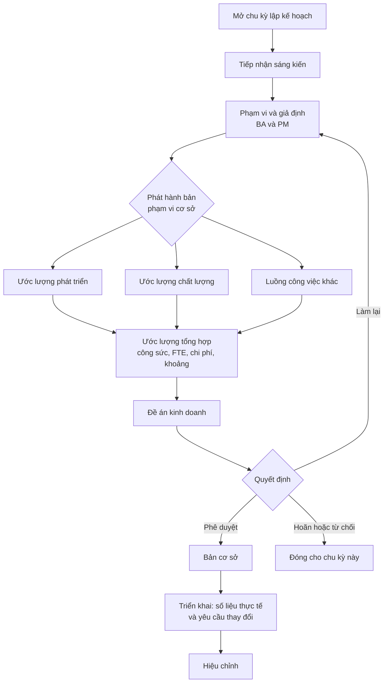
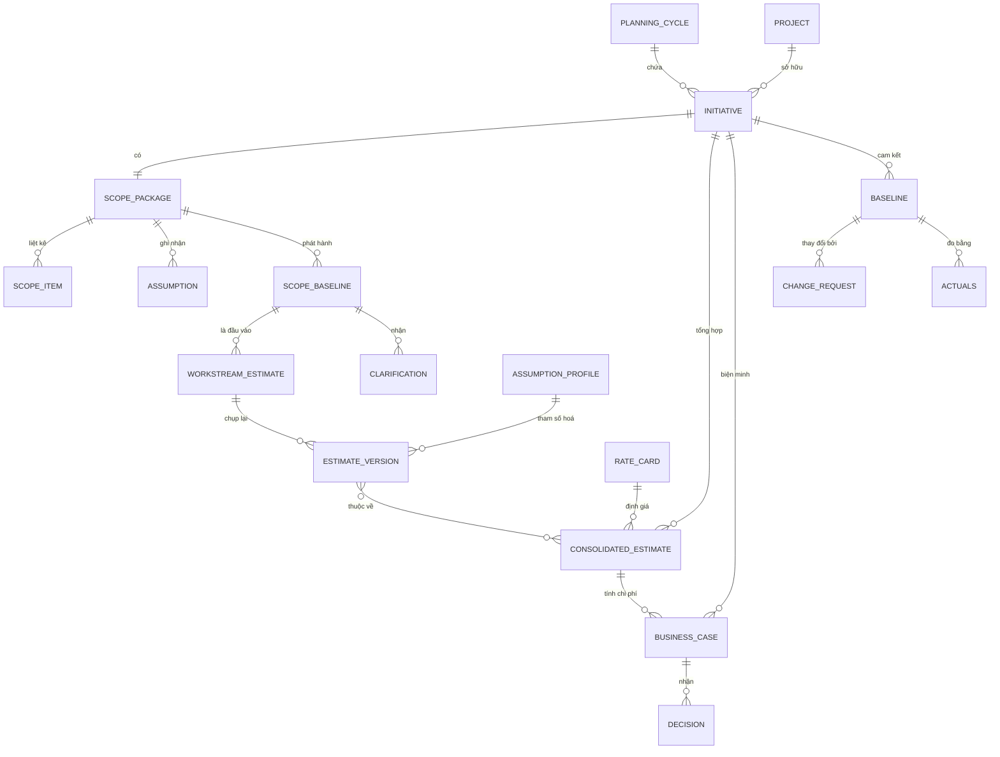
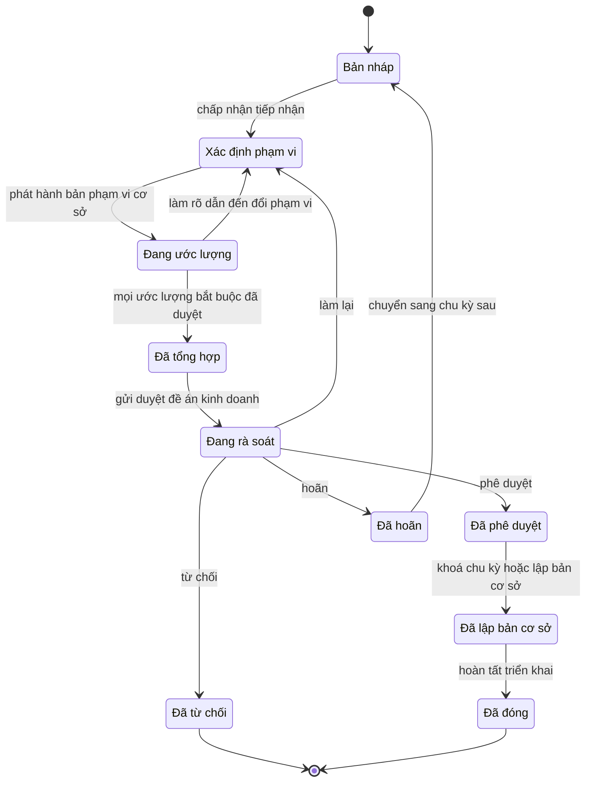

# Nền tảng Vòng đời Ước lượng — Yêu cầu nghiệp vụ và sản phẩm (BRD / PRD)

|                   |                                                                                                                                                                                      |
| ----------------- | ------------------------------------------------------------------------------------------------------------------------------------------------------------------------------------ |
| **Trạng thái**    | Bản nháp 0.1 để rà soát. Chưa có nội dung nào trong tài liệu này được phê duyệt hay cam kết. Bản dịch tiếng Việt chưa được rà soát.                                                  |
| **Ngày**          | 2026-11-19                                                                                                                                                                           |
| **Xây dựng trên** | Ứng dụng SIT Sizing hiện có (thiết kế giải pháp bản sửa đổi 5, engine 1.3.0, ADR-0001 đến ADR-0021)                                                                                  |
| **Product owner** | Chưa chỉ định (câu hỏi mở OQ-01)                                                                                                                                                     |
| **Tên tạm**       | "Nền tảng Vòng đời Ước lượng" (Estimation Lifecycle Platform). Đây là tên giữ chỗ (OQ-02).                                                                                           |
| **Nguồn**         | [brd-prd-estimation-lifecycle.vi.md](brd-prd-estimation-lifecycle.vi.md), dịch từ [bản tiếng Anh](brd-prd-estimation-lifecycle.md). Khi hai bản khác nhau, bản tiếng Anh là bản gốc. |

**Cách đọc tài liệu.** Phần A (mục 1–10) là yêu cầu nghiệp vụ: vì sao, cho ai, và doanh nghiệp cần gì. Phần B (mục 11–26) là yêu cầu sản phẩm: sản phẩm làm gì, theo từng mô-đun. Mã yêu cầu được giữ ổn định để các buổi rà soát, user story và kiểm thử có thể tham chiếu.

**Giả định được đánh dấu.** Bản nháp đầu tiên này được viết trước khi vấn đề nghiệp vụ, phương pháp ước lượng phát triển và mô hình chi phí được xác nhận. Mọi nội dung tác giả phải giả định đều được đánh dấu **[A]**. Hãy coi mỗi **[A]** là một đề xuất để chấp nhận, thay đổi hoặc bác bỏ. Những giả định làm thay đổi nội dung cần xây dựng được tập hợp ở mục 25.

---

# Phần A — Yêu cầu nghiệp vụ

## 1. Tóm tắt điều hành

Hiện nay ứng dụng SIT Sizing trả lời tốt một câu hỏi: một bản phát hành cần bao nhiêu công sức Kỹ thuật Chất lượng (Quality Engineering)? Ứng dụng làm việc đó bằng một mô hình đã hiệu chỉnh, các phiên bản bất biến, một bước phê duyệt và nhật ký kiểm toán. Ứng dụng chưa trả lời câu hỏi mà Lập kế hoạch năm và các kỳ Đánh giá kinh doanh hằng quý (QBR) thực sự đặt ra: **sáng kiến này tốn tổng cộng bao nhiêu, chúng ta chắc chắn đến mức nào, và có nên cấp ngân sách không?**

Câu trả lời đó đang được ghép lại bên ngoài công cụ. Business Analyst và Project Manager mô tả phạm vi và giả định trong các tài liệu. Kỹ thuật Phát triển (Development Engineering) và Kỹ thuật Chất lượng mỗi bên ước lượng theo cách hiểu riêng về các tài liệu đó. Các con số gặp nhau trong một bảng tính, ngay trước hạn lập kế hoạch. **[A]**

Tài liệu này đề xuất mở rộng ứng dụng thành một nơi duy nhất để ước lượng một sáng kiến từ ý tưởng ban đầu đến kết quả bàn giao:

1. **Một chuỗi đầu vào.** BA và PM ghi phạm vi và giả định một lần. Phạm vi đã phát hành đó trở thành đầu vào cho Kỹ thuật Phát triển và Kỹ thuật Chất lượng, nên mọi bộ phận ước lượng cùng một nội dung.
2. **Ước lượng phù hợp với giai đoạn lập kế hoạch.** Ước lượng sơ bộ theo bậc độ lớn cho Lập kế hoạch năm, ước lượng ngân sách kèm đề án kinh doanh cho QBR, ước lượng xác định trước khi triển khai. Mỗi ước lượng có khoảng dao động được nêu rõ, và tinh chỉnh ước lượng trước đó.
3. **Đề án kinh doanh dựa trên số liệu sống.** Công sức, FTE, chi phí và khoảng dao động đi thẳng vào đề án kinh doanh. Khi phạm vi thay đổi, đề án cho thấy nó đã lỗi thời.
4. **Góc nhìn danh mục cho chu kỳ lập kế hoạch.** Mọi sáng kiến trong một chu kỳ, cùng trạng thái, chi phí, khoảng dao động và nhu cầu đối với từng đội, đặt cạnh năng lực và ngân sách.
5. **Vòng lặp học hỏi.** Số liệu thực tế được ghi nhận so với bản cơ sở đã phê duyệt, cho mọi bộ phận, và dùng cho việc hiệu chỉnh.

Mô hình QE hiện có, các con số và các kiểm soát của nó được giữ nguyên. Phần việc mới bao quanh nó bằng một vòng đời và bổ sung các bộ phận ở thượng nguồn và ngang hàng.

## 2. Bối cảnh và hiện trạng

### 2.1 Những gì đã có

| Năng lực            | Hiện trạng                                                                                                     |
| ------------------- | -------------------------------------------------------------------------------------------------------------- |
| Bộ phận được hỗ trợ | Chỉ Kỹ thuật Chất lượng: kiểm thử SIT, nền tảng dữ liệu, sản phẩm AI và hiệu năng                              |
| Cấu trúc            | Dự án → Ước lượng → các Phiên bản đánh số, bất biến; mỗi ước lượng có một bản nháp chỉnh sửa được              |
| Chế độ              | Sơ bộ (tính năng theo kích cỡ áo) và Chi tiết (số lượng tác nhân), có bảng chênh lệch giữa hai chế độ          |
| Quản trị            | Gửi duyệt → phê duyệt hoặc trả lại, phân tách nhiệm vụ, nhật ký kiểm toán đầy đủ                               |
| Hiệu chỉnh          | Hồ sơ giả định (Bản nháp → Đã phát hành → Ngừng sử dụng), số liệu thực tế theo chu kỳ SIT, màn hình chênh lệch |
| Tổng hợp            | Màn hình danh mục các ước lượng QE theo dự án; bản tóm tắt QBR; xuất Excel và CSV                              |
| Vai trò             | Người xem, Người ước lượng, QE Lead (theo dự án); Quản trị (toàn cục)                                          |
| Kênh                | Ứng dụng web (EN/VI) và kênh trợ lý AI (máy chủ MCP, 17 công cụ)                                               |

### 2.2 Những gì còn thiếu cho việc lập kế hoạch

| Khoảng trống                               | Hệ quả                                                                                                  |
| ------------------------------------------ | ------------------------------------------------------------------------------------------------------- |
| Không có chu kỳ lập kế hoạch               | Ước lượng không gắn với "Kế hoạch năm 2027" hay "QBR Q2". Không thể mở, khoá hoặc tổng hợp theo chu kỳ. |
| Không có sáng kiến hay đề án kinh doanh    | Không có bản ghi về lý do đề xuất công việc, giá trị của nó, hay quyết định đã đưa ra.                  |
| Không có chủ sở hữu phạm vi ở thượng nguồn | QE tự nhập tính năng và số lượng. Giả định của BA và PM nằm trong tài liệu riêng và phải nhập lại.      |
| Không có ước lượng Kỹ thuật Phát triển     | Phần công sức lớn nhất được ước lượng ở nơi khác, không có phương pháp chung, phiên bản hay hiệu chỉnh. |
| Không có chi phí                           | Ứng dụng cho ra giờ và FTE. Quyết định lập kế hoạch được đưa ra dựa trên tiền.                          |
| Không có bối cảnh năng lực                 | Nhu cầu không được so với khả năng đáp ứng của các đội trong một quý.                                   |
| Không có độ chín của ước lượng             | Một phỏng đoán ban đầu và một ước lượng chi tiết trông giống nhau. Không có cấp độ tin cậy được nêu rõ. |

## 3. Phát biểu vấn đề và cơ hội

**Vấn đề [A].** Ước lượng cho việc lập kế hoạch do nhiều vai trò tạo ra, trên nhiều công cụ, từ các đầu vào không được chia sẻ. Hệ quả là:

- Các bộ phận ước lượng phạm vi khác nhau mà không biết. Khác biệt lộ ra trong lúc triển khai.
- Giả định không hiển thị với những người phụ thuộc vào chúng, và không được phản biện trước khi con số được sử dụng.
- Ước lượng ban đầu bị coi là cam kết vì độ bất định không được nêu ra.
- Khi phạm vi thay đổi, không ai biết ước lượng nào và đề án kinh doanh nào đã lỗi thời.
- Không có bản ghi toàn tổ chức về ước lượng so với thực tế, nên kế hoạch tiếp theo lại bắt đầu từ ý kiến chủ quan.

**Cơ hội.** Ứng dụng đã có những phần khó của một công cụ ước lượng đáng tin cậy: engine có thể kiểm toán, phiên bản bất biến, phê duyệt, hồ sơ và hiệu chỉnh. Mở rộng cùng mô thức đó lên thượng nguồn (phạm vi và giả định) và sang ngang (Kỹ thuật Phát triển, chi phí) sẽ cho việc lập kế hoạch một nguồn số liệu duy nhất, truy vết được.

## 4. Tầm nhìn, mục tiêu và thước đo thành công

**Tầm nhìn.** Mọi quyết định lập kế hoạch đều dựa trên một ước lượng mà phạm vi, giả định, phương pháp, khoảng dao động và người phê duyệt có thể xem ở cùng một nơi.

| #   | Mục tiêu                          | Thước đo                                                                                           | Mốc hiện tại     | Mục tiêu số                                                |
| --- | --------------------------------- | -------------------------------------------------------------------------------------------------- | ---------------- | ---------------------------------------------------------- |
| O1  | Một phạm vi chung cho mọi bộ phận | Tỷ lệ sáng kiến đã phê duyệt có ước lượng DE và QE tham chiếu cùng một bản phạm vi cơ sở           | Chưa đo          | Cần thống nhất (OQ-03)                                     |
| O2  | Vòng lập kế hoạch nhanh hơn       | Số ngày từ lúc mở chu kỳ đến khi mọi ước lượng được gửi duyệt                                      | Chưa đo          | Cần thống nhất                                             |
| O3  | Độ bất định trung thực            | Tỷ lệ ước lượng được trình bày kèm cấp ước lượng và khoảng dao động                                | 0%               | 100% ước lượng đã gửi duyệt                                |
| O4  | Độ chính xác tốt dần              | Chênh lệch giữa công sức thực tế và bản cơ sở, theo bộ phận và cấp ước lượng                       | Chỉ QE, một phần | Xu hướng cải thiện qua từng chu kỳ; giá trị cần thống nhất |
| O5  | Quyết định truy vết được          | Tỷ lệ sáng kiến được cấp ngân sách có đề án kinh doanh đã phê duyệt gắn với ước lượng đã phê duyệt | Chưa đo          | 100%                                                       |
| O6  | Mức độ áp dụng                    | Tỷ lệ sáng kiến trong một chu kỳ được ước lượng trên nền tảng                                      | 0%               | Cần thống nhất, theo từng bản phát hành                    |

Mốc hiện tại là "chưa đo" vì hiện không được ghi nhận ở đâu. Chu kỳ đầu tiên chạy trên nền tảng sẽ thiết lập các mốc này.

## 5. Phạm vi

### 5.1 Trong phạm vi

- Chu kỳ lập kế hoạch: Lập kế hoạch năm, QBR và yêu cầu thay đổi ngoài chu kỳ.
- Hai loại sáng kiến: **dự án mới**, và **tính năng mới hoặc cải tiến trên dự án hiện có**.
- Một đề án kinh doanh cho mỗi sáng kiến, lấy số liệu từ ước lượng tổng hợp.
- Gói phạm vi và giả định do BA và PM sở hữu, phát hành thành bản cơ sở cho người ước lượng ở hạ nguồn.
- Ước lượng Kỹ thuật Phát triển, có hồ sơ, phiên bản, rà soát và hiệu chỉnh.
- Ước lượng Kỹ thuật Chất lượng: mô hình hiện có, nhận đầu vào từ bản phạm vi cơ sở.
- Các luồng công việc khác (ví dụ BA, quản lý dự án, hỗ trợ UAT, phát hành và môi trường) dưới dạng các dòng đơn giản, cấu hình được.
- Tổng hợp thành công sức, FTE, thời lượng, chi phí và khoảng dao động.
- Rà soát, phê duyệt, lập bản cơ sở và kiểm soát thay đổi.
- Các màn hình danh mục, năng lực và ưu tiên theo chu kỳ.
- Số liệu thực tế và hiệu chỉnh cho mọi bộ phận.
- Báo cáo và xuất dữ liệu cho bộ tài liệu lập kế hoạch.
- Kênh trợ lý AI, mở rộng cho các đối tượng mới.

### 5.2 Ngoài phạm vi

- Đặt lịch nguồn lực theo từng cá nhân, bảng chấm công và nghỉ phép. Năng lực được lập theo đội và vai trò, tính bằng FTE.
- Lập lịch dự án (biểu đồ Gantt, lập kế hoạch sprint, phụ thuộc giữa các nhiệm vụ).
- Kế toán tài chính: đơn đặt hàng, hoá đơn, sổ chi tiêu thực tế. Chi phí ở đây là ước lượng suy ra từ công sức và đơn giá.
- Theo dõi hiện thực hoá lợi ích sau khi go-live, ngoài việc ghi nhận lợi ích kỳ vọng trong đề án kinh doanh (ứng viên về sau).
- Thay thế Jira, Confluence hoặc công cụ quản lý kiểm thử.
- Bất kỳ dữ liệu cá nhân hay khách hàng nào ngoài tên, email công việc và vai trò của người dùng đã đăng nhập.

### 5.3 Phản mục tiêu

Sản phẩm coi như thất bại, kể cả khi chạy được, nếu một trong các điều sau xảy ra:

- Nó làm thay đổi các con số QE hiện có. Tính tương đương của engine và các kiểm thử golden vẫn có hiệu lực.
- Một ước lượng sơ bộ có thể được hiển thị mà không kèm cấp và khoảng dao động, và vì thế bị hiểu là cam kết.
- Nó trở thành việc điền biểu mẫu mà mọi người hoàn thành sau khi đã quyết định con số ở nơi khác.
- Đơn giá hoặc dữ liệu chi phí hiển thị với người không được phép xem.
- Một quyết định có thể được ghi nhận mà không có dấu vết về phạm vi và giả định làm cơ sở.

## 6. Các bên liên quan và vai trò

| Bên liên quan                                      | Mối quan tâm                                                | Vai trò trong sản phẩm                               |
| -------------------------------------------------- | ----------------------------------------------------------- | ---------------------------------------------------- |
| Nhà tài trợ nghiệp vụ                              | Cấp ngân sách cho đúng việc; biết chi phí và rủi ro         | Sở hữu đề án kinh doanh; nhận quyết định             |
| Product owner                                      | Định hình phạm vi cho phù hợp giá trị và ngân sách          | Đề xuất sáng kiến; sắp xếp ưu tiên                   |
| Business Analyst (BA)                              | Mọi người hiểu phạm vi theo cùng một cách                   | Soạn hạng mục phạm vi và giả định nghiệp vụ          |
| Project Manager (PM)                               | Một kế hoạch đứng vững: tiến độ, đội ngũ, phụ thuộc, rủi ro | Soạn giả định triển khai; lắp ráp ước lượng tổng hợp |
| Trưởng nhóm và người ước lượng Kỹ thuật Phát triển | Ước lượng từ phạm vi rõ ràng; có thể phản biện              | Tạo và phê duyệt ước lượng DE                        |
| Trưởng nhóm và người ước lượng Kỹ thuật Chất lượng | Như hiện nay, ít phải nhập lại hơn                          | Tạo và phê duyệt ước lượng QE                        |
| PMO / văn phòng danh mục                           | Điều hành chu kỳ; so sánh các sáng kiến công bằng           | Mở và khoá chu kỳ; sở hữu màn hình danh mục          |
| Tài chính                                          | Đơn giá và hạn mức ngân sách được áp dụng nhất quán         | Sở hữu bảng đơn giá và số liệu ngân sách             |
| Kiến trúc, bảo mật, nền tảng                       | Sớm nhìn thấy công việc lớn hoặc rủi ro                     | Người rà soát và chủ luồng công việc tuỳ chọn        |
| Trưởng chuyên môn kỹ thuật                         | Phương pháp nhất quán, đã hiệu chỉnh                        | Sở hữu hồ sơ giả định DE và QE                       |
| Kiểm toán nội bộ                                   | Bằng chứng về ai quyết định gì, dựa trên cơ sở nào          | Đọc nhật ký kiểm toán                                |

## 7. Quy trình nghiệp vụ

### 7.1 Vòng đời



### 7.2 Cấp ước lượng theo giai đoạn lập kế hoạch

Mỗi giai đoạn đòi hỏi độ sâu khác nhau. Cấp ước lượng nêu rõ độ sâu đó và khoảng dao động đi kèm. Các khoảng dưới đây là giá trị khởi đầu **[A]**; chúng là cấu hình, và các trưởng chuyên môn sẽ thay bằng khoảng đo được khi có số liệu thực tế.

| Giai đoạn                      | Câu hỏi điển hình                                     | Cấp ước lượng                           | Đầu vào kỳ vọng                                                                                                     | Khoảng khởi đầu [A] |
| ------------------------------ | ----------------------------------------------------- | --------------------------------------- | ------------------------------------------------------------------------------------------------------------------- | ------------------- |
| Lập kế hoạch năm               | Nhu cầu năm tới lớn cỡ nào, và có vừa không?          | **Cấp 1 — Sơ bộ theo bậc độ lớn (ROM)** | Phác thảo sáng kiến; hạng mục phạm vi theo kích cỡ áo; giả định chính                                               | −25% đến +75%       |
| QBR                            | Có nên cấp ngân sách ngay, và cam kết gì cho quý này? | **Cấp 2 — Ngân sách**                   | Hạng mục phạm vi có kích cỡ và độ phức tạp; kênh, tích hợp và dữ liệu; đội ngũ và khung thời gian; đề án kinh doanh | −15% đến +30%       |
| Trước triển khai (sau BRD/FSD) | Chính xác chúng ta cam kết bàn giao gì?               | **Cấp 3 — Xác định**                    | Tác nhân và số lượng chi tiết; giả định đã xác nhận; bằng chứng                                                     | −10% đến +15%       |
| Yêu cầu thay đổi               | Thay đổi này thêm hay bớt gì?                         | Cùng cấp với bản cơ sở mà nó thay đổi   | Phạm vi chênh lệch so với một bản cơ sở                                                                             | Theo cấp            |

Điều này khớp với những gì mô hình QE đang làm: Cấp 1 và 2 dùng chế độ sơ bộ; Cấp 3 dùng chế độ chi tiết; bảng chênh lệch sơ bộ–chi tiết hiện có trở thành phép so sánh giữa các cấp.

### 7.3 Hai loại sáng kiến

|                  | Dự án mới                                                   | Tính năng trên dự án hiện có                                                              |
| ---------------- | ----------------------------------------------------------- | ----------------------------------------------------------------------------------------- |
| Bắt đầu từ       | Phạm vi trống, hoặc một mẫu                                 | Bản cơ sở đã phê duyệt gần nhất, hồ sơ và số liệu thực tế của dự án                       |
| Hồ sơ            | Hồ sơ toàn cục đã phát hành                                 | Hồ sơ đã hiệu chỉnh riêng của dự án, nếu có                                               |
| Đề án kinh doanh | Đề án đầy đủ: phương án, chi phí, lợi ích, chi phí vận hành | Đề án gọn hơn **[A]**: chi phí và lợi ích tăng thêm; đề án đầy đủ khi vượt ngưỡng (OQ-08) |
| Lịch sử          | Không có                                                    | Chênh lệch ước lượng–thực tế trước đây hiển thị cạnh ước lượng mới                        |

## 8. Yêu cầu nghiệp vụ

Mức ưu tiên theo MoSCoW: **M** phải có, **S** nên có, **C** có thể có.

| Mã    | Yêu cầu                                                                                                                          | Ưu tiên |
| ----- | -------------------------------------------------------------------------------------------------------------------------------- | ------- |
| BR-01 | Tổ chức có thể định nghĩa các chu kỳ lập kế hoạch (Lập kế hoạch năm, QBR, đột xuất) với ngày mở, ngày nộp và ngày khoá.          | M       |
| BR-02 | Mỗi sáng kiến trong một chu kỳ được ghi nhận một lần, là dự án mới hoặc là tính năng trên dự án hiện có.                         | M       |
| BR-03 | BA và PM ghi phạm vi và giả định một lần, và phát hành chúng thành bản cơ sở có phiên bản.                                       | M       |
| BR-04 | Kỹ thuật Phát triển và Kỹ thuật Chất lượng ước lượng từ một bản phạm vi cơ sở đã phát hành, không phải từ các tài liệu riêng rẽ. | M       |
| BR-05 | Mọi giả định đều có chủ sở hữu, và vai trò ở hạ nguồn có thể đặt câu hỏi về nó trước khi ước lượng dựa trên nó.                  | M       |
| BR-06 | Mọi ước lượng đều nêu cấp, khoảng dao động và các giả định mà nó phụ thuộc.                                                      | M       |
| BR-07 | Ước lượng của mọi bộ phận được tổng hợp thành công sức, FTE, thời lượng và chi phí cho từng sáng kiến.                           | M       |
| BR-08 | Mỗi sáng kiến có một đề án kinh doanh lấy số liệu chi phí từ ước lượng tổng hợp.                                                 | M       |
| BR-09 | Ước lượng và đề án kinh doanh đi qua rà soát và phê duyệt có phân tách nhiệm vụ, và các phiên bản đã phê duyệt là bất biến.      | M       |
| BR-10 | Khi phạm vi thượng nguồn thay đổi, mọi ước lượng và đề án kinh doanh phụ thuộc đều được đánh dấu lỗi thời.                       | M       |
| BR-11 | Văn phòng danh mục có thể xem mọi sáng kiến trong một chu kỳ cùng trạng thái, chi phí, khoảng dao động và quyết định.            | M       |
| BR-12 | Nhu cầu theo đội và quý có thể được so với năng lực.                                                                             | S       |
| BR-13 | Ước lượng đã phê duyệt trở thành bản cơ sở; các thay đổi về sau được ghi nhận là yêu cầu thay đổi đối với nó.                    | M       |
| BR-14 | Công sức thực tế được ghi nhận so với bản cơ sở cho từng bộ phận, và chênh lệch được báo cáo.                                    | S       |
| BR-15 | Phương pháp ước lượng được hiệu chỉnh từ số liệu thực tế, dưới sự kiểm soát của các trưởng chuyên môn.                           | S       |
| BR-16 | Có thể xuất bộ tài liệu lập kế hoạch (tóm tắt chu kỳ, đề án kinh doanh, chi tiết ước lượng).                                     | M       |
| BR-17 | Mọi thao tác tạo, thay đổi, gửi duyệt và quyết định đều được kiểm toán: ai, cái gì, khi nào, qua kênh nào.                       | M       |
| BR-18 | Đơn giá và số liệu ngân sách chỉ hiển thị với các vai trò được uỷ quyền.                                                         | M       |
| BR-19 | Sản phẩm hoạt động bằng tiếng Anh và tiếng Việt.                                                                                 | M       |
| BR-20 | Có thể xếp hạng sáng kiến và so sánh các kịch bản theo giới hạn ngân sách hoặc năng lực.                                         | C       |
| BR-21 | Trợ lý AI có thể giúp soạn nháp phạm vi và ước lượng từ tài liệu yêu cầu, với một người xác nhận mọi thao tác ghi.               | C       |
| BR-22 | Ước lượng QE, hồ sơ, số liệu thực tế và lịch sử kiểm toán hiện có được giữ lại và vẫn dùng được.                                 | M       |

## 9. Quy tắc nghiệp vụ

| Mã     | Quy tắc                                                                                                                                                                              |
| ------ | ------------------------------------------------------------------------------------------------------------------------------------------------------------------------------------ |
| BRL-01 | Một ước lượng hạ nguồn luôn tham chiếu đúng một phiên bản bản phạm vi cơ sở đã phát hành.                                                                                            |
| BRL-02 | Bản phạm vi cơ sở đã phát hành là bất biến. Một thay đổi sẽ tạo phiên bản mới.                                                                                                       |
| BRL-03 | Người gửi duyệt một ước lượng hoặc đề án kinh doanh không thể phê duyệt nó.                                                                                                          |
| BRL-04 | Đề án kinh doanh chỉ có thể gửi duyệt khi mọi ước lượng luồng công việc bắt buộc đã được phê duyệt trên cùng một bản phạm vi cơ sở.                                                  |
| BRL-05 | Một ước lượng không thể được hiển thị, xuất hoặc cộng gộp mà không có cấp và khoảng dao động.                                                                                        |
| BRL-06 | Khi một chu kỳ bị khoá, các sáng kiến trong đó và các phiên bản đã phê duyệt của chúng được đóng băng cho chu kỳ đó. Công việc về sau là yêu cầu thay đổi hoặc thuộc chu kỳ kế tiếp. |
| BRL-07 | Khoảng dao động tổng hợp được suy ra từ khoảng của các luồng công việc theo một quy tắc có tài liệu (FR-CON-04), không nhập tay.                                                     |
| BRL-08 | Chi phí luôn được tính từ công sức và bảng đơn giá đã phát hành; không bao giờ nhập tay dưới dạng tổng. Chi phí cố định ngoài nhân công là các dòng riêng, có nhãn.                  |
| BRL-09 | Thay đổi một phương pháp ước lượng (công thức hoặc giá trị mặc định) tuân theo chính sách thay đổi engine hiện có: ADR, phê duyệt của con người, đóng dấu phiên bản.                 |
| BRL-10 | Trợ lý AI không bao giờ phê duyệt, trả lại, quyết định hay phát hành. Nó soạn nháp; con người xác nhận.                                                                              |

## 10. Lợi ích, giả định, ràng buộc và phụ thuộc

**Lợi ích kỳ vọng.** Ít phải nhập lại và đối chiếu trong mỗi vòng lập kế hoạch; ít bất ngờ khi triển khai do lệch phạm vi; quyết định được đưa ra với độ bất định nêu rõ; bản ghi độ chính xác tích luỹ dần giúp cải thiện kế hoạch tiếp theo. Các lợi ích này chưa được lượng hoá (OQ-03).

**Giả định [A].**

- Việc lập kế hoạch chạy theo chu kỳ năm với các kỳ rà soát hằng quý, và cả hai dùng chung một danh sách sáng kiến.
- BA và PM là hai vai trò riêng; với sáng kiến nhỏ một người có thể giữ cả hai.
- Kỹ thuật Phát triển sẵn sàng áp dụng một phương pháp chung, có hiệu chỉnh. Đây là rủi ro áp dụng lớn nhất.
- Tài chính có thể cung cấp đơn giá bình quân theo nhóm vai trò, cấp bậc và địa điểm. Không cần và không muốn lương cá nhân.
- Hạ tầng lưu trữ, nhà cung cấp định danh (Keycloak) và ngăn xếp công nghệ hiện có được giữ nguyên.

**Ràng buộc.**

- Các con số của engine QE không được thay đổi (kiểm thử tương đương và golden).
- Không có dữ liệu cá nhân hay khách hàng; dùng dữ liệu tổng hợp trong mọi ví dụ, kiểm thử và dữ liệu mồi.
- Thay đổi về vai trò và quyền, cấu hình định danh, migration và engine cần người được chỉ định rà soát.
- Tiếng Anh và tiếng Việt cho mọi chuỗi hiển thị với người dùng.

**Phụ thuộc.** Một product owner được chỉ định; một chủ sở hữu phương pháp Kỹ thuật Phát triển; một đầu mối Tài chính cho bảng đơn giá; lịch lập kế hoạch từ văn phòng danh mục; quyết định về tích hợp (mục 21).

---

# Phần B — Yêu cầu sản phẩm

## 11. Nguyên tắc sản phẩm

1. **Nhập một lần, dùng lại ở hạ nguồn.** Phạm vi và giả định do vai trò sở hữu chúng nhập, và chảy đến mọi người khác.
2. **Độ bất định là một phần của con số.** Cấp và khoảng dao động đi cùng mọi số liệu, trên màn hình và trong bản xuất.
3. **Lịch sử bất biến.** Bản cơ sở và phiên bản đã phê duyệt không bao giờ thay đổi; một thay đổi tạo ra phiên bản mới.
4. **Lỗi thời thì phải thấy được.** Bất cứ thứ gì tính từ đầu vào đã bị thay thế đều nói rõ điều đó, và cho phép làm mới thành bản nháp mới trong một bước.
5. **Cùng một bộ kiểm soát ở mọi nơi.** Mọi bộ phận có mô thức mà QE đang có: bản nháp, khoá, phiên bản, gửi duyệt, phê duyệt, kiểm toán, hồ sơ, số liệu thực tế.
6. **Engine thuần, có phiên bản.** Phép tính của mỗi bộ phận là một gói thuần với kiểm thử golden và dấu phiên bản. Số liệu của máy chủ là số liệu chính thức.
7. **Nhẹ theo mặc định.** Một ước lượng Cấp 1 cho Lập kế hoạch năm chỉ nên mất vài phút cho mỗi sáng kiến. Chỉ thêm độ sâu khi giai đoạn yêu cầu.

## 12. Chân dung người dùng và công việc chính

| Chân dung                               | Công việc chính trong sản phẩm                                                                                                                        |
| --------------------------------------- | ----------------------------------------------------------------------------------------------------------------------------------------------------- |
| **Nhà tài trợ** (chủ nghiệp vụ)         | Đọc đề án kinh doanh; xem chi phí, khoảng dao động và rủi ro; quyết định hoặc tán thành                                                               |
| **Product owner**                       | Tạo sáng kiến; định hình phạm vi; so sánh phương án; sắp xếp ưu tiên                                                                                  |
| **Business Analyst**                    | Liệt kê hạng mục phạm vi; định cỡ; ghi giả định nghiệp vụ; trả lời yêu cầu làm rõ; cùng PM phát hành bản phạm vi cơ sở                                |
| **Project Manager**                     | Ghi giả định triển khai (khung thời gian, đội ngũ, phụ thuộc, rủi ro); yêu cầu ước lượng; lắp ráp và gửi duyệt ước lượng tổng hợp và đề án kinh doanh |
| **Người ước lượng DE / trưởng nhóm DE** | Ước lượng công sức phát triển từ bản phạm vi cơ sở; nêu yêu cầu làm rõ; rà soát và phê duyệt                                                          |
| **Người ước lượng QE / QE Lead**        | Như hiện nay, bắt đầu từ bản phạm vi cơ sở; rà soát và phê duyệt                                                                                      |
| **Quản lý danh mục (PMO)**              | Mở, điều hành và khoá chu kỳ; đôn đốc trạng thái; so sánh và xếp hạng sáng kiến; xuất bộ tài liệu                                                     |
| **Đối tác Tài chính**                   | Duy trì bảng đơn giá và hạn mức ngân sách; rà soát chi phí                                                                                            |
| **Trưởng chuyên môn**                   | Sở hữu hồ sơ; rà soát độ chính xác; hiệu chỉnh                                                                                                        |
| **Người xem / kiểm toán viên**          | Đọc sáng kiến, quyết định và nhật ký kiểm toán mà họ được phép xem                                                                                    |
| **Quản trị**                            | Người dùng, dữ liệu tham chiếu, cấu hình                                                                                                              |

## 13. Mô hình miền

### 13.1 Khái niệm

| Khái niệm                           | Ý nghĩa                                                                                                  | Quan hệ với hiện tại                                    |
| ----------------------------------- | -------------------------------------------------------------------------------------------------------- | ------------------------------------------------------- |
| **Danh mục / đơn vị kinh doanh**    | Nhóm các dự án để tổng hợp và phân quyền                                                                 | Mới (nhẹ)                                               |
| **Chu kỳ lập kế hoạch**             | Một vòng lập kế hoạch có ngày tháng: Lập kế hoạch năm 2027, QBR 2027-Q2, đột xuất                        | Mới                                                     |
| **Dự án**                           | Một sản phẩm hoặc chương trình sở hữu công việc                                                          | Đã có                                                   |
| **Sáng kiến**                       | Một phần việc được đề xuất trong một chu kỳ: dự án mới, hoặc tính năng trên dự án hiện có                | Mới                                                     |
| **Gói phạm vi**                     | Bản nháp làm việc của BA/PM: hạng mục phạm vi, giả định, tham số triển khai, rủi ro                      | Mới                                                     |
| **Hạng mục phạm vi**                | Một tính năng hoặc năng lực, có loại, kích cỡ, độ phức tạp và thuộc tính                                 | Tổng quát hoá dòng tính năng của phạm vi sơ bộ hiện nay |
| **Giả định (nghiệp vụ/triển khai)** | Một điều kiện được nêu ra mà ước lượng phụ thuộc, có chủ sở hữu, độ tin cậy và trạng thái                | Mới. Khác với _giả định mô hình_ trong hồ sơ            |
| **Bản phạm vi cơ sở**               | Một bản phát hành bất biến, đánh số của gói phạm vi                                                      | Mới                                                     |
| **Yêu cầu làm rõ**                  | Một câu hỏi hoặc phản biện đối với một hạng mục phạm vi hay giả định                                     | Mới                                                     |
| **Ước lượng luồng công việc**       | Ước lượng của một bộ phận trên một bản phạm vi cơ sở: DE, QE, hoặc luồng khác                            | Ước lượng hiện nay trở thành ước lượng luồng QE         |
| **Phiên bản ước lượng**             | Ảnh chụp bất biến đầu vào và kết quả của một ước lượng luồng công việc                                   | Đã có                                                   |
| **Hồ sơ giả định**                  | Bộ tham số mô hình đã phát hành cho một bộ phận                                                          | Đã có cho QE; mở rộng cho DE và các luồng khác          |
| **Bảng đơn giá**                    | Đơn giá chi phí đã phát hành theo nhóm vai trò, cấp bậc, địa điểm và năm                                 | Mới                                                     |
| **Ước lượng tổng hợp**              | Tổng hợp các ước lượng luồng công việc đã phê duyệt: công sức, FTE, thời lượng, chi phí, khoảng dao động | Mới                                                     |
| **Đề án kinh doanh**                | Vấn đề, phương án, lợi ích, chi phí (từ ước lượng tổng hợp), rủi ro, khuyến nghị                         | Mới                                                     |
| **Quyết định**                      | Phê duyệt, làm lại, hoãn hoặc từ chối, kèm ghi chú và người quyết định                                   | Mới                                                     |
| **Bản cơ sở**                       | Ước lượng tổng hợp và đề án kinh doanh đã phê duyệt, dùng làm mốc đo việc triển khai                     | Mới                                                     |
| **Yêu cầu thay đổi**                | Một thay đổi được đề xuất đối với bản cơ sở, có phạm vi chênh lệch và ước lượng chênh lệch               | Mới                                                     |
| **Kế hoạch năng lực**               | FTE khả dụng theo đội, nhóm vai trò và quý                                                               | Mới                                                     |
| **Số liệu thực tế**                 | Công sức và kết quả đo được so với một bản cơ sở                                                         | Đã có cho QE; mở rộng                                   |

### 13.2 Quan hệ



Tên thực thể trong sơ đồ giữ bằng tiếng Anh để khớp với mô hình dữ liệu; nghĩa tiếng Việt có trong bảng 13.1.

### 13.3 Hai loại giả định

Từ "giả định" đã có một nghĩa trong ứng dụng. Tài liệu này tách hai loại:

|                  | Giả định nghiệp vụ và triển khai                                                         | Giả định mô hình                                          |
| ---------------- | ---------------------------------------------------------------------------------------- | --------------------------------------------------------- |
| Ví dụ (tổng hợp) | "Môi trường sandbox của core banking sẵn sàng từ tuần 3." "Chỉ hai kênh: web và mobile." | "Số phút để thiết kế một ca kiểm thử API mức trung bình." |
| Chủ sở hữu       | BA hoặc PM, theo từng sáng kiến                                                          | Trưởng chuyên môn, theo từng hồ sơ                        |
| Nằm ở            | Gói phạm vi và bản cơ sở                                                                 | Hồ sơ giả định                                            |
| Thay đổi khi     | Thực tế của sáng kiến thay đổi                                                           | Việc hiệu chỉnh cho thấy giá trị tốt hơn                  |
| Tác động         | Định hình phạm vi và đầu vào; bị gắn cờ rủi ro khi chưa xác nhận                         | Thay đổi phép tính                                        |

## 14. Vòng đời và trạng thái

### 14.1 Sáng kiến



### 14.2 Các đối tượng khác

| Đối tượng                           | Trạng thái                                                                 | Ghi chú                                                                                                      |
| ----------------------------------- | -------------------------------------------------------------------------- | ------------------------------------------------------------------------------------------------------------ |
| Chu kỳ lập kế hoạch                 | Bản nháp → Mở → Đang ước lượng → Đang rà soát → Đã khoá → Đã đóng          | Ngày tháng kích hoạt nhắc nhở, không tự chuyển trạng thái **[A]**; quản lý danh mục chuyển trạng thái chu kỳ |
| Gói phạm vi / bản cơ sở             | Bản nháp → Đã phát hành (v1, v2, …) → Đã thay thế                          | Khoá chỉnh sửa và tự lưu như trình soạn hiện nay                                                             |
| Yêu cầu làm rõ                      | Mở → Đã trả lời → Đã chấp nhận, hoặc → Nêu thay đổi phạm vi                | Một yêu cầu làm rõ _chặn_ còn mở sẽ ngăn gửi duyệt ước lượng phụ thuộc                                       |
| Phiên bản ước lượng luồng công việc | Bản nháp → Đã lưu → Đã gửi duyệt → Đã phê duyệt / Đã trả lại → Đã thay thế | Không đổi so với hiện nay (ADR-0007)                                                                         |
| Đề án kinh doanh                    | Bản nháp → Đã gửi duyệt → Đã phê duyệt / Làm lại / Đã hoãn / Đã từ chối    | Một bản ghi quyết định cho mỗi lần gửi duyệt                                                                 |
| Yêu cầu thay đổi                    | Bản nháp → Đang ước lượng → Đã gửi duyệt → Đã phê duyệt / Đã từ chối       | Khi phê duyệt: tạo phiên bản bản cơ sở kế tiếp                                                               |
| Hồ sơ, bảng đơn giá                 | Bản nháp → Đã phát hành → Ngừng sử dụng                                    | Mô thức không đổi (ADR-0008)                                                                                 |

### 14.3 Tính lỗi thời

Một ước lượng luồng công việc, ước lượng tổng hợp hoặc đề án kinh doanh là **lỗi thời** khi đối tượng dùng để tính ra nó có phiên bản phát hành mới hơn: bản phạm vi cơ sở, phiên bản engine của hồ sơ, hoặc bảng đơn giá. Một đối tượng lỗi thời:

- hiển thị một dải thông báo nêu cái gì đã thay đổi và tóm tắt khác biệt;
- không thể được gửi duyệt hay phê duyệt mới;
- có nút "Làm mới thành bản nháp mới", sao chép nó sang đầu vào mới và không bao giờ sửa phiên bản cũ.

Điều này tổng quát hoá cờ phiên bản engine và "tính lại thành bản nháp mới" hiện có (ADR-0013).

## 15. Yêu cầu chức năng

Mức ưu tiên: **M** phải có, **S** nên có, **C** có thể có. "PH" là bản phát hành đề xuất ở mục 23.

### 15.1 Chu kỳ lập kế hoạch (CYC)

| Mã        | Yêu cầu                                                                                                                                                          | ƯT  | PH  |
| --------- | ---------------------------------------------------------------------------------------------------------------------------------------------------------------- | --- | --- |
| FR-CYC-01 | Quản lý danh mục tạo một chu kỳ với loại (Năm, QBR, Đột xuất), kỳ, cấp ước lượng mặc định, và các ngày mở, nộp và khoá.                                          | M   | 4   |
| FR-CYC-02 | Chu kỳ có các trạng thái (14.2); chỉ quản lý danh mục hoặc Quản trị thay đổi chúng, kèm ghi chú.                                                                 | M   | 4   |
| FR-CYC-03 | Bảng điều khiển chu kỳ liệt kê các sáng kiến với trạng thái, chủ sở hữu, tình trạng ước lượng theo luồng công việc, cấp, chi phí, khoảng dao động và quyết định. | M   | 4   |
| FR-CYC-04 | Khoá một chu kỳ sẽ đóng băng các sáng kiến của nó và ghi lại, cho từng sáng kiến, các phiên bản đang hiện hành.                                                  | M   | 5   |
| FR-CYC-05 | Một sáng kiến có thể được chuyển từ chu kỳ này sang chu kỳ kế tiếp (ví dụ từ Kế hoạch năm sang QBR), giữ lịch sử và bắt đầu từ bản cơ sở gần nhất.               | M   | 5   |
| FR-CYC-06 | Chu kỳ có thể chứa một hạn mức ngân sách và, tuỳ chọn, giới hạn năng lực theo đội, dùng trong các màn hình danh mục.                                             | S   | 6   |
| FR-CYC-07 | Nhắc nhở được gửi trước ngày nộp và ngày khoá đến chủ sở hữu của phần việc chưa hoàn tất.                                                                        | S   | 5   |

### 15.2 Sáng kiến và tiếp nhận (INI)

| Mã        | Yêu cầu                                                                                                                                                                                                    | ƯT  | PH  |
| --------- | ---------------------------------------------------------------------------------------------------------------------------------------------------------------------------------------------------------- | --- | --- |
| FR-INI-01 | Product owner, BA hoặc PM tạo một sáng kiến trong một chu kỳ với: tiêu đề, loại (dự án mới / tính năng trên dự án hiện có), dự án, nhà tài trợ, tóm tắt, kết quả kỳ vọng, khung thời gian mục tiêu và thẻ. | M   | 4   |
| FR-INI-02 | Với "tính năng trên dự án hiện có", sáng kiến liên kết đến dự án đó và hiển thị bản cơ sở gần nhất, hồ sơ và lịch sử ước lượng–thực tế của nó.                                                             | M   | 4   |
| FR-INI-03 | Với dự án mới, việc tạo sáng kiến có thể tạo luôn dự án và các thành viên đầu tiên trong một bước (Quản trị hoặc quản lý danh mục).                                                                        | S   | 4   |
| FR-INI-04 | Sáng kiến có một chủ sở hữu (mặc định là PM) và một đội: ai giữ vai trò nào cho sáng kiến này.                                                                                                             | M   | 4   |
| FR-INI-05 | Trang sáng kiến hiển thị một dòng thời gian cho mọi việc đã diễn ra: phát hành, ước lượng, làm rõ, quyết định.                                                                                             | S   | 5   |
| FR-INI-06 | Có thể tạo sáng kiến từ một mẫu (điền sẵn hạng mục phạm vi, giả định và luồng công việc) hoặc bằng cách sao chép một sáng kiến khác.                                                                       | S   | 5   |
| FR-INI-07 | Có thể nhập hàng loạt sáng kiến từ một mẫu bảng tính khi bắt đầu chu kỳ.                                                                                                                                   | C   | 6   |

### 15.3 Gói phạm vi và giả định — BA và PM (SCP)

| Mã        | Yêu cầu                                                                                                                                                                                                                                                                                                         | ƯT  | PH  |
| --------- | --------------------------------------------------------------------------------------------------------------------------------------------------------------------------------------------------------------------------------------------------------------------------------------------------------------- | --- | --- |
| FR-SCP-01 | BA liệt kê các hạng mục phạm vi. Mỗi hạng mục có: tên, mô tả, loại (ứng dụng, dữ liệu, AI, tích hợp, hạ tầng, khác), kích cỡ áo theo hồ sơ áp dụng, độ phức tạp, mức ưu tiên (phải/nên/có thể), và thuộc hay không thuộc giai đoạn này.                                                                         | M   | 4   |
| FR-SCP-02 | Hạng mục phạm vi có thể mang các thuộc tính dùng ở hạ nguồn: kênh, số tích hợp, nguồn dữ liệu, cần di trú dữ liệu, nhạy cảm về hiệu năng, tác động pháp lý, mới hay thay đổi. Tất cả là tuỳ chọn ở Cấp 1.                                                                                                       | M   | 4   |
| FR-SCP-03 | Ở Cấp 3, hạng mục phạm vi có thể mang số lượng chi tiết (màn hình, API, quy tắc, báo cáo, giao diện), do BA nhập hoặc để lại cho người ước lượng hạ nguồn.                                                                                                                                                      | S   | 5   |
| FR-SCP-04 | BA và PM ghi các giả định. Mỗi giả định có: phát biểu, nhóm (phạm vi, nghiệp vụ, kỹ thuật, triển khai, môi trường, nhân sự, nhà cung cấp, pháp lý), chủ sở hữu, độ tin cậy (thấp/trung bình/cao), trạng thái (chưa xác nhận, đã xác nhận, không còn đúng), tác động nếu sai, và các hạng mục phạm vi liên quan. | M   | 4   |
| FR-SCP-05 | PM ghi tham số triển khai: ngày bắt đầu và kết thúc mục tiêu, các khung phát hành, cơ cấu đội và tỷ lệ địa điểm, lịch làm việc, phụ thuộc vào sáng kiến hoặc đội khác, và ràng buộc.                                                                                                                            | M   | 4   |
| FR-SCP-06 | PM ghi rủi ro với khả năng xảy ra, tác động và mức dự phòng đề xuất.                                                                                                                                                                                                                                            | S   | 5   |
| FR-SCP-07 | BA và PM có thể nhập ước lượng cho luồng công việc của chính họ (phân tích, quản lý dự án) và, tuỳ chọn, một kích cỡ tổng thể mang tính chỉ báo ở Cấp 1. Kích cỡ chỉ báo được gắn nhãn rõ và được thay thế, không trộn lẫn, khi có ước lượng DE và QE. **[A]**                                                  | M   | 4   |
| FR-SCP-08 | Gói tự lưu, dùng khoá chỉnh sửa, và kiểm tra độ đầy đủ theo cấp của chu kỳ trước khi phát hành.                                                                                                                                                                                                                 | M   | 4   |
| FR-SCP-09 | Việc phát hành tạo một bản phạm vi cơ sở bất biến, đánh số. Phát hành cần cả BA và PM (hoặc một người giữ cả hai vai trò, và được ghi nhận như vậy). **[A]**                                                                                                                                                    | M   | 4   |
| FR-SCP-10 | Có thể so sánh hai bản cơ sở bất kỳ: hạng mục thêm, bớt và thay đổi; giả định thay đổi.                                                                                                                                                                                                                         | M   | 4   |
| FR-SCP-11 | Có thể liên kết tài liệu (URL và tiêu đề) làm nguồn. Tệp không được lưu trong nền tảng. **[A]**                                                                                                                                                                                                                 | S   | 4   |

### 15.4 Bàn giao và làm rõ (HND)

| Mã        | Yêu cầu                                                                                                                                                                                 | ƯT  | PH  |
| --------- | --------------------------------------------------------------------------------------------------------------------------------------------------------------------------------------- | --- | --- |
| FR-HND-01 | Phát hành một bản cơ sở sẽ tạo hoặc cập nhật yêu cầu ước lượng cho từng luồng công việc bắt buộc và thông báo cho trưởng nhóm của luồng đó.                                             | M   | 4   |
| FR-HND-02 | Mỗi ước lượng luồng công việc mở ra với đầu vào điền sẵn từ bản cơ sở (15.5, 15.6), và hiển thị hạng mục phạm vi và giả định ở dạng chỉ đọc bên cạnh đầu vào riêng của người ước lượng. | M   | 4   |
| FR-HND-03 | Người ước lượng hạ nguồn có thể nêu yêu cầu làm rõ cho bất kỳ hạng mục phạm vi hay giả định nào, đánh dấu chặn hoặc không chặn.                                                         | M   | 4   |
| FR-HND-04 | Chủ sở hữu trả lời; người nêu chấp nhận câu trả lời hoặc hỏi lại. Câu trả lời làm đổi phạm vi dẫn đến một bản cơ sở mới, không phải sửa trực tiếp.                                      | M   | 4   |
| FR-HND-05 | Người ước lượng hạ nguồn có thể thêm _giả định của người ước lượng_ vào ước lượng của mình. Các giả định này hiển thị với BA và PM, và được đưa lên màn hình tổng hợp.                  | M   | 4   |
| FR-HND-06 | Bảng bàn giao hiển thị, theo từng sáng kiến, trạng thái của mỗi luồng công việc: chưa bắt đầu, đang làm, bị chặn bởi yêu cầu làm rõ, đã gửi duyệt, đã phê duyệt, lỗi thời.              | M   | 4   |
| FR-HND-07 | Khi một bản cơ sở mới được phát hành, mỗi ước lượng phụ thuộc được đánh dấu lỗi thời kèm danh sách hạng mục thay đổi có ảnh hưởng đến nó.                                               | M   | 4   |

### 15.5 Ước lượng Kỹ thuật Phát triển (DE)

Phương pháp dưới đây là một đề xuất **[A]**. Kỹ thuật Phát triển phải sở hữu và xác nhận nó (OQ-04). Phương pháp chủ ý phản chiếu mô thức QE để hai bộ phận dùng chung trình soạn, phiên bản, hồ sơ và hiệu chỉnh.

| Mã       | Yêu cầu                                                                                                                                                                                                                                                                                                               | ƯT  | PH  |
| -------- | --------------------------------------------------------------------------------------------------------------------------------------------------------------------------------------------------------------------------------------------------------------------------------------------------------------------- | --- | --- |
| FR-DE-01 | Ước lượng DE có hai chế độ. **Sơ bộ**: công sức cho mỗi hạng mục phạm vi tính từ kích cỡ, loại và độ phức tạp, theo hồ sơ DE. **Chi tiết**: công sức tính từ số lượng thành phần của mỗi hạng mục phạm vi (ví dụ màn hình, API, tích hợp, đối tượng dữ liệu, batch job, di trú, cấu hình), mỗi loại theo độ phức tạp. | M   | 5   |
| FR-DE-02 | Hồ sơ chứa số giờ cơ sở theo kích cỡ và theo loại thành phần và độ phức tạp, cùng tỷ lệ phần trăm cộng thêm cho các hoạt động: thiết kế kỹ thuật, review mã, kiểm thử đơn vị và thành phần, sửa lỗi trong SIT và UAT, môi trường và phát hành, thời gian của tech lead.                                               | M   | 5   |
| FR-DE-03 | Người ước lượng có thể ghi đè một giá trị đã tính cho từng hạng mục phạm vi, bắt buộc nêu lý do. Các giá trị ghi đè được liệt kê trong kết quả và khi rà soát.                                                                                                                                                        | M   | 5   |
| FR-DE-04 | Người ước lượng có thể nhập giá trị ba điểm (lạc quan, khả dĩ nhất, bi quan) cho một hạng mục thay cho mô hình; engine tính giá trị kỳ vọng và độ phân tán.                                                                                                                                                           | S   | 5   |
| FR-DE-05 | Kết quả hiển thị: giờ theo hạng mục phạm vi, theo hoạt động và theo nhóm vai trò; FTE cho khung thời gian; kiểm tra thời lượng so với khung của PM; cấp và khoảng dao động; độ nhạy với các tác nhân lớn nhất.                                                                                                        | M   | 5   |
| FR-DE-06 | Các hệ số điều chỉnh áp dụng cho toàn ước lượng: mã nguồn mới hay hiện có, mức độ quen thuộc công nghệ, tái sử dụng, phân bố đội. Mỗi hệ số là một dòng hồ sơ có giá trị mặc định và trạng thái hiệu chỉnh.                                                                                                           | S   | 5   |
| FR-DE-07 | Ước lượng DE dùng cùng luồng bản nháp, khoá, tự lưu, phiên bản, so sánh, gửi duyệt, phê duyệt và trả lại như QE. Vai trò phê duyệt: trưởng nhóm DE.                                                                                                                                                                   | M   | 5   |
| FR-DE-08 | Phép tính DE nằm trong gói engine thuần, có phiên bản riêng với kiểm thử golden; máy chủ tính lại và lưu kết quả chính thức.                                                                                                                                                                                          | M   | 5   |
| FR-DE-09 | Hồ sơ DE ở mức toàn cục hoặc theo dự án, Bản nháp → Đã phát hành → Ngừng sử dụng, có nguồn và ngày hiệu chỉnh cho từng dòng.                                                                                                                                                                                          | M   | 5   |
| FR-DE-10 | Các phân ngành (ví dụ front end, back end, dữ liệu, nền tảng) có thể được ước lượng thành các phần riêng của một ước lượng DE bởi những người ước lượng khác nhau.                                                                                                                                                    | C   | 6   |

### 15.6 Ước lượng Kỹ thuật Chất lượng (QE)

| Mã       | Yêu cầu                                                                                                                                                                                                                | ƯT  | PH  |
| -------- | ---------------------------------------------------------------------------------------------------------------------------------------------------------------------------------------------------------------------- | --- | --- |
| FR-QE-01 | Mô hình, trình soạn, kết quả, hồ sơ và số liệu thực tế QE hiện có được giữ nguyên. Không có công thức hay giá trị mặc định nào thay đổi trong phần việc này.                                                           | M   | 4   |
| FR-QE-02 | Ước lượng QE tạo từ một bản phạm vi cơ sở có các tính năng phạm vi sơ bộ điền sẵn từ hạng mục phạm vi (tên, loại, kích cỡ, độ phức tạp, cờ hiệu năng), và khung thời gian cùng đội ngũ điền sẵn từ tham số triển khai. | M   | 4   |
| FR-QE-03 | Giá trị điền sẵn được đánh dấu là kế thừa. Người ước lượng QE có thể điều chỉnh; các điều chỉnh hiển thị dưới dạng khác biệt so với bản cơ sở, kèm lý do.                                                              | M   | 4   |
| FR-QE-04 | Khi bản cơ sở có số lượng chi tiết, chúng điền sẵn chế độ chi tiết theo cùng cách.                                                                                                                                     | S   | 5   |
| FR-QE-05 | Bằng chứng phát triển mà mô hình QE đã dùng (bằng chứng shift-left) có thể lấy từ ước lượng DE của cùng bản cơ sở khi có, thay vì nhập tay.                                                                            | C   | 6   |
| FR-QE-06 | Vẫn có thể tạo ước lượng QE không gắn với sáng kiến ("độc lập"), như hiện nay.                                                                                                                                         | M   | 4   |

### 15.7 Các luồng công việc khác và tổng hợp (CON)

| Mã        | Yêu cầu                                                                                                                                                                                                                                                                     | ƯT  | PH  |
| --------- | --------------------------------------------------------------------------------------------------------------------------------------------------------------------------------------------------------------------------------------------------------------------------- | --- | --- |
| FR-CON-01 | Quản trị cấu hình những luồng công việc nào tồn tại và luồng nào bắt buộc theo loại chu kỳ và loại sáng kiến. Bộ mặc định **[A]**: Phân tích nghiệp vụ, Quản lý dự án, Kỹ thuật Phát triển, Kỹ thuật Chất lượng, Hỗ trợ UAT, Phát hành và môi trường, Kiến trúc và bảo mật. | M   | 5   |
| FR-CON-02 | Một luồng công việc đơn giản được ước lượng theo tỷ lệ phần trăm của các luồng khác, theo công sức cố định, hoặc theo vai trò × thời lượng. Phương pháp và đầu vào của nó được lưu và đánh phiên bản như mọi ước lượng.                                                     | M   | 5   |
| FR-CON-03 | Ước lượng tổng hợp cộng phiên bản đã phê duyệt hiện hành của mỗi luồng công việc: giờ và ngày công theo luồng, nhóm vai trò và quý; FTE đỉnh và trung bình; thời lượng; chi phí; dự phòng.                                                                                  | M   | 5   |
| FR-CON-04 | Khoảng dao động tổng hợp được tính từ khoảng của các luồng theo một quy tắc có tài liệu. Đề xuất **[A]**: mặc định cộng các giá trị thấp và cộng các giá trị cao (thận trọng), kèm một cách kết hợp thống kê làm góc nhìn thay thế.                                         | M   | 5   |
| FR-CON-05 | Dự phòng phải tường minh: một tỷ lệ phần trăm theo cấp, hoặc suy ra từ danh sách rủi ro, hiển thị thành dòng riêng và không bao giờ ẩn trong số liệu của luồng công việc.                                                                                                   | M   | 5   |
| FR-CON-06 | Màn hình tổng hợp liệt kê mọi giả định chưa xác nhận và mọi giá trị ghi đè, làm phần "con số này phụ thuộc vào đâu".                                                                                                                                                        | M   | 5   |
| FR-CON-07 | Công sức được phân kỳ theo quý trong khung triển khai, dùng một phân bổ mặc định cho mỗi luồng mà PM có thể điều chỉnh.                                                                                                                                                     | S   | 6   |
| FR-CON-08 | Có thể so sánh hai ước lượng tổng hợp bất kỳ của một sáng kiến: theo cấp, theo bản cơ sở, hoặc trước và sau một yêu cầu thay đổi.                                                                                                                                           | M   | 5   |

### 15.8 Chi phí và bảng đơn giá (CST)

| Mã        | Yêu cầu                                                                                                                                                          | ƯT  | PH  |
| --------- | ---------------------------------------------------------------------------------------------------------------------------------------------------------------- | --- | --- |
| FR-CST-01 | Tài chính duy trì bảng đơn giá: một đơn giá theo nhóm vai trò, cấp bậc và địa điểm, theo năm, bằng một đồng tiền cơ sở. Bản nháp → Đã phát hành → Ngừng sử dụng. | M   | 5   |
| FR-CST-02 | Chi phí = công sức theo nhóm vai trò và địa điểm × đơn giá đã phát hành. Tỷ lệ địa điểm và cấp bậc của đội lấy từ tham số triển khai hoặc một tỷ lệ mặc định.    | M   | 5   |
| FR-CST-03 | Chi phí ngoài nhân công (giấy phép, hạ tầng, giá cố định của nhà cung cấp) được nhập thành các dòng có nhãn, có chủ sở hữu và ghi chú.                           | S   | 5   |
| FR-CST-04 | Đơn giá chỉ hiển thị với Tài chính, quản lý danh mục và Quản trị. Các vai trò khác chỉ thấy tổng chi phí khi vai trò cho phép (mục 16).                          | M   | 5   |
| FR-CST-05 | Mỗi dòng chi phí có thể gắn một loại chi phí (ví dụ vốn hoặc hoạt động), nếu Tài chính yêu cầu (OQ-07).                                                          | C   | 6   |
| FR-CST-06 | Đồng tiền hiển thị thứ hai với tỷ giá quy đổi đã phát hành.                                                                                                      | C   | 7   |

### 15.9 Đề án kinh doanh (BC)

| Mã       | Yêu cầu                                                                                                                                                                                                                                                       | ƯT  | PH  |
| -------- | ------------------------------------------------------------------------------------------------------------------------------------------------------------------------------------------------------------------------------------------------------------- | --- | --- |
| FR-BC-01 | Đề án kinh doanh có các phần: vấn đề hoặc cơ hội; mục tiêu và sự phù hợp chiến lược; các phương án đã cân nhắc (gồm "không làm gì"); phương án khuyến nghị; lợi ích (lượng hoá và định tính); chi phí; rủi ro và giả định; phác thảo triển khai; khuyến nghị. | M   | 5   |
| FR-BC-02 | Phần chi phí được đọc từ ước lượng tổng hợp và không thể nhập đè. Nó hiển thị cấp, khoảng dao động và dự phòng.                                                                                                                                               | M   | 5   |
| FR-BC-03 | Lợi ích được nhập theo năm với loại (doanh thu, tiết kiệm chi phí, tránh chi phí, giảm rủi ro, pháp lý, trải nghiệm khách hàng) và độ tin cậy.                                                                                                                | M   | 5   |
| FR-BC-04 | Các chỉ số được tính từ chi phí và lợi ích: lợi ích ròng, thời gian hoàn vốn và tỷ suất hoàn vốn trên một khoảng thời gian chọn trước; giá trị hiện tại ròng khi có cấu hình tỷ lệ chiết khấu.                                                                | S   | 6   |
| FR-BC-05 | Một mẫu gọn hơn áp dụng cho tính năng trên dự án hiện có dưới một ngưỡng chi phí cấu hình được (OQ-08).                                                                                                                                                       | S   | 5   |
| FR-BC-06 | Mỗi phương án có thể liên kết đến bản phạm vi cơ sở và ước lượng tổng hợp riêng, để so sánh song song.                                                                                                                                                        | C   | 6   |
| FR-BC-07 | Đề án kinh doanh được đánh phiên bản và bất biến sau khi gửi duyệt; nó trở nên lỗi thời khi ước lượng tổng hợp của nó lỗi thời.                                                                                                                               | M   | 5   |
| FR-BC-08 | Đề án có thể được xuất thành tài liệu cho bộ tài liệu lập kế hoạch (15.12).                                                                                                                                                                                   | M   | 5   |

### 15.10 Rà soát, phê duyệt, bản cơ sở và kiểm soát thay đổi (GOV)

| Mã        | Yêu cầu                                                                                                                                                                    | ƯT  | PH  |
| --------- | -------------------------------------------------------------------------------------------------------------------------------------------------------------------------- | --- | --- |
| FR-GOV-01 | Mỗi ước lượng luồng công việc do trưởng nhóm của bộ phận đó phê duyệt; người gửi duyệt không thể phê duyệt.                                                                | M   | 4   |
| FR-GOV-02 | Ước lượng tổng hợp và đề án kinh doanh do PM gửi duyệt và do những người phê duyệt được cấu hình cho chu kỳ quyết định (nhà tài trợ, quản lý danh mục, hoặc một hội đồng). | M   | 5   |
| FR-GOV-03 | Các bước phê duyệt cấu hình được theo loại chu kỳ và theo ngưỡng chi phí: ví dụ một người phê duyệt dưới ngưỡng, hai người trên ngưỡng.                                    | S   | 6   |
| FR-GOV-04 | Quyết định là Phê duyệt, Làm lại, Hoãn hoặc Từ chối, bắt buộc có ghi chú. Làm lại đưa sáng kiến về bước xác định phạm vi kèm ghi chú.                                      | M   | 5   |
| FR-GOV-05 | Phê duyệt tạo một bản cơ sở: bản phạm vi cơ sở, các phiên bản luồng công việc, ước lượng tổng hợp, bảng đơn giá và đề án kinh doanh đã được phê duyệt.                     | M   | 5   |
| FR-GOV-06 | Yêu cầu thay đổi đối với một bản cơ sở mang phạm vi chênh lệch, ước lượng chênh lệch cho từng luồng bị ảnh hưởng, và lý do. Phê duyệt tạo phiên bản bản cơ sở kế tiếp.     | M   | 6   |
| FR-GOV-07 | Lịch sử bản cơ sở hiển thị bản gốc, từng thay đổi đã phê duyệt và bản hiện hành, kèm chênh lệch luỹ kế.                                                                    | M   | 6   |
| FR-GOV-08 | Người rà soát có thể bình luận trên một hạng mục phạm vi, một dòng ước lượng hoặc một phần của đề án kinh doanh. Bình luận được giữ cùng phiên bản.                        | S   | 5   |

### 15.11 Danh mục, năng lực và ưu tiên (PRT)

| Mã        | Yêu cầu                                                                                                                                                                          | ƯT  | PH  |
| --------- | -------------------------------------------------------------------------------------------------------------------------------------------------------------------------------- | --- | --- |
| FR-PRT-01 | Màn hình danh mục liệt kê các sáng kiến của một chu kỳ với bộ lọc (đơn vị kinh doanh, dự án, trạng thái, loại, cấp) và tổng công sức, chi phí và khoảng dao động.                | M   | 5   |
| FR-PRT-02 | Trưởng nhóm nhập năng lực: FTE khả dụng theo đội, nhóm vai trò và quý.                                                                                                           | S   | 6   |
| FR-PRT-03 | Màn hình nhu cầu–năng lực hiển thị, theo đội và quý, nhu cầu từ các sáng kiến đã phê duyệt và đang đề xuất so với năng lực, làm nổi bật phần thiếu hụt.                          | S   | 6   |
| FR-PRT-04 | Có thể xếp hạng sáng kiến thủ công và chấm điểm theo tiêu chí cấu hình được (giá trị, độ khẩn, rủi ro, phù hợp chiến lược, công sức).                                            | C   | 6   |
| FR-PRT-05 | Kịch bản là một lựa chọn sáng kiến được lưu: màn hình cho thấy cái gì vừa trong giới hạn ngân sách hoặc năng lực và cái gì nằm dưới vạch. Kịch bản không thay đổi các sáng kiến. | C   | 7   |
| FR-PRT-06 | So sánh giữa các năm và giữa các chu kỳ: ước lượng của một sáng kiến đã dịch chuyển thế nào từ Kế hoạch năm sang QBR sang xác định.                                              | S   | 6   |
| FR-PRT-07 | Tổng của các sáng kiến ở các cấp khác nhau được hiển thị theo từng cấp và không bao giờ gộp thành một con số duy nhất không kèm chú thích.                                       | M   | 5   |

### 15.12 Số liệu thực tế, hiệu chỉnh và độ chính xác (ACT), báo cáo (RPT)

| Mã        | Yêu cầu                                                                                                                                                                                                                                    | ƯT  | PH  |
| --------- | ------------------------------------------------------------------------------------------------------------------------------------------------------------------------------------------------------------------------------------------ | --- | --- |
| FR-ACT-01 | Công sức thực tế được ghi nhận theo luồng công việc so với một bản cơ sở, theo kỳ hoặc khi đóng. Số liệu thực tế QE hoạt động như hiện nay.                                                                                                | M   | 6   |
| FR-ACT-02 | Chênh lệch được hiển thị theo luồng công việc, cấp và hạng mục phạm vi (nếu có ghi nhận), so với bản cơ sở gốc và bản hiện hành.                                                                                                           | M   | 6   |
| FR-ACT-03 | Báo cáo độ chính xác theo bộ phận và cấp cho thấy độ phân tán của thực tế so với ước lượng, và đề xuất các khoảng cho mục 7.2 từ dữ liệu đó. Trưởng chuyên môn chấp nhận hoặc bỏ qua đề xuất.                                              | S   | 7   |
| FR-ACT-04 | Các mức đo được hiển thị cạnh dòng hồ sơ mà chúng bổ trợ, cho DE cũng như cho QE hiện nay. Hồ sơ do con người cập nhật, không tự động.                                                                                                     | S   | 6   |
| FR-ACT-05 | Có thể nhập số liệu thực tế từ tệp. Nguồn cấp tự động là một tích hợp (mục 21).                                                                                                                                                            | C   | 6   |
| FR-RPT-01 | Xuất: tóm tắt chu kỳ (bảng tính), bộ tài liệu sáng kiến (đề án kinh doanh, ước lượng tổng hợp, giả định, quyết định), chi tiết ước lượng luồng công việc. Định dạng: bảng tính và trang sẵn sàng in; slide trình chiếu là lựa chọn về sau. | M   | 5   |
| FR-RPT-02 | Mọi bản xuất đều nêu cấp, khoảng dao động, số phiên bản, trạng thái và ngày, và được kiểm toán.                                                                                                                                            | M   | 5   |
| FR-RPT-03 | Bản xuất tuân theo quyền xem chi phí: vai trò không được xem đơn giá hay chi phí sẽ nhận bản xuất không có chúng.                                                                                                                          | M   | 5   |
| FR-RPT-04 | Bảng điều khiển chuẩn: tiến độ chu kỳ, tình trạng ước lượng theo luồng công việc, yêu cầu làm rõ tồn đọng, mục lỗi thời, xu hướng chênh lệch.                                                                                              | S   | 6   |

### 15.13 Thông báo, trợ lý AI và quản trị (NTF, AI, ADM)

| Mã        | Yêu cầu                                                                                                                                                                                                                                              | ƯT  | PH  |
| --------- | ---------------------------------------------------------------------------------------------------------------------------------------------------------------------------------------------------------------------------------------------------- | --- | --- |
| FR-NTF-01 | Thông báo trong ứng dụng và qua email cho: ước lượng được yêu cầu, yêu cầu làm rõ được nêu hoặc trả lời, bản cơ sở được phát hành, ước lượng lỗi thời, đã gửi duyệt, đã quyết định, sắp đến ngày của chu kỳ. Xây dựng trên outbox và worker hiện có. | M   | 4   |
| FR-NTF-02 | Trang "Việc của tôi" liệt kê những gì đang chờ người dùng đã đăng nhập xử lý trên mọi sáng kiến.                                                                                                                                                     | M   | 4   |
| FR-NTF-03 | Người dùng chọn thông báo nào được gửi qua email.                                                                                                                                                                                                    | S   | 5   |
| FR-AI-01  | Trợ lý có thể đọc các chu kỳ, sáng kiến, bản cơ sở, ước lượng và đề án kinh doanh mà người dùng được xem.                                                                                                                                            | S   | 6   |
| FR-AI-02  | Từ tài liệu yêu cầu do người dùng cung cấp, trợ lý có thể đề xuất hạng mục phạm vi, kích cỡ và giả định thành một gói phạm vi nháp, và một ước lượng DE hoặc QE nháp, mỗi thứ chỉ được lưu sau khi người dùng xác nhận.                              | S   | 6   |
| FR-AI-03  | Trợ lý có thể giải thích một con số: đầu vào, giả định và dòng hồ sơ nào đã tạo ra nó.                                                                                                                                                               | C   | 6   |
| FR-AI-04  | Trợ lý không bao giờ phát hành bản cơ sở, phê duyệt, trả lại hay quyết định (BRL-10), và mọi thao tác ghi đều được kiểm toán kèm kênh thực hiện.                                                                                                     | M   | 6   |
| FR-ADM-01 | Quản trị duy trì dữ liệu tham chiếu: đơn vị kinh doanh, đội, nhóm vai trò, cấp bậc, địa điểm, luồng công việc, cấp ước lượng và khoảng dao động, mẫu, ngưỡng.                                                                                        | M   | 4   |
| FR-ADM-02 | Nhật ký kiểm toán bao phủ mọi đối tượng và thao tác mới, với các bộ lọc hiện có cộng thêm chu kỳ và sáng kiến.                                                                                                                                       | M   | 4   |
| FR-ADM-03 | Hướng dẫn từng bước và phần hướng dẫn trong ứng dụng được mở rộng theo từng vai trò.                                                                                                                                                                 | S   | 5   |

## 16. Vai trò và quyền

Các vai trò đề xuất **[A]**. Vai trò được gán trong nhà cung cấp định danh và theo dự án hoặc sáng kiến, như hiện nay; ma trận quyền vẫn là một nguồn duy nhất trong ứng dụng và mọi thay đổi đối với nó cần rà soát bảo mật bởi con người.

| Năng lực                                    | Nhà tài trợ | Product owner | BA  | PM  | Ước lượng DE | Trưởng DE | Ước lượng QE | QE Lead | QL danh mục | Tài chính | Người xem |
| ------------------------------------------- | ----------- | ------------- | --- | --- | ------------ | --------- | ------------ | ------- | ----------- | --------- | --------- |
| Tạo sáng kiến                               | –           | ✓             | ✓   | ✓   | –            | –         | –            | –       | ✓           | –         | –         |
| Sửa hạng mục phạm vi và giả định nghiệp vụ  | –           | ✓             | ✓   | ✓   | –            | –         | –            | –       | –           | –         | –         |
| Sửa tham số triển khai và rủi ro            | –           | –             | –   | ✓   | –            | –         | –            | –       | –           | –         | –         |
| Phát hành bản phạm vi cơ sở                 | –           | –             | ✓   | ✓   | –            | –         | –            | –       | –           | –         | –         |
| Nêu yêu cầu làm rõ                          | –           | ✓             | ✓   | ✓   | ✓            | ✓         | ✓            | ✓       | ✓           | ✓         | –         |
| Sửa ước lượng DE                            | –           | –             | –   | –   | ✓            | ✓         | –            | –       | –           | –         | –         |
| Phê duyệt ước lượng DE                      | –           | –             | –   | –   | –            | ✓         | –            | –       | –           | –         | –         |
| Sửa ước lượng QE                            | –           | –             | –   | –   | –            | –         | ✓            | ✓       | –           | –         | –         |
| Phê duyệt ước lượng QE                      | –           | –             | –   | –   | –            | –         | –            | ✓       | –           | –         | –         |
| Sửa luồng đơn giản, màn hình tổng hợp       | –           | –             | –   | ✓   | –            | –         | –            | –       | –           | –         | –         |
| Sửa đề án kinh doanh                        | –           | ✓             | ✓   | ✓   | –            | –         | –            | –       | –           | –         | –         |
| Quyết định đề án kinh doanh                 | ✓           | –             | –   | –   | –            | –         | –            | –       | ✓           | –         | –         |
| Xem tổng chi phí                            | ✓           | ✓             | –   | ✓   | –            | ✓         | –            | ✓       | ✓           | ✓         | –         |
| Xem và sửa bảng đơn giá                     | –           | –             | –   | –   | –            | –         | –            | –       | chỉ đọc     | ✓         | –         |
| Quản lý chu kỳ, giới hạn năng lực, danh mục | –           | –             | –   | –   | –            | –         | –            | –       | ✓           | –         | –         |
| Nhập năng lực của đội                       | –           | –             | –   | –   | –            | ✓         | –            | ✓       | ✓           | –         | –         |
| Đọc sáng kiến (không có chi phí)            | ✓           | ✓             | ✓   | ✓   | ✓            | ✓         | ✓            | ✓       | ✓           | ✓         | ✓         |

Các quy tắc áp dụng cho mọi dòng: quyền truy cập giới hạn trong các dự án và đơn vị kinh doanh của người dùng; bên ngoài phạm vi đó bản ghi coi như không tồn tại; người gửi duyệt không bao giờ phê duyệt việc của chính mình; Quản trị quản trị hệ thống nhưng không phê duyệt ước lượng. Vai trò Người ước lượng hiện nay trở thành Người ước lượng QE; QE Lead và Người xem hiện nay không đổi.

## 17. Các hành trình chính

### 17.1 Lập kế hoạch năm: định cỡ nhu cầu năm tới

1. Quản lý danh mục mở "Lập kế hoạch năm 2027", cấp 1, và mời các product owner và PM.
2. Một product owner tạo sáng kiến "Tiền gửi có kỳ hạn trực tuyến cho SME" (ví dụ tổng hợp), là dự án mới.
3. BA liệt kê tám hạng mục phạm vi theo kích cỡ áo và ba giả định. PM thêm khung thời gian mục tiêu và cơ cấu đội. Họ phát hành bản phạm vi cơ sở v1. Việc này mất vài phút, không phải vài ngày.
4. Trưởng nhóm DE và QE Lead mỗi người nhận một yêu cầu ước lượng. Mỗi người mở một ước lượng sơ bộ đã điền sẵn từ bản cơ sở, điều chỉnh khi cần, và gửi duyệt. Một người thứ hai phê duyệt.
5. PM thấy ước lượng tổng hợp: công sức, FTE, chi phí và khoảng −25% đến +75%, với ba giả định chưa xác nhận liệt kê bên dưới.
6. Quản lý danh mục thấy sáng kiến trong màn hình chu kỳ cạnh các sáng kiến khác, và so với năng lực của từng quý.
7. Chu kỳ được khoá. Sáng kiến mang bản cơ sở Cấp 1 vào năm kế hoạch.

### 17.2 QBR: đề án kinh doanh cho tính năng mới trên dự án hiện có

1. Trong "QBR 2027-Q2", một PM tạo sáng kiến trên một dự án hiện có. Trang hiển thị bản cơ sở gần nhất của dự án và cho thấy hai ước lượng QE gần nhất thấp hơn thực tế 8% và 12%.
2. BA chi tiết hoá các hạng mục phạm vi với độ phức tạp, kênh và tích hợp. Một người ước lượng DE nêu yêu cầu làm rõ có tính chặn: "Dịch vụ hạn mức bị thay đổi hay chỉ được gọi?" BA trả lời; phạm vi thay đổi, nên bản cơ sở v2 được phát hành và các ước lượng của v1 được đánh dấu lỗi thời rồi làm mới.
3. Ước lượng DE và QE được phê duyệt ở cấp 2. Các luồng đơn giản được tính theo tỷ lệ phần trăm.
4. PM hoàn thiện đề án kinh doanh. Chi phí lấy từ ước lượng tổng hợp; product owner nhập lợi ích.
5. Nhà tài trợ đọc đề án, với chi phí, khoảng dao động, thời gian hoàn vốn và các giả định còn mở trên một trang, và phê duyệt. Bản cơ sở được lập.

### 17.3 Thay đổi phạm vi sau khi lập bản cơ sở

1. Trong lúc triển khai xuất hiện một yêu cầu pháp lý mới. PM mở một yêu cầu thay đổi đối với bản cơ sở.
2. BA thêm một hạng mục phạm vi và sửa một hạng mục khác. Chỉ các luồng bị ảnh hưởng được yêu cầu ước lượng chênh lệch.
3. Yêu cầu thay đổi cho thấy công sức và chi phí tăng thêm và tổng mới so với bản gốc. Nó được phê duyệt; bản cơ sở chuyển sang phiên bản 2; lịch sử giữ cả hai.

### 17.4 Phác thảo: trang sáng kiến

```text
┌───────────────────────────────────────────────────────────────────────────────┐
│ Tiền gửi kỳ hạn trực tuyến SME     QBR 2027-Q2 · Cấp 2 Ngân sách · Đang ước lượng │
│ Tính năng mới trên: Dự án mẫu      Chủ sở hữu: PM   Nhà tài trợ: (vai trò)      │
├───────────────────────────────────────────────────────────────────────────────┤
│ Bản phạm vi cơ sở v2 (đã phát hành) 8 hạng mục · 5 giả định (2 chưa xác nhận)   │
├──────────────────────┬──────────────┬──────────────┬───────────────────────────┤
│ Luồng công việc      │ Trạng thái   │ Công (ngày)  │ Khoảng dao động           │
│ Kỹ thuật Phát triển  │ Đã duyệt v3  │ 420          │ 357 – 546                 │
│ Kỹ thuật Chất lượng  │ Lỗi thời     │ 180          │ Làm mới thành bản nháp →  │
│ Phân tích nghiệp vụ  │ Đã duyệt     │  45          │                           │
│ Quản lý dự án        │ Tính 10%     │  65          │                           │
├──────────────────────┴──────────────┴──────────────┴───────────────────────────┤
│ Tổng hợp: chờ Kỹ thuật Chất lượng           Làm rõ: 1 đang mở (chặn)            │
│ Đề án kinh doanh: Bản nháp                  Dòng thời gian ▸                    │
└───────────────────────────────────────────────────────────────────────────────┘
```

Mọi số liệu trong phác thảo đều là giả lập.

## 18. Danh mục màn hình

| Màn hình                                                   | Mục đích                                               | Người dùng chính               | Tình trạng                                           |
| ---------------------------------------------------------- | ------------------------------------------------------ | ------------------------------ | ---------------------------------------------------- |
| Việc của tôi                                               | Những gì đang chờ tôi                                  | Tất cả                         | Mới                                                  |
| Chu kỳ lập kế hoạch (danh sách, chi tiết, bảng điều khiển) | Điều hành một chu kỳ                                   | Quản lý danh mục               | Mới                                                  |
| Sáng kiến (tổng quan, dòng thời gian)                      | Một trang duy nhất cho một sáng kiến                   | Tất cả                         | Mới                                                  |
| Trình soạn gói phạm vi                                     | Hạng mục phạm vi, giả định, tham số triển khai, rủi ro | BA, PM                         | Mới; dùng lại khung trình soạn, tự lưu và khoá       |
| So sánh bản cơ sở                                          | Cái gì thay đổi giữa các lần phát hành                 | Tất cả                         | Mới; dùng lại so sánh phiên bản                      |
| Yêu cầu làm rõ                                             | Nêu, trả lời, theo dõi                                 | Tất cả                         | Mới                                                  |
| Trình soạn và kết quả ước lượng DE                         | Ước lượng phát triển                                   | DE                             | Mới; phản chiếu trình soạn QE                        |
| Trình soạn và kết quả ước lượng QE                         | Ước lượng chất lượng                                   | QE                             | Đã có; thêm đầu vào kế thừa và bảng bên về bản cơ sở |
| Ước lượng tổng hợp                                         | Tổng hợp, khoảng dao động, chi phí, phụ thuộc          | PM, người phê duyệt            | Mới                                                  |
| Đề án kinh doanh                                           | Soạn, rà soát, quyết định                              | PM, product owner, nhà tài trợ | Mới                                                  |
| Danh mục và năng lực                                       | So sánh, xếp hạng, cân đối                             | Quản lý danh mục               | Mở rộng màn hình danh mục hiện có                    |
| Hồ sơ (QE, DE, luồng đơn giản)                             | Tham số mô hình                                        | Trưởng chuyên môn              | Mở rộng                                              |
| Bảng đơn giá                                               | Đơn giá chi phí                                        | Tài chính                      | Mới                                                  |
| Số liệu thực tế và độ chính xác                            | Ghi nhận và học hỏi                                    | Trưởng nhóm, trưởng chuyên môn | Mở rộng                                              |
| Quản trị, kiểm toán, dữ liệu tham chiếu                    | Cấu hình và bằng chứng                                 | Quản trị                       | Mở rộng                                              |

## 19. Yêu cầu phi chức năng

Đây là các giả định làm việc cần xác nhận với product owner và đội nền tảng; chúng không phải cam kết.

| Mã     | Lĩnh vực           | Yêu cầu                                                                                                                                                                  |
| ------ | ------------------ | ------------------------------------------------------------------------------------------------------------------------------------------------------------------------ |
| NFR-01 | Quy mô **[A]**     | Tối đa 1.500 người dùng định danh và 150 người đồng thời; 2.000 sáng kiến mỗi năm; 20 phiên bản luồng công việc cho mỗi sáng kiến                                        |
| NFR-02 | Hiệu năng          | Trang dưới 2 giây ở phân vị 95; tính lại trong trình duyệt dưới 50 ms; bảng điều khiển chu kỳ với 500 sáng kiến dưới 3 giây                                              |
| NFR-03 | Tính sẵn sàng      | Giờ hành chính, công cụ nội bộ; kỳ vọng cao hơn trong hai tuần trước ngày khoá chu kỳ (cần thống nhất)                                                                   |
| NFR-04 | Bảo mật            | Giữ các kiểm soát hiện có: đăng nhập OIDC, chính sách MFA, phân quyền theo dự án, giới hạn tần suất, CSP, kiểm toán. Mới: bảo vệ đơn giá và chi phí ở mức trường dữ liệu |
| NFR-05 | Khả năng kiểm toán | Mọi thay đổi trạng thái và bản xuất đều được ghi lại và không thể sửa; thời hạn lưu giữ cần thống nhất                                                                   |
| NFR-06 | Độ chính xác       | Mỗi engine là tất định, có phiên bản và được bao phủ bởi kiểm thử golden; kết quả của máy chủ là chính thức                                                              |
| NFR-07 | Khả năng tiếp cận  | Nhãn, thao tác bàn phím, trạng thái focus, giảm chuyển động; mục tiêu WCAG 2.2 AA                                                                                        |
| NFR-08 | Ngôn ngữ           | Tiếng Anh và tiếng Việt cho mọi chuỗi, theo quy trình rà soát hiện có                                                                                                    |
| NFR-09 | Trình duyệt        | Chrome và Edge hiện hành trên máy tính; hỗ trợ máy tính bảng; điện thoại chỉ đọc                                                                                         |
| NFR-10 | Khả năng khôi phục | Sao lưu và khôi phục như hiện nay, định cỡ lại cho tập dữ liệu lớn hơn                                                                                                   |
| NFR-11 | Khả năng bảo trì   | API schema-first, mã phân lớp, ngưỡng độ phủ và hợp đồng OpenAPI như hiện nay, áp dụng cho mọi mô-đun mới                                                                |
| NFR-12 | Khả năng vận hành  | Tracing, log có cấu trúc và một mục runbook cho mỗi tác vụ nền mới                                                                                                       |

## 20. Dữ liệu, bảo mật và quyền riêng tư

- **Không có dữ liệu cá nhân hay khách hàng.** Nền tảng lưu tên, email công việc và vai trò của người dùng đã đăng nhập, và không lưu gì khác về con người. Năng lực tính theo đội và nhóm vai trò, không bao giờ theo cá nhân có tên.
- **Dữ liệu nhạy cảm về thương mại.** Đơn giá, ngân sách và số liệu đề án kinh doanh là dữ liệu mới và nhạy cảm hơn mọi thứ đang lưu hiện nay. Chúng bị giới hạn theo vai trò (mục 16), loại khỏi log, và bị bỏ khỏi bản xuất cho các vai trò không được xem.
- **Văn bản tự do.** Hạng mục phạm vi, giả định và đề án kinh doanh là văn bản tự do. Sản phẩm hiển thị lời nhắc thường trực không nhập dữ liệu khách hàng, và phần hướng dẫn nhắc lại điều đó. Tài liệu được liên kết vẫn nằm trong hệ thống riêng của chúng.
- **Trợ lý AI.** Trợ lý hành động với tư cách người dùng đã đăng nhập, qua cùng API và quyền. Các trường chi phí tuân theo cùng quy tắc hiển thị ở đó.
- **Rà soát.** Mô hình mối đe doạ được cập nhật cho các đối tượng và vai trò mới trước bản phát hành 5. Thay đổi về ma trận quyền, định danh và migration cần người được chỉ định rà soát.

## 21. Tích hợp

Các bản phát hành đầu không bắt buộc tích hợp nào; giá trị được nhập tay hoặc nhập từ tệp. Các ứng viên, theo thứ tự đề xuất:

| Tích hợp                         | Mục đích                                                                              | Bản phát hành đề xuất |
| -------------------------------- | ------------------------------------------------------------------------------------- | --------------------- |
| Nhập và xuất bảng tính           | Tiếp nhận hàng loạt đầu chu kỳ; bộ tài liệu; số liệu thực tế                          | 5–6                   |
| Jira (hoặc tương đương)          | Liên kết sáng kiến với epic; lấy danh sách hạng mục phạm vi; về sau, công sức thực tế | 7                     |
| Confluence (hoặc tương đương)    | Liên kết hoặc xuất bản đề án kinh doanh và bộ tài liệu                                | 7                     |
| Hệ thống tài chính hoặc danh mục | Đẩy ngân sách đã phê duyệt; lấy trung tâm chi phí                                     | Về sau                |
| Hệ thống nhân sự hoặc nguồn lực  | Năng lực của đội                                                                      | Về sau                |
| Định danh doanh nghiệp           | Liên kết với đăng nhập doanh nghiệp                                                   | Như đã lên kế hoạch   |

## 22. Tương thích và chuyển đổi

- Các dự án, ước lượng, phiên bản, hồ sơ, số liệu thực tế, bình luận, thông báo và sự kiện kiểm toán hiện có được giữ nguyên.
- Một ước lượng hiện có trở thành **ước lượng luồng QE độc lập**. Có thể gắn nó vào một sáng kiến về sau; việc gắn không làm thay đổi các phiên bản của nó.
- Các vai trò hiện có ánh xạ trực tiếp: Người ước lượng → Người ước lượng QE; QE Lead, Người xem và Quản trị không đổi.
- Engine QE, các tệp golden và kiểm tra tương đương của nó không bị đụng đến. Engine mới là các gói mới.
- API hiện có vẫn tương thích. Tài nguyên mới được bổ sung; mọi thay đổi phá vỡ tương thích tuân theo quy tắc phê duyệt hiện có.
- Màn hình danh mục hiện có tiếp tục hoạt động cho nhu cầu chỉ có QE cho đến khi màn hình theo chu kỳ thay thế nó.

## 23. Lộ trình phát hành

Các bản phát hành tiếp nối cách đánh số hiện có. Thứ tự là một đề xuất; không hàm ý ngày tháng nào.

| Bản phát hành | Chủ đề               | Bàn giao                                                                                                                                                               | Kết quả                                                                                      |
| ------------- | -------------------- | ---------------------------------------------------------------------------------------------------------------------------------------------------------------------- | -------------------------------------------------------------------------------------------- |
| **4**         | Phạm vi dùng chung   | Chu kỳ (cơ bản), sáng kiến, gói phạm vi và bản cơ sở, yêu cầu làm rõ, bảng bàn giao, ước lượng QE nhận đầu vào từ bản cơ sở, Việc của tôi, các vai trò mới             | Đầu vào của BA/PM chảy vào QE. Chuỗi thượng nguồn được chứng minh với bộ phận đã có mô hình. |
| **5**         | Mọi bộ phận và đề án | Engine, trình soạn và hồ sơ DE; luồng đơn giản; tổng hợp; bảng đơn giá và chi phí; đề án kinh doanh; quyết định và bản cơ sở; khoá chu kỳ và chuyển tiếp; xuất dữ liệu | Có thể chạy trọn vẹn một kỳ QBR trên nền tảng.                                               |
| **6**         | Danh mục và học hỏi  | Năng lực và nhu cầu; yêu cầu thay đổi; số liệu thực tế và chênh lệch cho mọi luồng; ngưỡng phê duyệt; chỉ số; bảng điều khiển; trợ lý cho các đối tượng mới            | Lập kế hoạch năm ở mức danh mục; vòng lặp học hỏi bắt đầu.                                   |
| **7**         | Tối ưu và kết nối    | Kịch bản và xếp hạng; khoảng dao động dựa trên độ chính xác; đồng tiền thứ hai; liên kết Jira và Confluence                                                            | Quyết định lập kế hoạch được thử với các giới hạn; ít nhập tay hơn.                          |

Bản phát hành 4 được chủ ý giữ nhỏ. Nó kiểm chứng giả định sản phẩm rủi ro nhất (rằng BA và PM sẽ soạn phạm vi trong công cụ, và các vai trò hạ nguồn sẽ ước lượng từ đó) trước phần xây dựng lớn nhất (engine DE).

## 24. Rủi ro

| #   | Rủi ro                                                                        | Khả năng   | Tác động   | Ứng phó                                                                                                                  |
| --- | ----------------------------------------------------------------------------- | ---------- | ---------- | ------------------------------------------------------------------------------------------------------------------------ |
| R1  | Kỹ thuật Phát triển không thống nhất hoặc không áp dụng một phương pháp chung | Cao        | Cao        | Chỉ định chủ sở hữu phương pháp trước bản phát hành 5; bắt đầu với nhập ba điểm và ghi đè; hiệu chỉnh từ chu kỳ đầu tiên |
| R2  | BA và PM coi việc nhập phạm vi là làm hai lần bên cạnh tài liệu của họ        | Trung bình | Cao        | Giữ việc nhập Cấp 1 trong vài phút; trợ lý soạn nháp từ tài liệu; liên kết thay vì sao chép tài liệu                     |
| R3  | Ước lượng ban đầu vẫn bị đọc như cam kết                                      | Trung bình | Cao        | Cấp và khoảng dao động trên mọi số liệu và bản xuất (BRL-05); không bao giờ trộn tổng giữa các cấp                       |
| R4  | Giá trị mặc định DE chưa hiệu chỉnh tạo ra con số gây hiểu lầm                | Cao        | Trung bình | Hiển thị trạng thái hiệu chỉnh trên mọi kết quả, như QE; khoảng khởi đầu rộng                                            |
| R5  | Dữ liệu chi phí rò rỉ qua bản xuất, log hoặc trợ lý                           | Thấp       | Cao        | Quy tắc mức trường được kiểm thử trong kiểm thử tích hợp; cập nhật mô hình mối đe doạ; rà soát bảo mật                   |
| R6  | Phạm vi phình thành một sản phẩm quản lý danh mục hoặc nguồn lực đầy đủ       | Trung bình | Trung bình | Giữ danh sách ngoài phạm vi (5.2); tích hợp thay vì xây lại                                                              |
| R7  | Mô hình quyền trở nên quá phức tạp để suy luận                                | Trung bình | Trung bình | Một ma trận, như hiện nay; vai trò do người rà soát bảo mật được chỉ định rà soát                                        |
| R8  | Con số QE vô tình thay đổi trong quá trình mở rộng                            | Thấp       | Cao        | Không đụng đến engine; kiểm thử tương đương và golden vẫn nằm trong cổng kiểm soát                                       |
| R9  | Lịch lập kế hoạch ép một thời hạn trước khi phương pháp sẵn sàng              | Trung bình | Trung bình | Bản phát hành 4 đem lại giá trị chỉ với QE; không hứa một chu kỳ trước khi bản phát hành của nó được chấp nhận           |
| R10 | Việc đánh dấu lỗi thời gây nhiễu và mọi người bỏ qua                          | Trung bình | Trung bình | Chỉ đánh dấu ước lượng bị ảnh hưởng bởi hạng mục thay đổi; hiển thị khác biệt                                            |

## 25. Câu hỏi mở

Mỗi câu có một giá trị mặc định để công việc có thể tiếp tục; mặc định được dùng cho đến khi có người trả lời.

| #     | Câu hỏi                                                                                                           | Vì sao quan trọng                                 | Mặc định nếu chưa trả lời                                                                                                                            |
| ----- | ----------------------------------------------------------------------------------------------------------------- | ------------------------------------------------- | ---------------------------------------------------------------------------------------------------------------------------------------------------- |
| OQ-01 | Ai là product owner, và ai tài trợ cho phần mở rộng này?                                                          | Quyết định mọi điều bên dưới                      | Tech lead đảm nhận cho đến khi chỉ định                                                                                                              |
| OQ-02 | Sản phẩm sẽ được gọi là gì khi không còn chỉ là "SIT Sizing"?                                                     | Điều hướng, hướng dẫn, truyền thông               | Giữ tên hiện tại với phụ đề rộng hơn                                                                                                                 |
| OQ-03 | Điều gì đang sai trong Lập kế hoạch năm và QBR hiện nay, theo thứ tự mức độ? Thành công đáng giá bao nhiêu?       | Mục 3, mục tiêu, thứ tự phát hành                 | Phát biểu vấn đề ở mục 3                                                                                                                             |
| OQ-04 | Ai sở hữu phương pháp Kỹ thuật Phát triển, và đề xuất ở 15.5 có chấp nhận được để khởi đầu không?                 | Phần xây dựng lớn nhất và rủi ro áp dụng lớn nhất | Đề xuất ở 15.5, có sẵn nhập ba điểm                                                                                                                  |
| OQ-05 | Có những chu kỳ lập kế hoạch nào, ai điều hành, ngày tháng và đầu ra là gì?                                       | Loại chu kỳ, trạng thái, nhắc nhở, bản xuất       | Một chu kỳ năm và bốn QBR, do văn phòng danh mục điều hành                                                                                           |
| OQ-06 | Ai quyết định một đề án kinh doanh: nhà tài trợ, một hội đồng, văn phòng danh mục? Có thay đổi theo quy mô không? | Cấu hình phê duyệt                                | Nhà tài trợ quyết định; quản lý danh mục cũng có thể quyết định                                                                                      |
| OQ-07 | Tài chính có cần loại chi phí, trung tâm chi phí hay cấu trúc đơn giá cụ thể không? Đồng tiền nào?                | Bảng đơn giá và dòng chi phí                      | Một đồng tiền; nhóm vai trò × cấp bậc × địa điểm; không có loại chi phí                                                                              |
| OQ-08 | Mọi sáng kiến đều cần đề án kinh doanh, hay chỉ trên một ngưỡng? Có mẫu sẵn để theo không?                        | Các phần của đề án và mẫu gọn                     | Luôn bắt buộc; mẫu gọn cho tính năng dưới ngưỡng cấu hình được                                                                                       |
| OQ-09 | BA và PM có nên đưa ra một ước lượng tổng thể chỉ báo, hay chỉ phạm vi, giả định và công sức luồng của chính họ?  | FR-SCP-07                                         | Chỉ cho phép kích cỡ chỉ báo ở Cấp 1, gắn nhãn rõ                                                                                                    |
| OQ-10 | Ngoài DE và QE, những luồng công việc nào phải được ước lượng, và do ai?                                          | Bộ luồng công việc mặc định                       | Bộ ở FR-CON-01                                                                                                                                       |
| OQ-11 | Các cấp ước lượng và khoảng khởi đầu ở 7.2 có chấp nhận được không?                                               | Mọi con số hiển thị                               | Như ở 7.2, cấu hình được                                                                                                                             |
| OQ-12 | Nên kết hợp khoảng dao động giữa các luồng công việc như thế nào?                                                 | Khoảng dao động tổng hợp                          | Cộng các giá trị thấp và các giá trị cao                                                                                                             |
| OQ-13 | Năng lực ở mức đội là đủ, hay cần lập kế hoạch theo cá nhân có tên?                                               | Ranh giới phạm vi và quyền riêng tư dữ liệu       | Chỉ ở mức đội                                                                                                                                        |
| OQ-14 | Tích hợp nào quan trọng trước, và có được phép không?                                                             | Mục 21                                            | Không có cho đến bản phát hành 7                                                                                                                     |
| OQ-15 | Ai được xem chi phí? Ma trận ở mục 16 có đúng không?                                                              | Thiết kế bảo mật                                  | Như ở mục 16                                                                                                                                         |
| OQ-16 | Các giả định về quy mô ở NFR-01 có đúng không?                                                                    | Định cỡ hạ tầng và kiểm thử                       | Như ở NFR-01                                                                                                                                         |
| OQ-17 | Tài liệu nên được đính kèm, hay chỉ liên kết?                                                                     | Lưu trữ, quét, xử lý dữ liệu                      | Chỉ liên kết                                                                                                                                         |
| OQ-18 | Phần mở rộng này có cần một bản sửa đổi thiết kế giải pháp và các ADR riêng trước khi bắt đầu xây dựng không?     | Quản trị                                          | Có: một bản sửa đổi thiết kế và một ADR cho mỗi quyết định lớn (chu kỳ và sáng kiến, bản phạm vi cơ sở, engine DE, chi phí và bảng đơn giá, vai trò) |

## 26. Thuật ngữ

| Thuật ngữ                                  | Ý nghĩa                                                                                                                    |
| ------------------------------------------ | -------------------------------------------------------------------------------------------------------------------------- |
| Lập kế hoạch năm (Annual Planning)         | Vòng hằng năm xác lập nhu cầu, ngân sách và ưu tiên của năm tới                                                            |
| QBR                                        | Quarterly Business Review — Đánh giá kinh doanh hằng quý: vòng hằng quý để xác nhận, cấp ngân sách hoặc thay đổi công việc |
| Sáng kiến (Initiative)                     | Một phần việc được đề xuất, xem xét trong một chu kỳ lập kế hoạch                                                          |
| Bản phạm vi cơ sở (Scope baseline)         | Bản phát hành bất biến, đánh số của phạm vi và giả định mà các ước lượng hạ nguồn tham chiếu                               |
| Luồng công việc (Workstream)               | Một bộ phận đóng góp công sức: Kỹ thuật Phát triển, Kỹ thuật Chất lượng và các bộ phận khác                                |
| Cấp ước lượng (Estimate class)             | Độ chín của một ước lượng (ROM, Ngân sách, Xác định), kèm khoảng dao động kỳ vọng                                          |
| ROM                                        | Rough order of magnitude — sơ bộ theo bậc độ lớn                                                                           |
| Khoảng dao động (Range)                    | Giá trị thấp và cao mà một ước lượng được kỳ vọng nằm trong đó                                                             |
| Ước lượng tổng hợp (Consolidated estimate) | Tổng hợp mọi ước lượng luồng công việc của một sáng kiến                                                                   |
| Bản cơ sở (Baseline)                       | Ước lượng và đề án kinh doanh đã phê duyệt, dùng làm mốc đo việc triển khai                                                |
| Yêu cầu thay đổi (Change request)          | Một thay đổi được đề xuất đối với bản cơ sở                                                                                |
| Đề án kinh doanh (Business case)           | Tài liệu nêu lý do, phương án, lợi ích, chi phí và rủi ro để ra quyết định cấp ngân sách                                   |
| Hồ sơ (Profile)                            | Bộ tham số mô hình đã phát hành cho một bộ phận                                                                            |
| Bảng đơn giá (Rate card)                   | Đơn giá chi phí đã phát hành theo nhóm vai trò, cấp bậc và địa điểm                                                        |
| Lỗi thời (Stale)                           | Được tính từ đầu vào đã bị thay thế                                                                                        |
| DE / QE                                    | Development Engineering (Kỹ thuật Phát triển) / Quality Engineering (Kỹ thuật Chất lượng)                                  |
| FTE                                        | Full-time equivalent — nhân sự quy đổi toàn thời gian                                                                      |
| Ngày công (pd)                             | Person-day                                                                                                                 |

## Phụ lục A — Truy vết: từ yêu cầu nghiệp vụ đến yêu cầu sản phẩm

| Yêu cầu nghiệp vụ | Yêu cầu sản phẩm                         |
| ----------------- | ---------------------------------------- |
| BR-01             | FR-CYC-01 đến FR-CYC-07                  |
| BR-02             | FR-INI-01 đến FR-INI-07                  |
| BR-03             | FR-SCP-01 đến FR-SCP-11                  |
| BR-04             | FR-HND-01, FR-HND-02, FR-DE-01, FR-QE-02 |
| BR-05             | FR-SCP-04, FR-HND-03 đến FR-HND-05       |
| BR-06             | FR-CON-06, FR-RPT-02, FR-PRT-07, BRL-05  |
| BR-07             | FR-CON-01 đến FR-CON-08, FR-CST-02       |
| BR-08             | FR-BC-01 đến FR-BC-08                    |
| BR-09             | FR-GOV-01 đến FR-GOV-05, FR-DE-07        |
| BR-10             | Mục 14.3, FR-HND-07, FR-BC-07            |
| BR-11             | FR-CYC-03, FR-PRT-01                     |
| BR-12             | FR-PRT-02, FR-PRT-03                     |
| BR-13             | FR-GOV-05 đến FR-GOV-07                  |
| BR-14             | FR-ACT-01, FR-ACT-02, FR-ACT-05          |
| BR-15             | FR-ACT-03, FR-ACT-04, FR-DE-09           |
| BR-16             | FR-RPT-01 đến FR-RPT-04, FR-BC-08        |
| BR-17             | FR-ADM-02, FR-RPT-02, FR-AI-04           |
| BR-18             | FR-CST-04, FR-RPT-03, mục 16             |
| BR-19             | NFR-08                                   |
| BR-20             | FR-PRT-04, FR-PRT-05                     |
| BR-21             | FR-AI-01 đến FR-AI-04                    |
| BR-22             | FR-QE-01, FR-QE-06, mục 22               |

## Phụ lục B — Những gì được giữ nguyên hoàn toàn

Engine tính toán QE, 160 dòng giả định và mười kích cỡ dựng sẵn, các tệp golden và kiểm tra tương đương; luồng phiên bản và phân tách nhiệm vụ; khoá chỉnh sửa và tự lưu; hồ sơ giả định và vòng đời của chúng; nhật ký kiểm toán; đăng nhập Keycloak; EN/VI; kiến trúc phân lớp, API schema-first và hợp đồng OpenAPI; quy tắc của máy chủ MCP rằng trợ lý không bao giờ phê duyệt.
